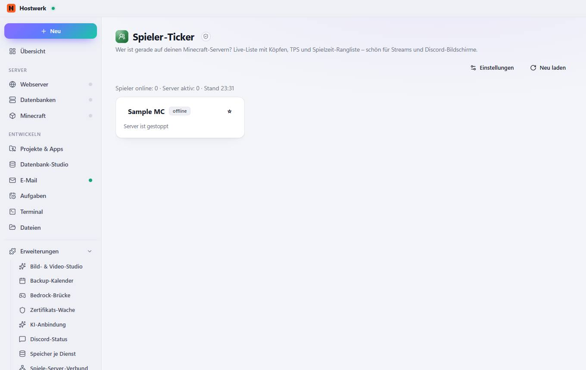

# Spieler-Ticker

[← Zurück zur Übersicht](README.md)

Wer ist gerade auf deinen Minecraft-Servern? Live-Liste mit Köpfen, TPS und Spielzeit-Rangliste – schön für Streams und Discord-Bildschirme.

### Gut zu wissen

- Abgeschottete Erweiterung von Hostwerk · v1.2.0 · nur lesen Dienste und ihren Zustand sehen Minecraft-Server, Spieler und Statistiken lesen Eigene Daten speichern (max. 256 KB)

### Was du hier tun kannst

- Einstellungen
- Neu laden

Erzeugt am 2026-10-19 · Hostwerk 2.9.0
