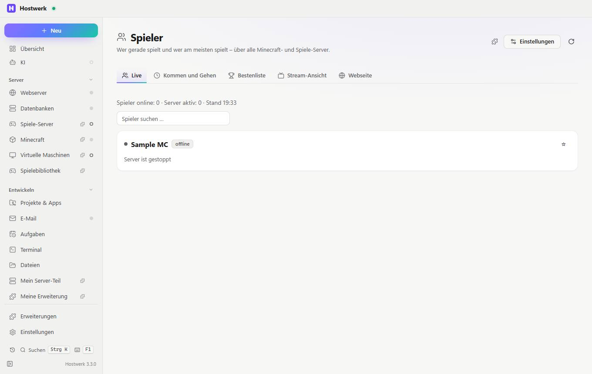
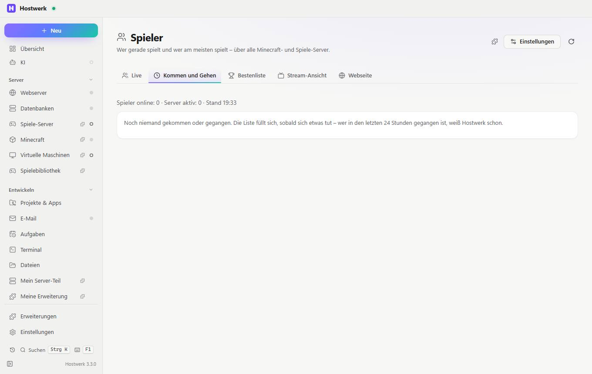
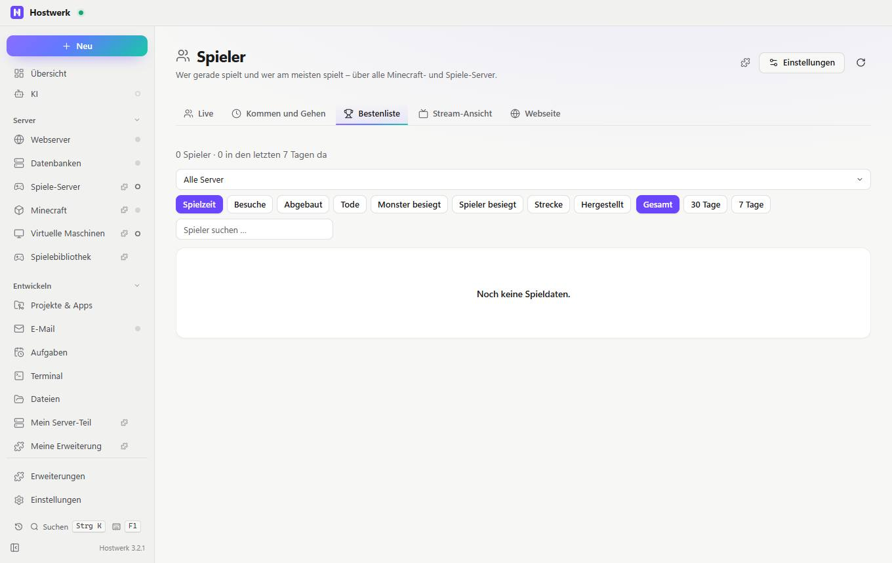
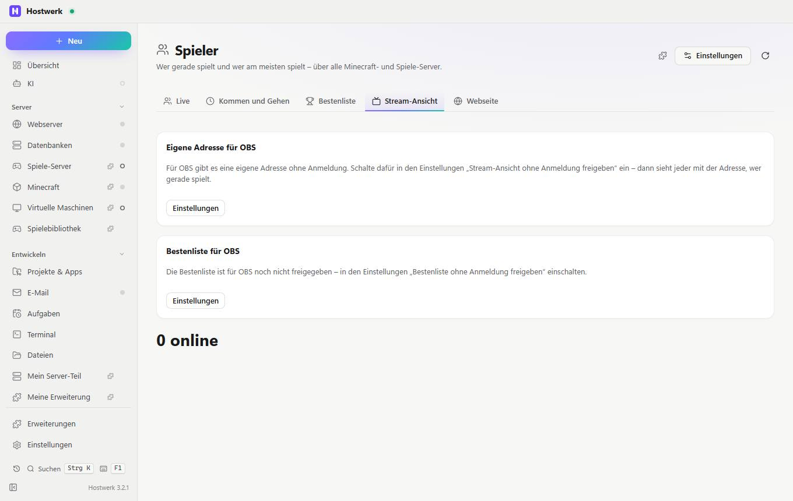
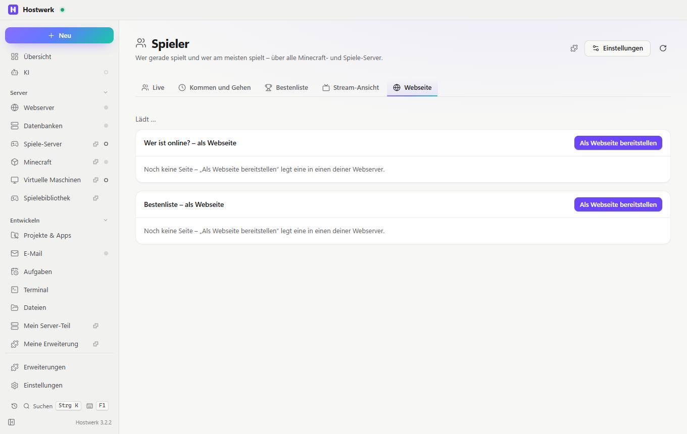

# Spieler → Live

[← Zurück zur Übersicht](README.md)

Wer gerade spielt und wer am meisten spielt – über alle Minecraft- und Spiele-Server.

### Was du hier tun kannst

- Von der Erweiterung „Spieler“ – Infos
- Einstellungen
- Neu laden

## Reiter

### Kommen und Gehen

**Was du hier tun kannst:** Von der Erweiterung „Spieler“ – Infos · Einstellungen · Neu laden

### Bestenliste

**Was du hier tun kannst:** Von der Erweiterung „Spieler“ – Infos · Einstellungen · Neu laden

### Stream-Ansicht

**Was du hier tun kannst:** Von der Erweiterung „Spieler“ – Infos · Einstellungen · Neu laden

### Webseite

**Was du hier tun kannst:** Von der Erweiterung „Spieler“ – Infos · Einstellungen · Neu laden

Erzeugt am 2026-11-18 · Hostwerk 3.2.1
