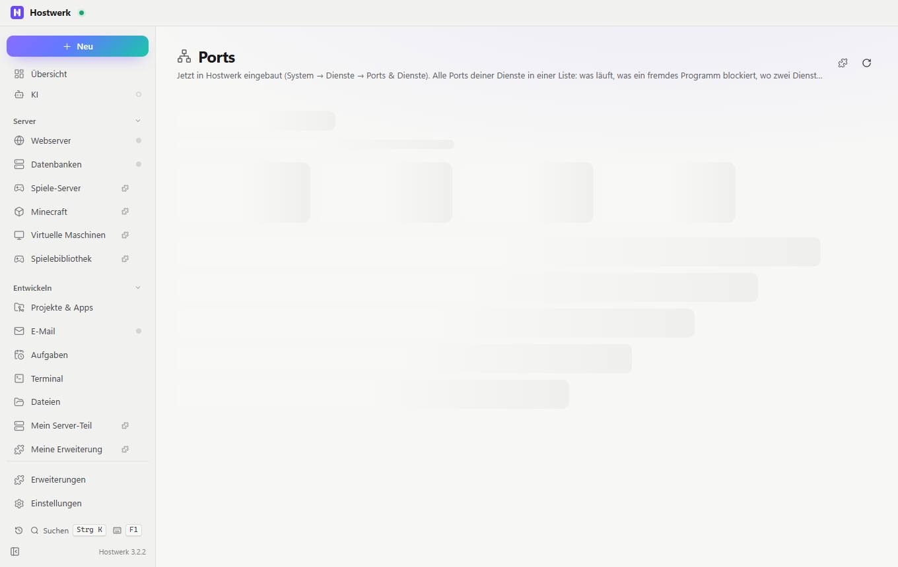

# Ports

[← Zurück zur Übersicht](README.md)

Jetzt in Hostwerk eingebaut (System → Dienste → Ports & Dienste). Alle Ports deiner Dienste in einer Liste: was läuft, was ein fremdes Programm blockiert, wo zwei Dienste denselben Port wollen, was im Router freigegeben ist – „Port ändern“ mit einem Klick, Frei-Prüfung und freie Vorschläge zum Kopieren.

### Was du hier tun kannst

- Von der Erweiterung „Ports“ – Infos
- Neu laden

Erzeugt am 2026-11-20 · Hostwerk 3.3.0
