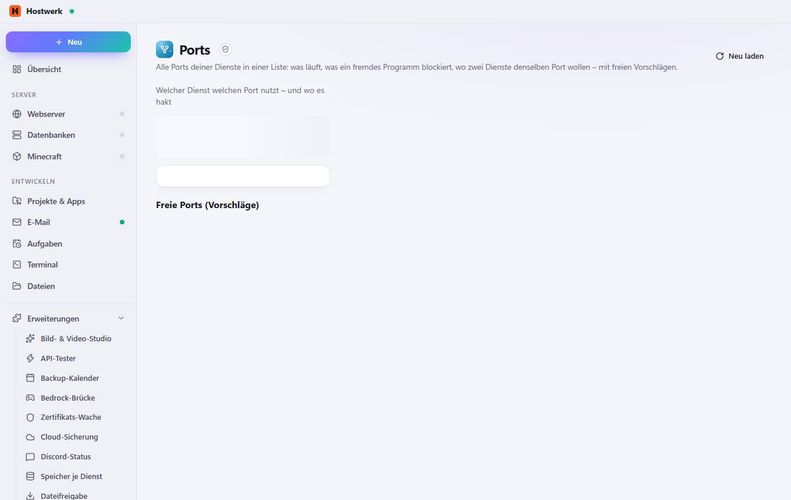

# Ports

[← Zurück zur Übersicht](README.md)

Alle Ports deiner Dienste in einer Liste: was läuft, was ein fremdes Programm blockiert, wo zwei Dienste denselben Port wollen – mit freien Vorschlägen.

### Gut zu wissen

- Abgeschottete Erweiterung von Hostwerk · v1.2.0 · nur lesen Systemzustand, Auslastung und Ports lesen

### Was du hier tun kannst

- Neu laden

Erzeugt am 2026-10-20 · Hostwerk 2.10.0
