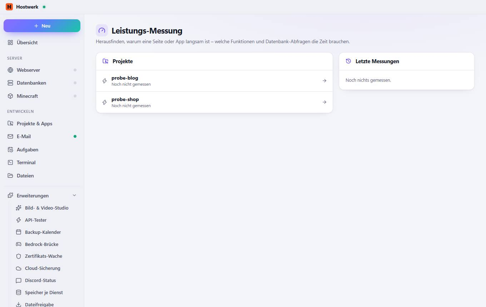

# Leistungs-Messung

[← Zurück zur Übersicht](README.md)

Herausfinden, warum eine Seite oder App langsam ist – welche Funktionen und Datenbank-Abfragen die Zeit brauchen.

### Bereiche auf dieser Seite

- Projekte
- Letzte Messungen

Erzeugt am 2026-10-20 · Hostwerk 2.10.0
