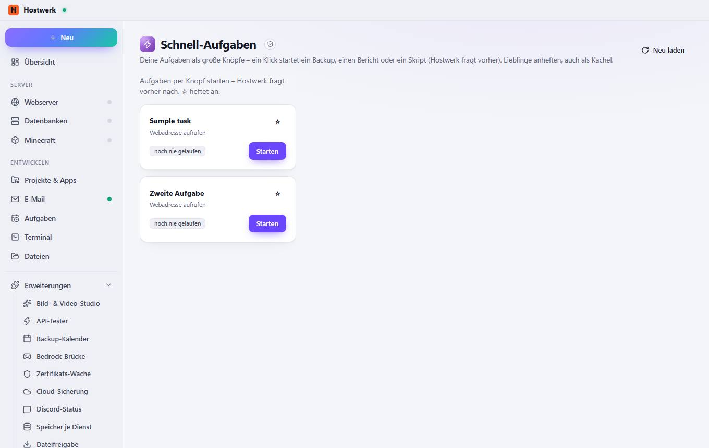

# Schnell-Aufgaben

[← Zurück zur Übersicht](README.md)

Deine Aufgaben als große Knöpfe – ein Klick startet ein Backup, einen Bericht oder ein Skript (Hostwerk fragt vorher). Lieblinge anheften, auch als Kachel.

### Gut zu wissen

- Abgeschottete Erweiterung von Hostwerk · v1.2.0 · darf nach Rückfrage ändern Aufgaben lesen Aufgaben ausführen (mit Rückfrage) Eigene Daten speichern (max. 256 KB)

### Was du hier tun kannst

- Neu laden

Erzeugt am 2026-10-20 · Hostwerk 2.10.0
