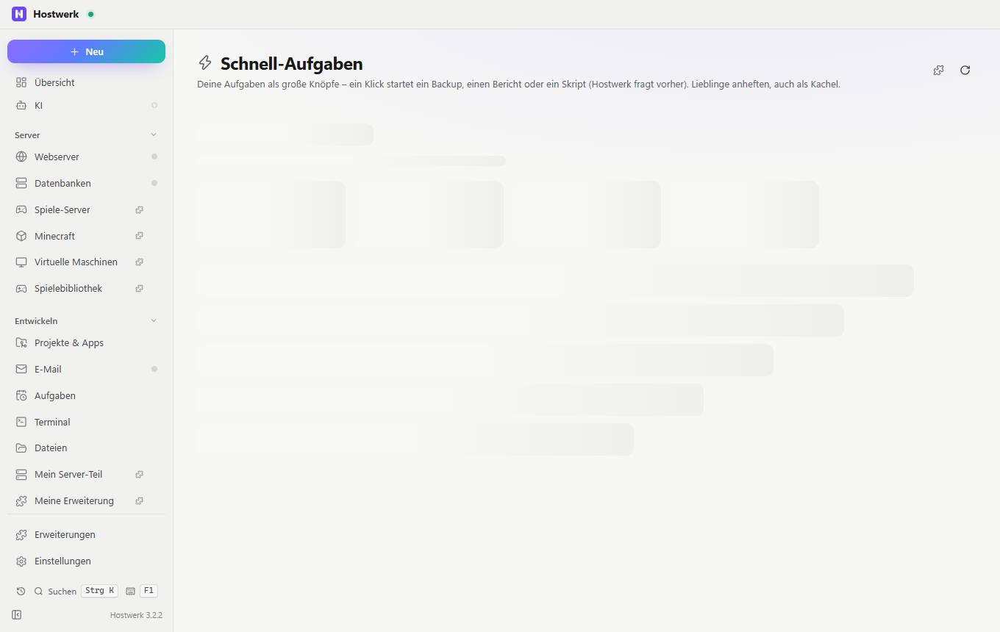

# Schnell-Aufgaben

[← Zurück zur Übersicht](README.md)

Deine Aufgaben als große Knöpfe – ein Klick startet ein Backup, einen Bericht oder ein Skript (Hostwerk fragt vorher). Lieblinge anheften, auch als Kachel.

### Was du hier tun kannst

- Von der Erweiterung „Schnell-Aufgaben“ – Infos
- Neu laden

Erzeugt am 2026-11-20 · Hostwerk 3.3.0
