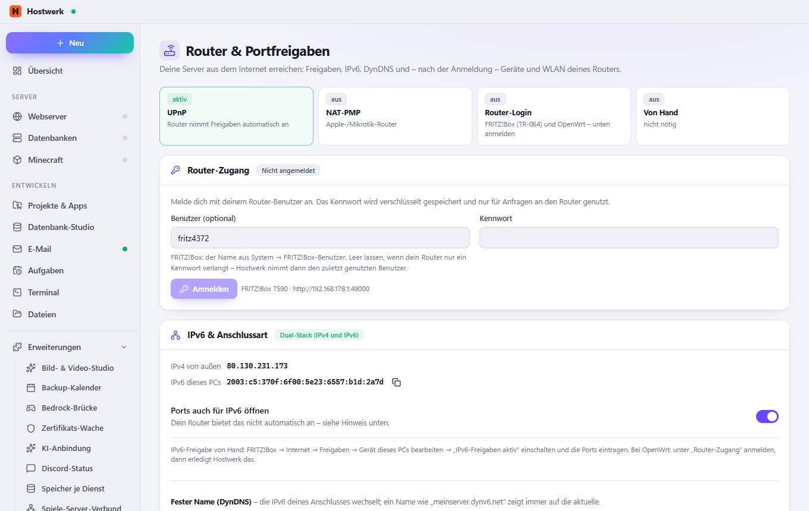

# Router & Portfreigaben

[← Zurück zur Übersicht](README.md)

Deine Server aus dem Internet erreichen: Freigaben, IPv6, DynDNS und – nach der Anmeldung – Geräte und WLAN deines Routers.

### Bereiche auf dieser Seite

- Router-Zugang
- IPv6 & Anschlussart
- FRITZ!Box 7590
- Automatisch freigeben
- Ports von Hostwerk
- Alle Freigaben im Router

### Was du hier tun kannst

- Anmelden
- Kopieren
- Speichern
- Neu suchen
- Router-Oberfläche öffnen
- Jetzt abgleichen
- Eigene Freigabe
- Router öffnen
- Hinweis ausblenden
- Freigeben

### Eingaben

- Benutzer (optional)
- Kennwort
- Ports auch für IPv6 öffnen
- Anbieter
- Freigaben automatisch verwalten

Erzeugt am 2026-10-19 · Hostwerk 2.9.0
