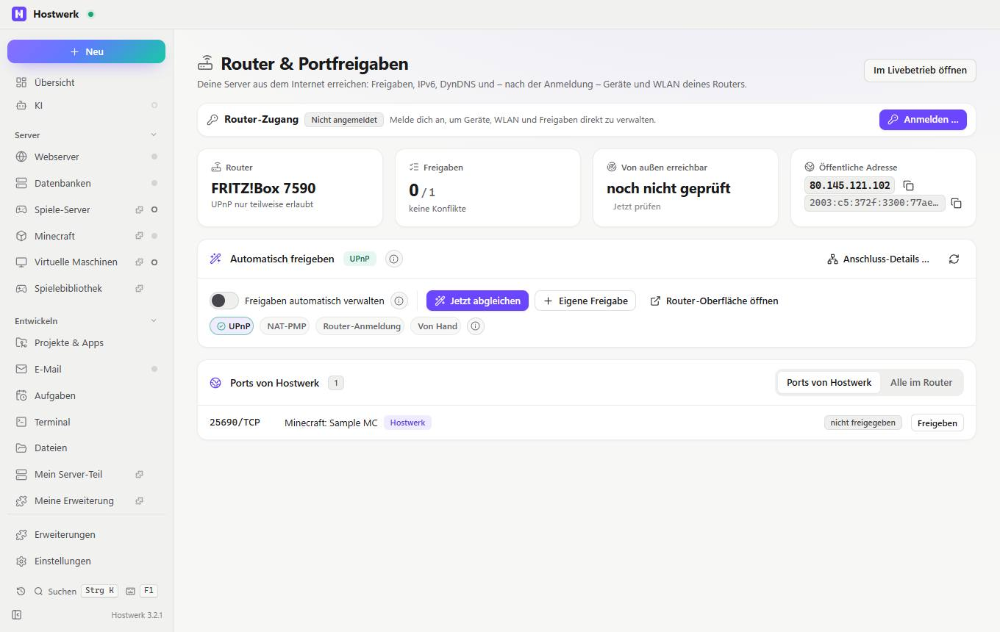

# Router & Portfreigaben

[← Zurück zur Übersicht](README.md)

Deine Server aus dem Internet erreichen: Freigaben, IPv6, DynDNS und – nach der Anmeldung – Geräte und WLAN deines Routers.

### Gut zu wissen

- Automatisch freigeben Hostwerk gibt die Ports deiner öffentlichen Dienste (Webseiten mit Domain, Minecraft, Mailserver, Fernzugriff) im Router frei und hält sie aktuell – auch nach neuen Servern oder geänderten Ports.
- Freigaben automatisch verwalten Prüft alle 30 Minuten und nach dem Start; räumt nicht mehr gebrauchte Hostwerk-Freigaben wieder auf.
- Tipp für FRITZ!Box In der FRITZ!Box unter Internet → Freigaben → Portfreigaben beim Gerät dieses PCs „Selbstständige Portfreigaben für dieses Gerät erlauben“ einschalten. Sonst lehnt sie automatische Freigaben ab. Router öffnen

### Bereiche auf dieser Seite

- Automatisch freigeben
- Ports von Hostwerk

### Was du hier tun kannst

- Im Livebetrieb öffnen
- Anmelden …
- Jetzt prüfen
- IPv4 kopieren
- IPv6 kopieren
- Anschluss-Details …
- Neu suchen
- Jetzt abgleichen
- Eigene Freigabe
- Router-Oberfläche öffnen
- Freigeben

Erzeugt am 2026-11-20 · Hostwerk 3.2.2
