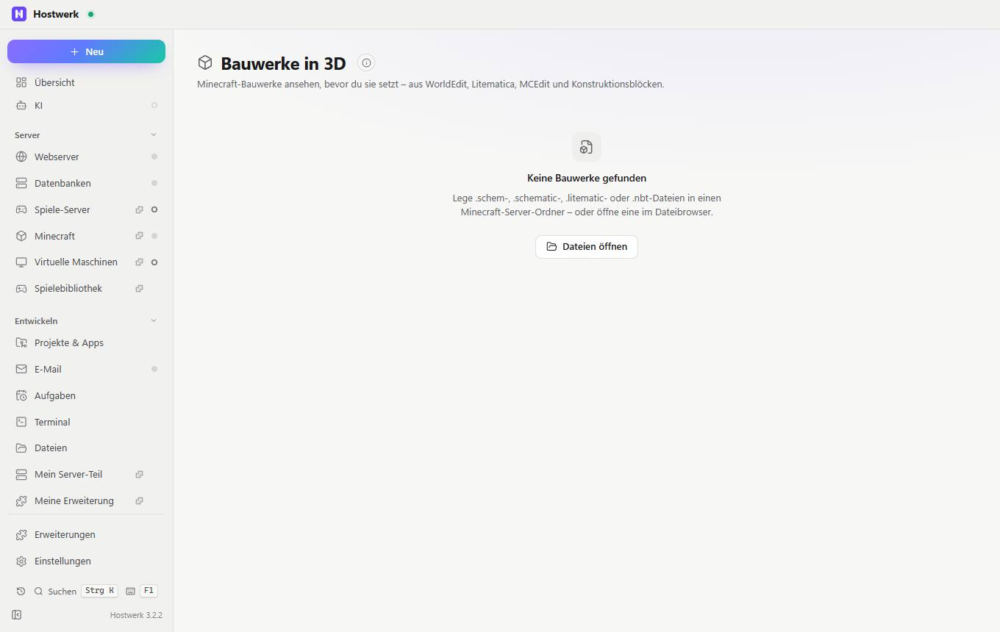

# Bauwerke in 3D

[← Zurück zur Übersicht](README.md)

Minecraft-Bauwerke ansehen, bevor du sie setzt – aus WorldEdit, Litematica, MCEdit und Konstruktionsblöcken.

### Gut zu wissen

- Woher kommen die Dateien? Hostwerk durchsucht die Ordner deiner Minecraft-Server (z. B. plugins/WorldEdit/schematics, schematics/ oder structures/). Jede Bauwerk-Datei im Dateibrowser öffnet sich ebenfalls in 3D.

### Was du hier tun kannst

- Dateien öffnen

Erzeugt am 2026-11-20 · Hostwerk 3.3.0
