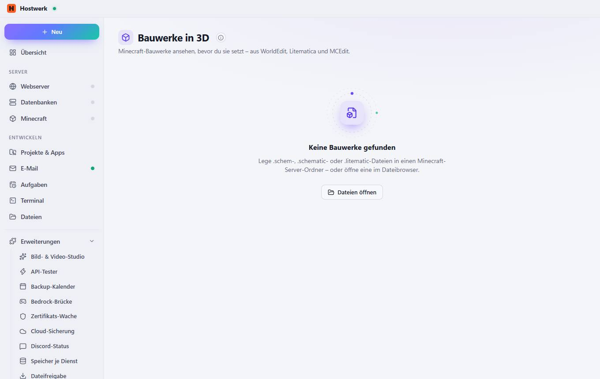

# Bauwerke in 3D

[← Zurück zur Übersicht](README.md)

Minecraft-Bauwerke ansehen, bevor du sie setzt – aus WorldEdit, Litematica und MCEdit.

### Gut zu wissen

- Woher kommen die Dateien? Hostwerk durchsucht die Ordner deiner Minecraft-Server (z. B. plugins/WorldEdit/schematics oder schematics/). Jede Bauwerk-Datei im Dateibrowser öffnet sich ebenfalls in 3D.

### Was du hier tun kannst

- Dateien öffnen

Erzeugt am 2026-10-20 · Hostwerk 2.10.0
