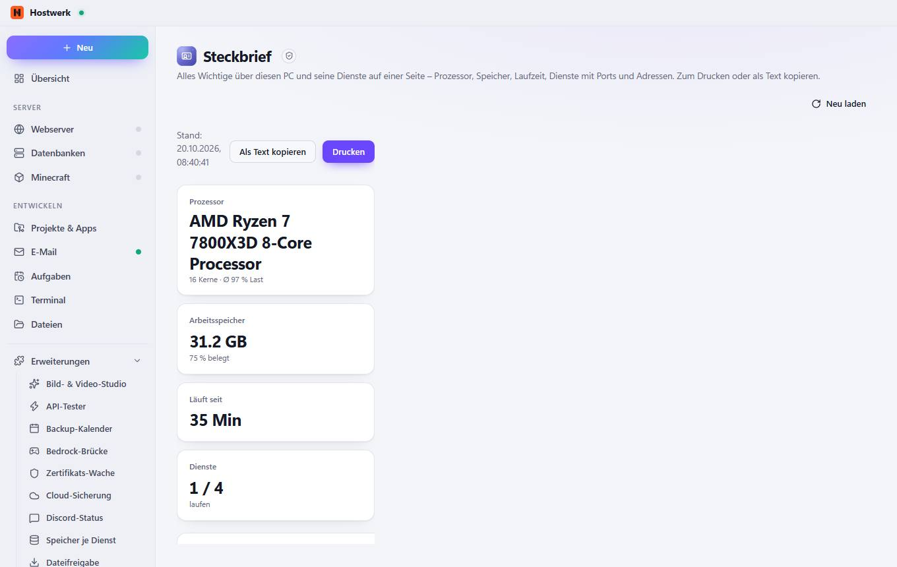

# Steckbrief

[← Zurück zur Übersicht](README.md)

Alles Wichtige über diesen PC und seine Dienste auf einer Seite – Prozessor, Speicher, Laufzeit, Dienste mit Ports und Adressen. Zum Drucken oder als Text kopieren.

### Gut zu wissen

- Abgeschottete Erweiterung von Hostwerk · v1.2.0 · nur lesen Systemzustand, Auslastung und Ports lesen Dienste und ihren Zustand sehen

### Was du hier tun kannst

- Neu laden

Erzeugt am 2026-10-20 · Hostwerk 2.10.0
