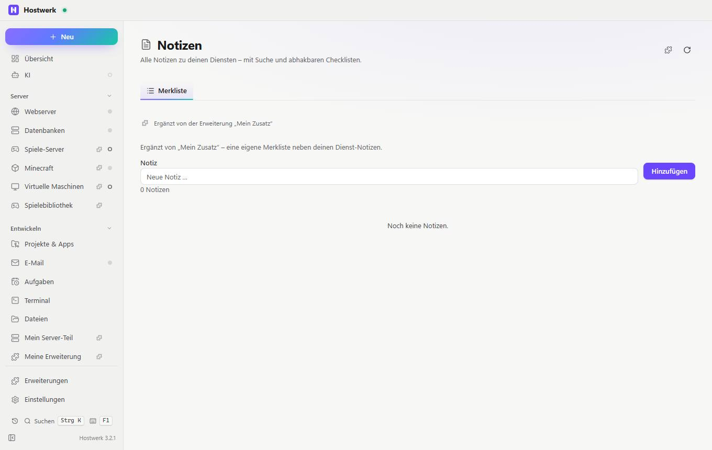

# Notizen → Merkliste

[← Zurück zur Übersicht](README.md)

Alle Notizen zu deinen Diensten – mit Suche und abhakbaren Checklisten.

### Was du hier tun kannst

- Von der Erweiterung „Notizen“ – Infos
- Neu laden
- Von der Erweiterung „Mein Zusatz“ – Infos

Erzeugt am 2026-11-18 · Hostwerk 3.2.1
