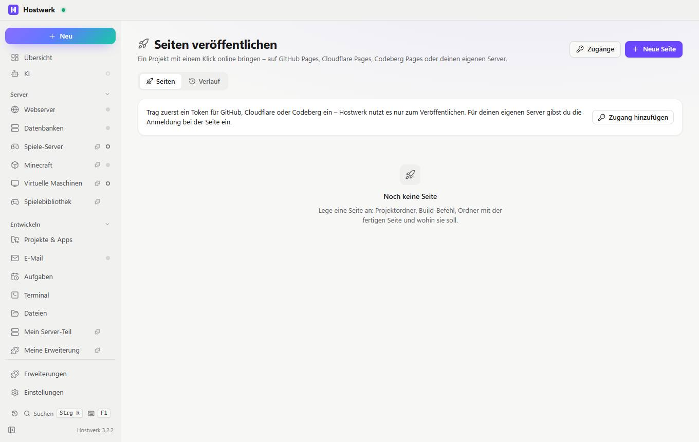

# Seiten veröffentlichen

[← Zurück zur Übersicht](README.md)

Ein Projekt mit einem Klick online bringen – auf GitHub Pages, Cloudflare Pages, Codeberg Pages oder deinen eigenen Server.

### Was du hier tun kannst

- Zugänge
- Neue Seite
- Zugang hinzufügen

Erzeugt am 2026-11-20 · Hostwerk 3.2.2
