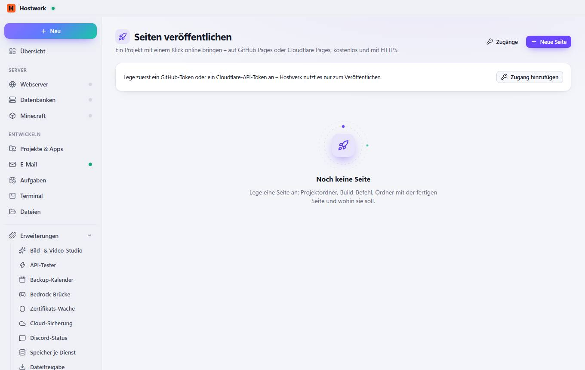

# Seiten veröffentlichen

[← Zurück zur Übersicht](README.md)

Ein Projekt mit einem Klick online bringen – auf GitHub Pages oder Cloudflare Pages, kostenlos und mit HTTPS.

### Was du hier tun kannst

- Zugänge
- Neue Seite
- Zugang hinzufügen

Erzeugt am 2026-10-20 · Hostwerk 2.10.0
