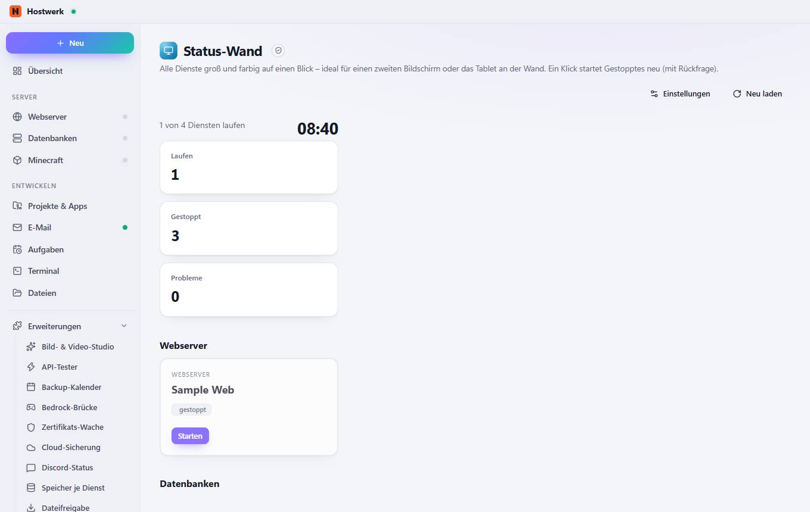

# Status-Wand

[← Zurück zur Übersicht](README.md)

Alle Dienste groß und farbig auf einen Blick – ideal für einen zweiten Bildschirm oder das Tablet an der Wand. Ein Klick startet Gestopptes neu (mit Rückfrage).

### Gut zu wissen

- Abgeschottete Erweiterung von Hostwerk · v1.2.0 · darf nach Rückfrage ändern Dienste und ihren Zustand sehen Dienste starten, stoppen, neu starten (mit Rückfrage)

### Was du hier tun kannst

- Einstellungen
- Neu laden

Erzeugt am 2026-10-20 · Hostwerk 2.10.0
