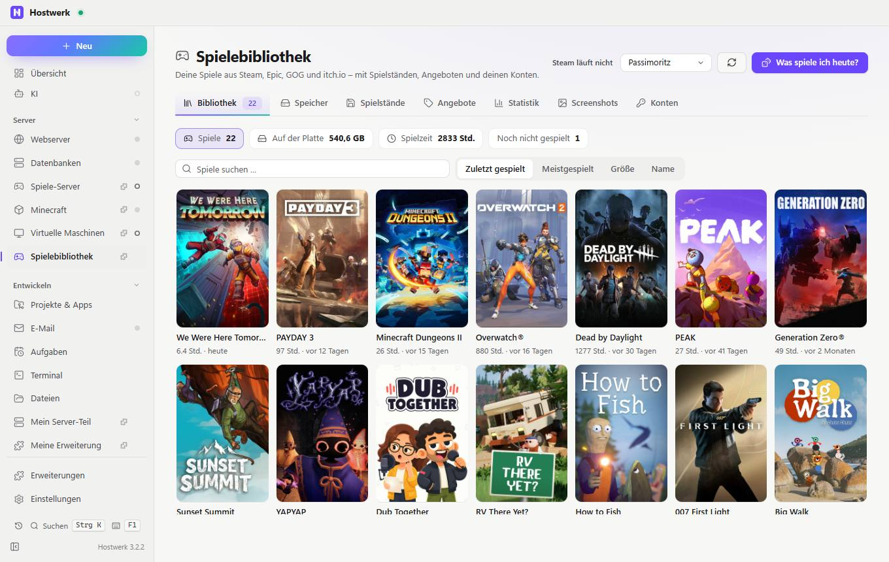
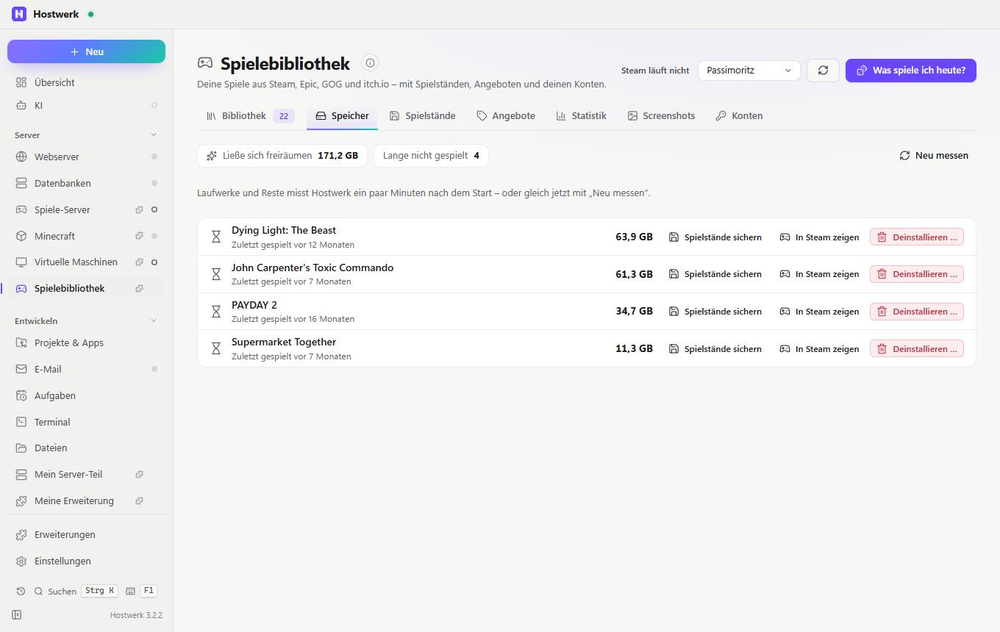
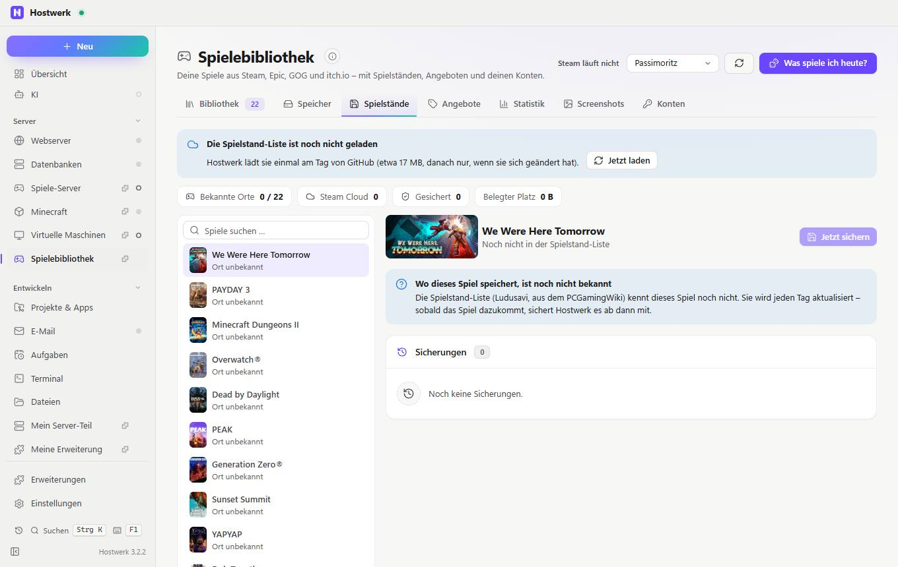
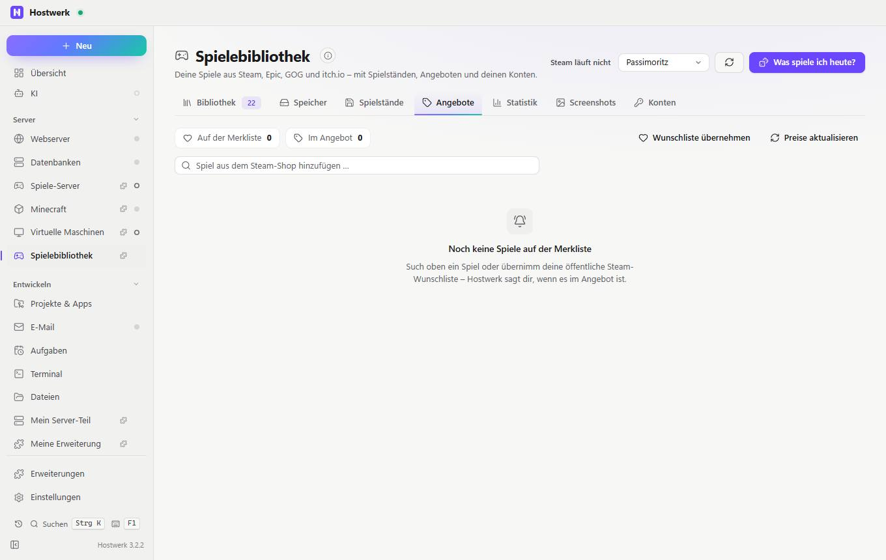
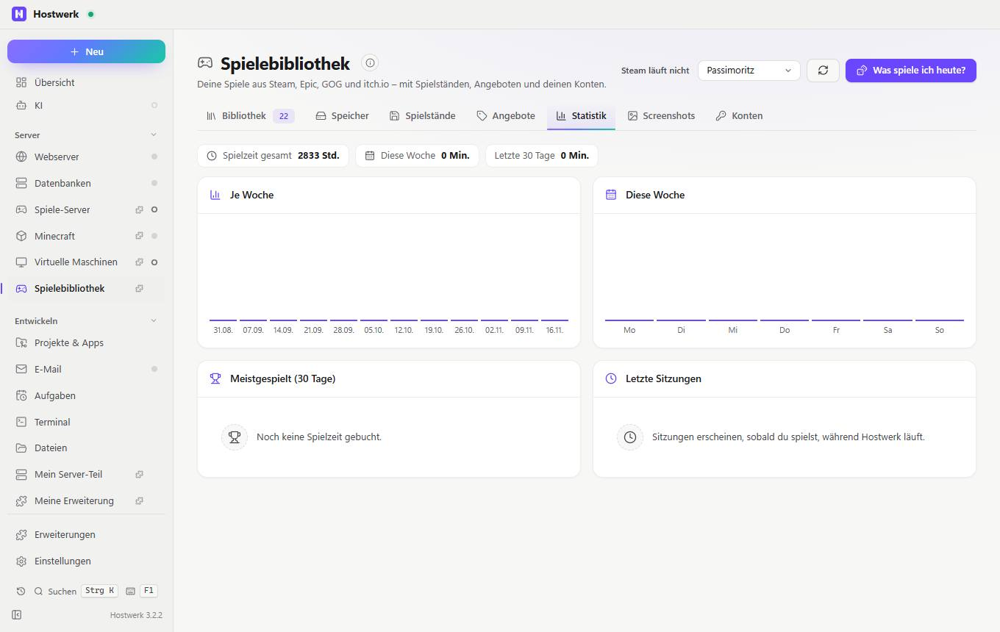
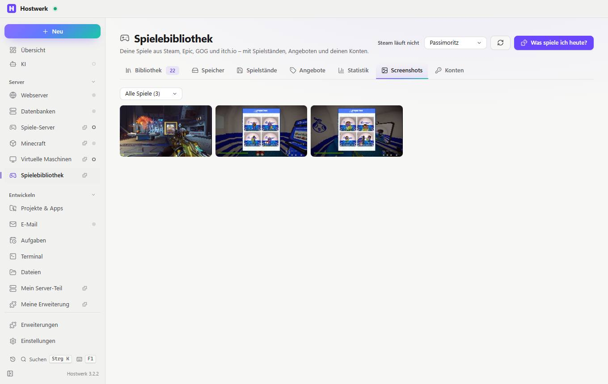
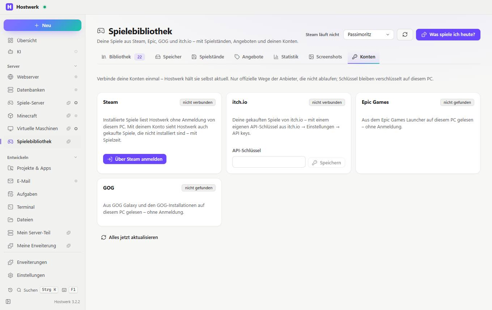

# Spielebibliothek → Bibliothek

[← Zurück zur Übersicht](README.md)

Deine Spiele aus Steam, Epic, GOG und itch.io – mit Spielständen, Angeboten und deinen Konten.

### Was du hier tun kannst

- Neu gelesen
- Was spiele ich heute?
- Spiele 22
- Auf der Platte 540,6 GB
- Spielzeit 2833 Std.
- Noch nicht gespielt 1
- We Were Here Tomorrow 6.4 Std. · heute
- PAYDAY 3 97 Std. · vor 12 Tagen
- Minecraft Dungeons II 26 Std. · vor 15 Tagen
- Overwatch® 880 Std. · vor 16 Tagen
- Dead by Daylight 1277 Std. · vor 30 Tagen
- PEAK 27 Std. · vor 41 Tagen
- Generation Zero® 49 Std. · vor 2 Monaten
- Sunset Summit 4 Std. · vor 2 Monaten
- YAPYAP noch nicht gespielt · vor 2 Monaten
- Dub Together 1 Min. · vor 2 Monaten
- RV There Yet? 12 Std. · vor 2 Monaten
- How to Fish 6.6 Std. · vor 2 Monaten
- 007 First Light 18 Std. · vor 3 Monaten
- Big Walk 35 Min. · vor 3 Monaten
- Wallpaper Engine 89 Std. · vor 3 Monaten
- Deep Rock Galactic: Rogue Core 10 Std. · vor 4 Monaten
- Just Shapes & Beats 16 Std. · vor 6 Monaten
- Supermarket Together 104 Std. · vor 7 Monaten
- John Carpenter's Toxic Commando 6.9 Std. · vor 7 Monaten
- s&box 3.5 Std. · vor 7 Monaten
- Dying Light: The Beast 7 Min. · vor 12 Monaten
- PAYDAY 2 201 Std. · vor 16 Monaten

## Reiter

### Speicher

> So entscheidet der Speicher-Doktor Nur aus Steams eigenen Dateien: Größe, zuletzt gespielt und Spielzeit je Spiel, Laufwerke (SSD oder Festplatte) und Ordner von Spielen, die weg sind (Workshop, Shader-Cache, Proton, Downloads). Hostwerk löscht hier nie selbst etwas – Deinstallieren und Verschieben macht Steam, Reste öffnen sich im Dateimanager. Die Schwellen (z. B. „lange nicht gespielt“ ab 180 Tagen) stehen in den Einstellungen der Erweiterung.

**Was du hier tun kannst:** Neu gelesen · Was spiele ich heute? · Neu messen · Spielstände sichern · In Steam zeigen · Deinstallieren …

### Spielstände

> So funktioniert die Spielstand-Sicherung Wo ein Spiel seine Spielstände ablegt, kommt aus der offenen Ludusavi-Liste (aus dem PCGamingWiki, täglich aktualisiert) – Hostwerk pflegt keine eigene Liste. Nach jeder Sitzung (Hostwerk merkt, wenn ein Spiel endet) werden die Spielstände von selbst gesichert. Jede Datei liegt nur einmal da; unveränderte Spielstände kosten keinen Platz. Die Sicherungen erscheinen in Hostwerks Sicherungs-Zentrale und in der externen Sicherung.

**Bereiche auf dieser Seite:** Sicherungen

**Was du hier tun kannst:** Neu gelesen · Was spiele ich heute? · Jetzt laden · We Were Here Tomorrow Ort unbekannt · PAYDAY 3 Ort unbekannt · Minecraft Dungeons II Ort unbekannt · Overwatch® Ort unbekannt · Dead by Daylight Ort unbekannt · PEAK Ort unbekannt · Generation Zero® Ort unbekannt · Sunset Summit Ort unbekannt · YAPYAP Ort unbekannt · Dub Together Ort unbekannt · RV There Yet? Ort unbekannt · How to Fish Ort unbekannt · 007 First Light Ort unbekannt · Big Walk Ort unbekannt · Wallpaper Engine Ort unbekannt · Deep Rock Galactic: Rogue Core Ort unbekannt · Just Shapes & Beats Ort unbekannt · Supermarket Together Ort unbekannt · John Carpenter's Toxic Commando Ort unbekannt · s&box Ort unbekannt · Dying Light: The Beast Ort unbekannt · PAYDAY 2 Ort unbekannt · Jetzt sichern

### Angebote

> Preise und Meldungen Die Preise kommen aus dem Steam-Shop (Land DE, änderbar in den Einstellungen der Erweiterung), zweimal am Tag und ohne Schlüssel. Ein neues Angebot oder dein Zielpreis schickt eine gebündelte Benachrichtigung. Hostwerk merkt sich jede Preisänderung und zeigt den tiefsten Preis, den es gesehen hat.

**Was du hier tun kannst:** Neu gelesen · Was spiele ich heute? · Wunschliste übernehmen · Preise aktualisieren

### Statistik

> Woher die Zahlen kommen Steam schreibt die Gesamtspielzeit je Spiel in seine Dateien. Hostwerk bucht jede Zunahme auf den Tag, an dem es sie sieht – die Wochen füllen sich also ab dem Tag, an dem die Erweiterung installiert wurde. Sitzungen erscheinen, wenn Hostwerk beim Spielen läuft.

**Bereiche auf dieser Seite:** Je Woche · Diese Woche · Meistgespielt (30 Tage) · Letzte Sitzungen

**Was du hier tun kannst:** Neu gelesen · Was spiele ich heute?

### Screenshots

**Was du hier tun kannst:** Neu gelesen · Was spiele ich heute? · Overwatch®, 16.09.2026, 22:47 · PEAK, 17.08.2026, 15:35 · PEAK, 15.08.2026, 23:02

### Konten

**Was du hier tun kannst:** Neu gelesen · Was spiele ich heute? · Über Steam anmelden · Speichern · Alles jetzt aktualisieren

Erzeugt am 2026-11-20 · Hostwerk 3.2.2
