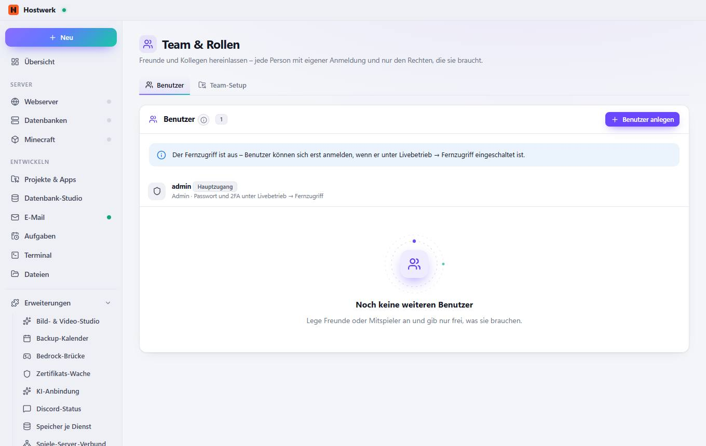
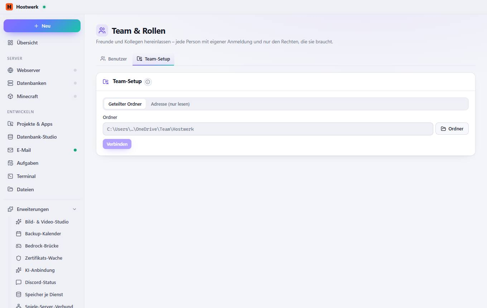

# Team & Rollen → Benutzer

[← Zurück zur Übersicht](README.md)

Freunde und Kollegen hereinlassen – jede Person mit eigener Anmeldung und nur den Rechten, die sie braucht.

### Gut zu wissen

- So funktionieren Rollen Jede Person meldet sich im Fernzugriff mit eigenem Namen und Passwort (oder Passkey) an. Mitglieder sehen und steuern nur die Dienste und Bereiche, die du freigibst – zum Beispiel „Survival-Server starten und Spieler verwalten“. Das Änderungs-Protokoll zeigt, wer was gemacht hat.

### Bereiche auf dieser Seite

- Benutzer

### Was du hier tun kannst

- Benutzer anlegen

## Reiter

### Team-Setup

> Was ist ein Team-Setup? Ein gemeinsames Setup für alle im Team: liegt in einem geteilten Ordner (OneDrive, Netzlaufwerk, Git-Repo) oder unter einer Adresse. Hostwerk prüft alle 15 Minuten auf Änderungen und fragt, bevor etwas übernommen wird – es legt nur Fehlendes an.

**Bereiche auf dieser Seite:** Team-Setup

**Was du hier tun kannst:** Ordner · Verbinden

Erzeugt am 2026-10-19 · Hostwerk 2.9.0
