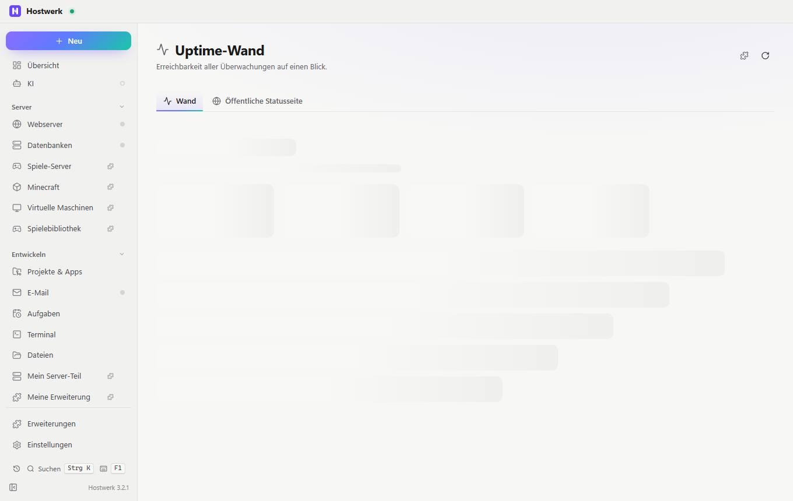
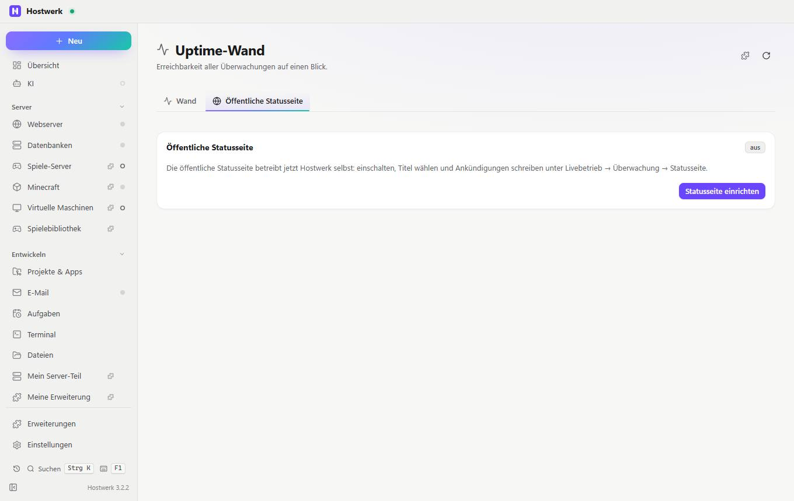

# Uptime-Wand → Wand

[← Zurück zur Übersicht](README.md)

Erreichbarkeit aller Überwachungen auf einen Blick.

### Was du hier tun kannst

- Von der Erweiterung „Uptime-Wand“ – Infos
- Neu laden

## Reiter

### Öffentliche Statusseite

**Was du hier tun kannst:** Von der Erweiterung „Uptime-Wand“ – Infos · Neu laden

Erzeugt am 2026-11-18 · Hostwerk 3.2.1
