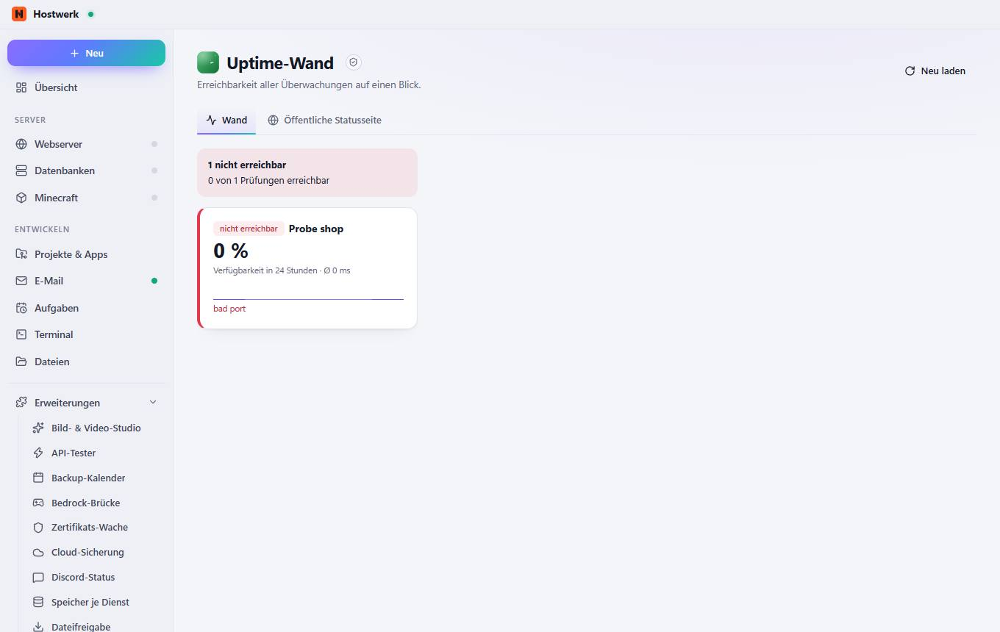
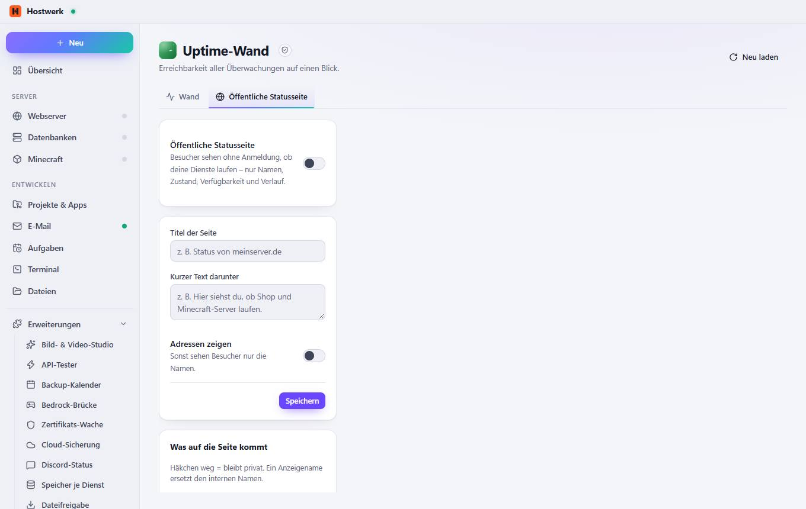

# Uptime-Wand → Wand

[← Zurück zur Übersicht](README.md)

Erreichbarkeit aller Überwachungen auf einen Blick.

### Gut zu wissen

- Abgeschottete Erweiterung von Hostwerk · v1.2.0 · nur lesen Zertifikate und Erreichbarkeit (Überwachung) lesen Öffentliche Statusseite einrichten (mit Rückfrage)

### Was du hier tun kannst

- Neu laden

## Reiter

### Öffentliche Statusseite

> Abgeschottete Erweiterung von Hostwerk · v1.2.0 · nur lesen Zertifikate und Erreichbarkeit (Überwachung) lesen Öffentliche Statusseite einrichten (mit Rückfrage)

**Was du hier tun kannst:** Neu laden

Erzeugt am 2026-10-20 · Hostwerk 2.10.0
