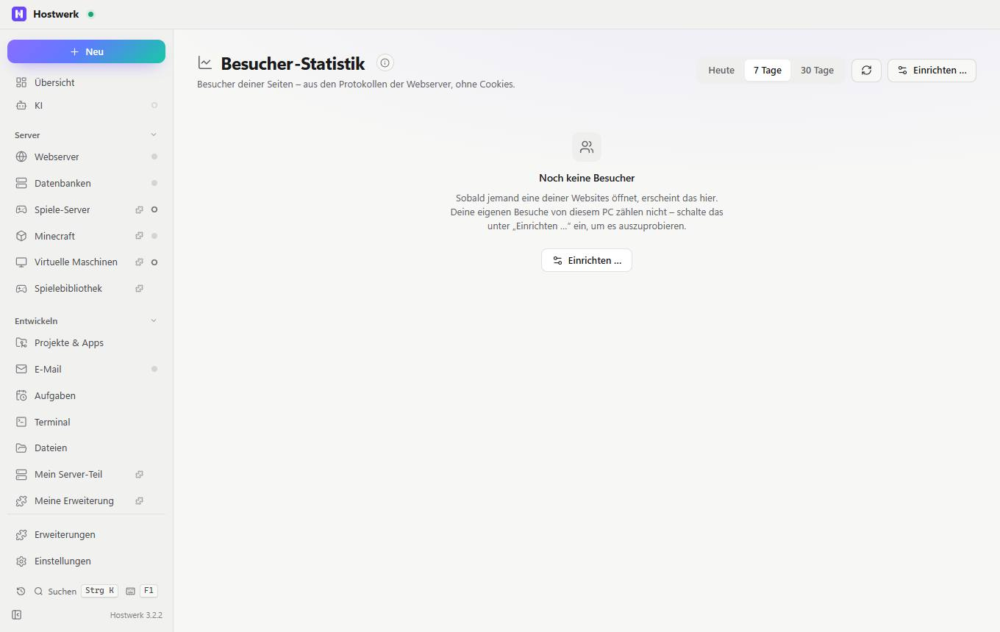

# Besucher-Statistik

[← Zurück zur Übersicht](README.md)

Besucher deiner Seiten – aus den Protokollen der Webserver, ohne Cookies.

### Gut zu wissen

- Datenschutz Keine Cookies, kein Fingerabdruck. IP-Adressen werden gekürzt (der letzte Teil fällt weg) und in einen Hash verwandelt, der sich jeden Tag ändert – nach zwei Tagen kann nicht einmal dieser PC Besuche miteinander verbinden. Bots, Crawler, Erreichbarkeits-Prüfungen, Bilder und Skripte bleiben draußen. Nichts verlässt diesen PC.

### Was du hier tun kannst

- Neue Protokollzeilen jetzt lesen
- Einrichten …

Erzeugt am 2026-11-20 · Hostwerk 3.2.2
