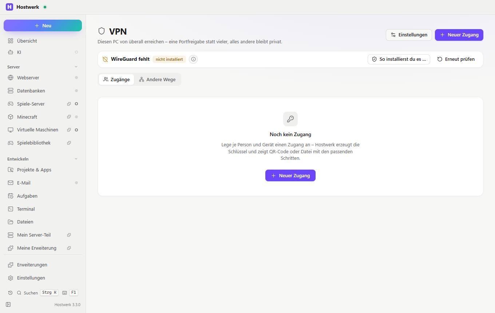

# VPN

[← Zurück zur Übersicht](README.md)

Diesen PC von überall erreichen – eine Portfreigabe statt vieler, alles andere bleibt privat.

### Gut zu wissen

- WireGuard fehlt Zugänge kannst du schon anlegen – die Konfigurationen funktionieren, sobald der Tunnel läuft.

### Was du hier tun kannst

- Einstellungen
- Neuer Zugang
- So installierst du es …
- Erneut prüfen

Erzeugt am 2026-11-20 · Hostwerk 3.3.0
