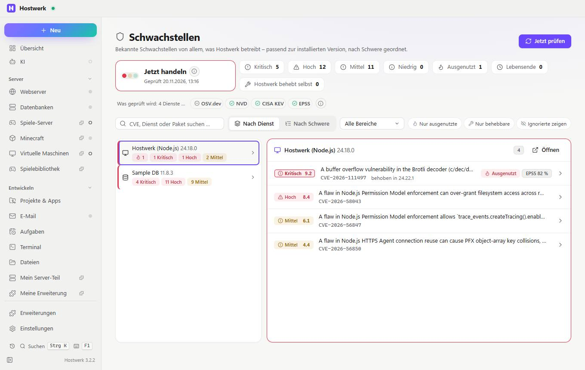

# Schwachstellen

[← Zurück zur Übersicht](README.md)

Bekannte Schwachstellen von allem, was Hostwerk betreibt – passend zur installierten Version, nach Schwere geordnet.

### Gut zu wissen

- Jetzt handeln Es gibt kritische oder aktiv ausgenutzte Schwachstellen.
- Quellen Freie Datenbanken ohne Schlüssel: OSV.dev, die NVD (über CPE), die CISA-Liste ausgenutzter Schwachstellen und EPSS von FIRST. Hostwerk fragt einmal am Tag, gebündelt und gedrosselt, und merkt sich die Antworten – fällt eine Quelle aus, bleibt der letzte Stand. Neue kritische oder ausgenutzte Funde gehen an Hostwerks Benachrichtigungen (Einstellungen → Benachrichtigungen).

### Bereiche auf dieser Seite

- Hostwerk (Node.js) 24.18.0

### Was du hier tun kannst

- Jetzt prüfen
- Kritisch 5
- Hoch 12
- Mittel 11
- Niedrig 0
- Ausgenutzt 1
- Lebensende 0
- Hostwerk behebt selbst 0
- Was geprüft wird: 4 Dienste …
- Nur ausgenutzte
- Nur behebbare
- Ignorierte zeigen
- Hostwerk (Node.js) 24.18.0 1 1 Kritisch 1 Hoch 2 Mittel
- Sample DB 11.8.3 4 Kritisch 11 Hoch 9 Mittel
- Öffnen
- Hoch 8.4 A flaw in Node.js Permission Model enforcement can over-grant filesystem access across radix-tree prefix boundaries. CVE-2026-58043

Erzeugt am 2026-11-20 · Hostwerk 3.2.2
