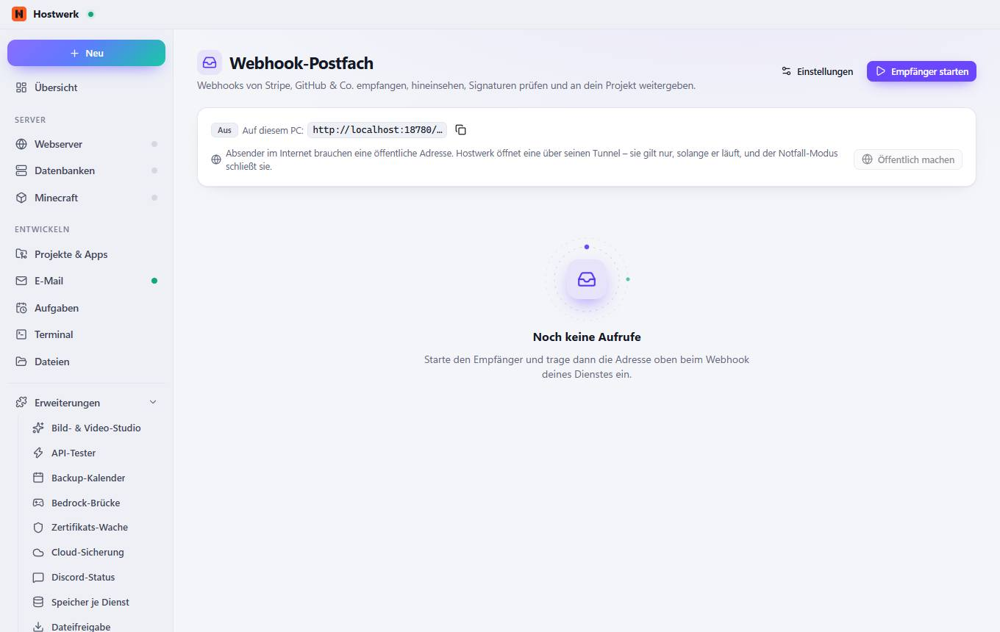

# Webhook-Postfach

[← Zurück zur Übersicht](README.md)

Webhooks von Stripe, GitHub & Co. empfangen, hineinsehen, Signaturen prüfen und an dein Projekt weitergeben.

### Was du hier tun kannst

- Einstellungen
- Empfänger starten
- Kopieren
- Öffentlich machen

Erzeugt am 2026-10-20 · Hostwerk 2.10.0
