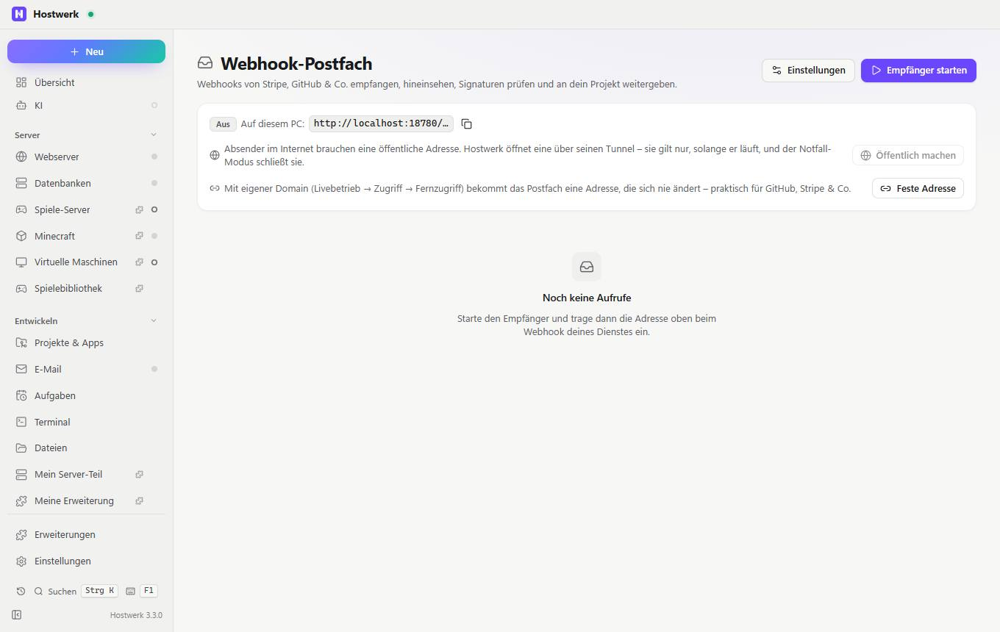

# Webhook-Postfach

[← Zurück zur Übersicht](README.md)

Webhooks von Stripe, GitHub & Co. empfangen, hineinsehen, Signaturen prüfen und an dein Projekt weitergeben.

### Was du hier tun kannst

- Einstellungen
- Empfänger starten
- Kopieren
- Öffentlich machen
- Feste Adresse

Erzeugt am 2026-11-20 · Hostwerk 3.3.0
