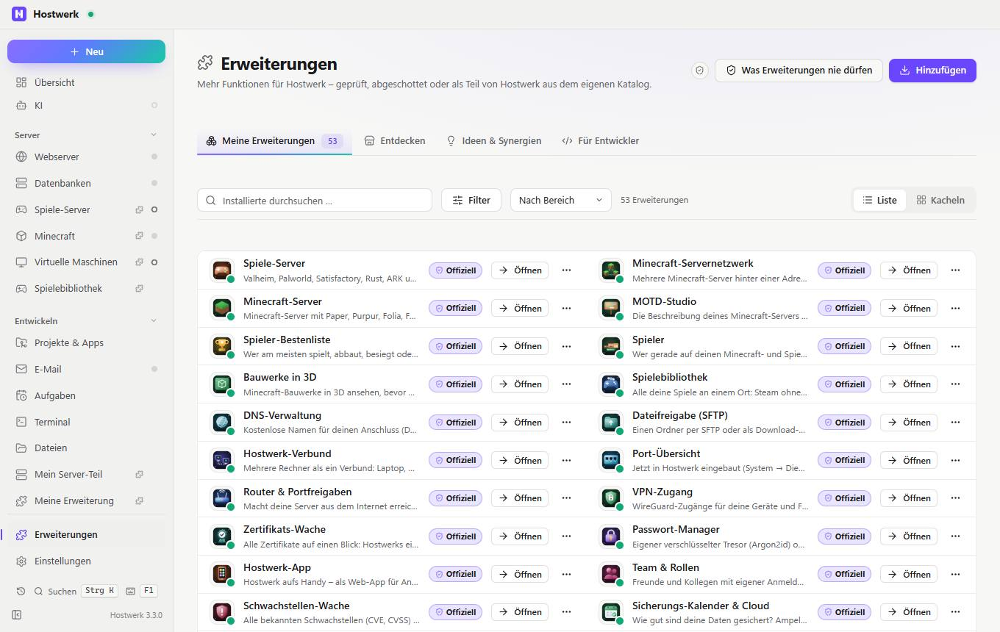
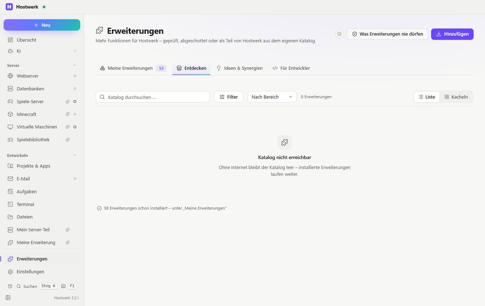
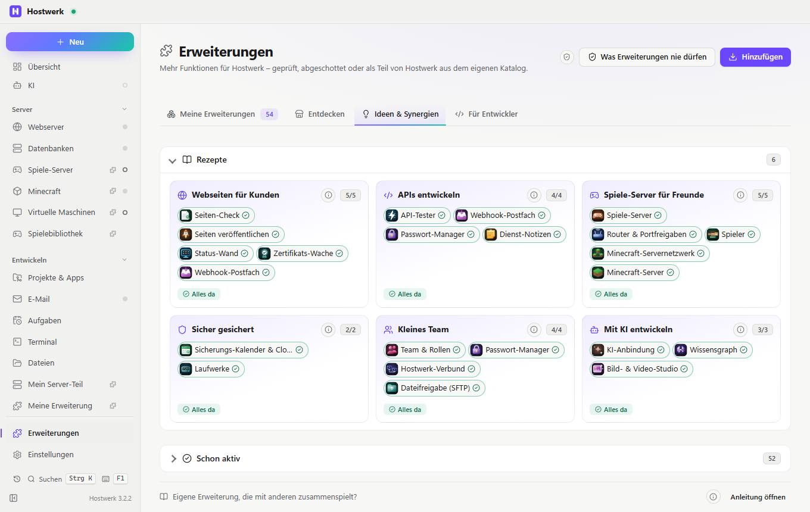
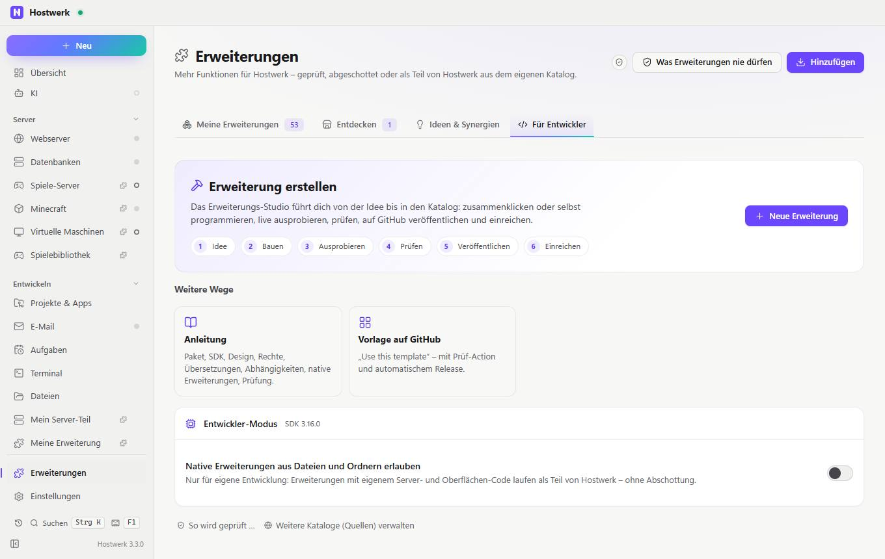

# Erweiterungen

[← Zurück zur Übersicht](README.md)

Mehr Funktionen für Hostwerk – geprüft, abgeschottet oder als Teil von Hostwerk aus dem eigenen Katalog.

### Gut zu wissen

- So sind Erweiterungen gebaut Erweiterungen aus anderen Quellen laufen abgeschottet: Seiten im Rahmen, eigener Server-Code in einem eigenen Prozess – ohne Zugriff auf Einstellungen, Passwörter, Schlüssel oder dein Heimnetz, Änderungen nur nach deiner Bestätigung. Erweiterungen mit dem Abzeichen „Teil von Hostwerk“ kommen aus dem Hostwerk-Katalog und sind per Prüfsumme festgelegt.

### Was du hier tun kannst

- Was Erweiterungen nie dürfen
- Hinzufügen
- Filter
- Öffnen
- Spiele-Server – weitere Aktionen
- Minecraft-Servernetzwerk – weitere Aktionen
- Minecraft-Server – weitere Aktionen
- MOTD-Studio – weitere Aktionen
- Spieler-Bestenliste – weitere Aktionen
- Spieler – weitere Aktionen
- Bauwerke in 3D – weitere Aktionen
- Spielebibliothek – weitere Aktionen
- DNS-Verwaltung – weitere Aktionen
- Dateifreigabe (SFTP) – weitere Aktionen
- Hostwerk-Verbund – weitere Aktionen
- Port-Übersicht – weitere Aktionen
- Router & Portfreigaben – weitere Aktionen
- VPN-Zugang – weitere Aktionen
- Zertifikats-Wache – weitere Aktionen
- Passwort-Manager – weitere Aktionen
- Hostwerk-App – weitere Aktionen
- Team & Rollen – weitere Aktionen
- Schwachstellen-Wache – weitere Aktionen
- Sicherungs-Kalender & Cloud – weitere Aktionen
- Laufwerke – weitere Aktionen
- Speicher je Dienst Wie viel Platz jeder Dienst belegt – Daten, Sicherungen, Projekte – und wie voll das Laufwerk ist. Mit Kachel für die Übersicht.
- Speicher je Dienst – weitere Aktionen
- Server-Steckbrief – weitere Aktionen
- Status-Wand – weitere Aktionen
- Uptime-Wand – weitere Aktionen
- Besucher-Statistik – weitere Aktionen
- API-Tester – weitere Aktionen
- Deploy-Protokoll – weitere Aktionen
- Mein Server-Teil – weitere Aktionen
- Meine Erweiterung Startpunkt für eigene Hostwerk-Erweiterungen: Seite, Kachel, Einstellungen und Übersetzungen.
- Meine Erweiterung – weitere Aktionen
- Seiten-Check – weitere Aktionen
- Leistungs-Messung – weitere Aktionen
- Schnell-Aufgaben – weitere Aktionen
- Seiten veröffentlichen – weitere Aktionen

## Reiter

### Entdecken

> So sind Erweiterungen gebaut Erweiterungen aus anderen Quellen laufen abgeschottet: Seiten im Rahmen, eigener Server-Code in einem eigenen Prozess – ohne Zugriff auf Einstellungen, Passwörter, Schlüssel oder dein Heimnetz, Änderungen nur nach deiner Bestätigung. Erweiterungen mit dem Abzeichen „Teil von Hostwerk“ kommen aus dem Hostwerk-Katalog und sind per Prüfsumme festgelegt.

**Was du hier tun kannst:** Was Erweiterungen nie dürfen · Hinzufügen · Filter · 39 Erweiterungen schon installiert – unter „Meine Erweiterungen“

### Ideen & Synergien

> So sind Erweiterungen gebaut Erweiterungen aus anderen Quellen laufen abgeschottet: Seiten im Rahmen, eigener Server-Code in einem eigenen Prozess – ohne Zugriff auf Einstellungen, Passwörter, Schlüssel oder dein Heimnetz, Änderungen nur nach deiner Bestätigung. Erweiterungen mit dem Abzeichen „Teil von Hostwerk“ kommen aus dem Hostwerk-Katalog und sind per Prüfsumme festgelegt.
> Webseiten für Kunden Seiten bauen, prüfen, veröffentlichen und im Blick behalten.
> APIs entwickeln Anfragen testen, Webhooks empfangen, Zugänge sicher ablegen.
> Spiele-Server für Freunde Server starten, von außen erreichbar machen, Spieler sehen.
> Sicher gesichert Geplante Sicherungen, Kopie außer Haus, Platz im Blick.
> Kleines Team Mehrere Rechner, gemeinsame Zugänge, Dateien teilen.
> Mit KI entwickeln Claude verbinden und mit Projektwissen versorgen.
> Webhooks nachstellen Im Webhook-Postfach „Im API-Tester öffnen“: der empfangene Aufruf landet mit Kopfzeilen und Inhalt in der Sammlung „Webhook-Postfach“ – dort ändern und erneut an dein Projekt senden.
> Erreichbar und gut Die Status-Wand zeigt, ob eine Seite antwortet – der Seiten-Check, ob sie auch schnell, barrierefrei und ohne kaputte Links ist.
> Ein Blick für den Livebetrieb Beide lesen Hostwerks eigene Daten aus dem Livebetrieb – nebeneinander angeheftet siehst du ablaufende Zertifikate und ausgefallene Seiten auf einen Blick. Gewarnt wird weiter über Hostwerks Wächter.
> Erst prüfen, dann veröffentlichen Vor dem Veröffentlichen auf GitHub/Cloudflare Pages die Seite durch den Seiten-Check laufen lassen.
> Dateien zwischen Rechnern Dateifreigabe (SFTP) im Heimnetz auf jedem Rechner einschalten, den du im Hostwerk-Verbund gekoppelt hast – die Rechner erreichen sich dann gegenseitig über ihre LAN-Adresse. Eingerichtet wird je Rechner.

**Was du hier tun kannst:** Was Erweiterungen nie dürfen · Hinzufügen · Anleitung öffnen

### Für Entwickler

> So sind Erweiterungen gebaut Erweiterungen aus anderen Quellen laufen abgeschottet: Seiten im Rahmen, eigener Server-Code in einem eigenen Prozess – ohne Zugriff auf Einstellungen, Passwörter, Schlüssel oder dein Heimnetz, Änderungen nur nach deiner Bestätigung. Erweiterungen mit dem Abzeichen „Teil von Hostwerk“ kommen aus dem Hostwerk-Katalog und sind per Prüfsumme festgelegt.

**Bereiche auf dieser Seite:** Entwickler-Modus

**Was du hier tun kannst:** Was Erweiterungen nie dürfen · Hinzufügen · Neue Erweiterung · Anleitung Paket, SDK, Design, Rechte, Übersetzungen, Abhängigkeiten, native Erweiterungen, Prüfung. · Vorlage auf GitHub „Use this template“ – mit Prüf-Action und automatischem Release. · So wird geprüft … · Weitere Kataloge (Quellen) verwalten

Erzeugt am 2026-11-20 · Hostwerk 3.2.2
