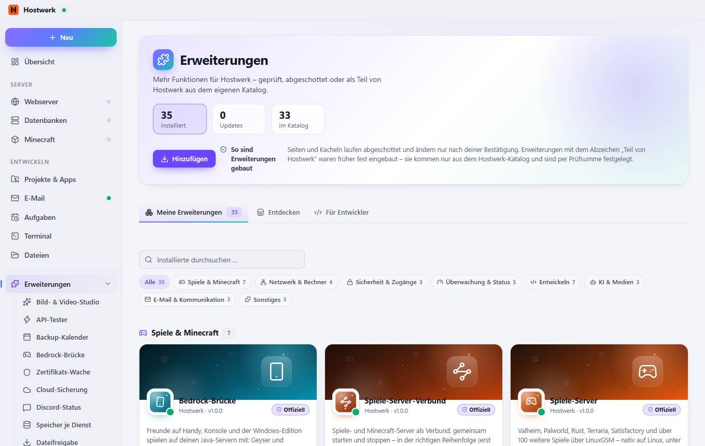
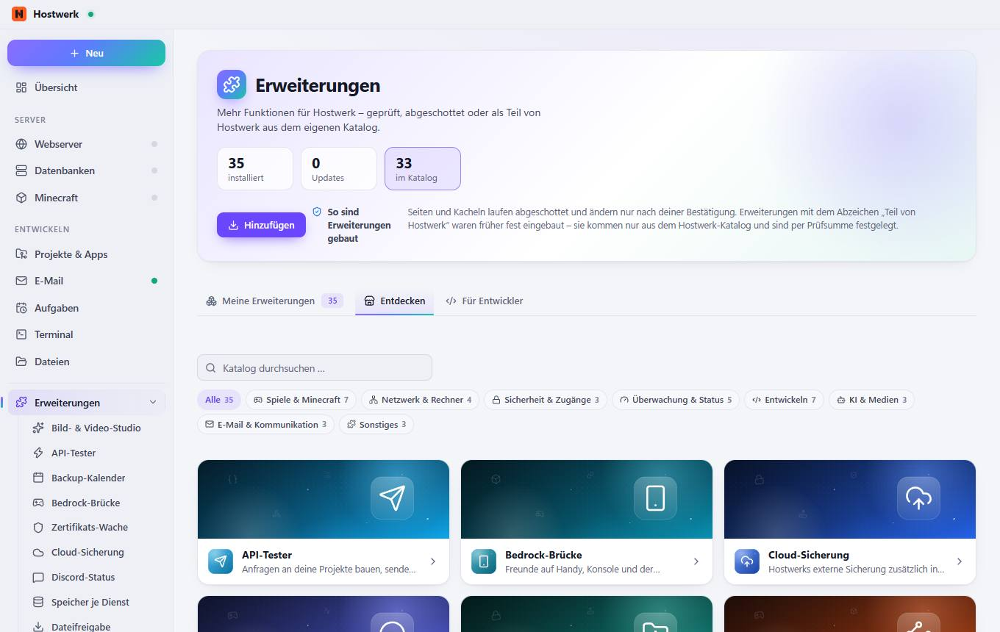
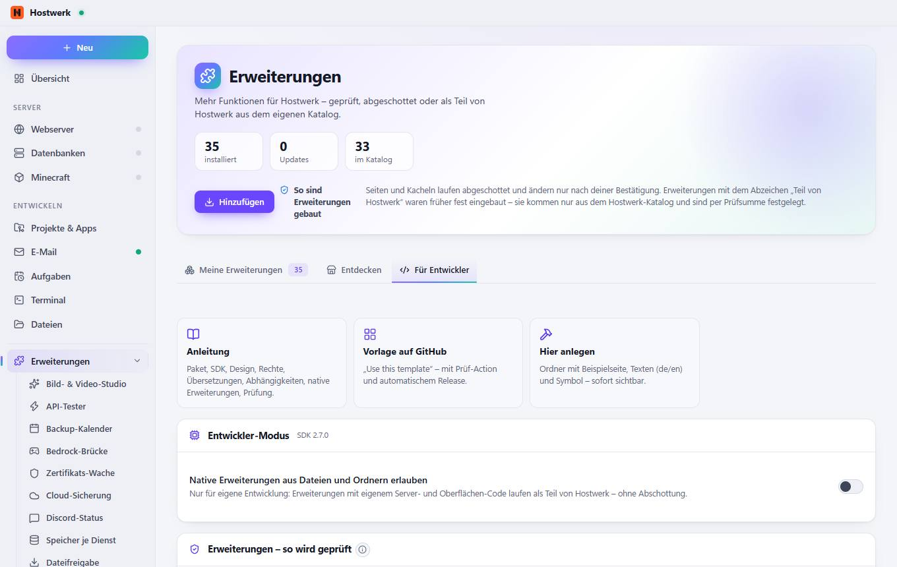

# Erweiterungen

[← Zurück zur Übersicht](README.md)

### Bereiche auf dieser Seite

- Spiele & Minecraft 7
- Netzwerk & Rechner 4
- Sicherheit & Zugänge 3
- Überwachung & Status 5
- Entwickeln 7
- KI & Medien 3
- E-Mail & Kommunikation 3
- Sonstiges 3

### Was du hier tun kannst

- 35 installiert
- 0 Updates
- 33 im Katalog
- Hinzufügen
- Alle 35
- Spiele & Minecraft 7
- Netzwerk & Rechner 4
- Sicherheit & Zugänge 3
- Überwachung & Status 5
- Entwickeln 7
- KI & Medien 3
- E-Mail & Kommunikation 3
- Sonstiges 3
- Bedrock-Brücke – Details
- Öffnen
- Spiele-Server-Verbund – Details
- Spiele-Server – Details
- MOTD-Studio – Details
- Spieler-Bestenliste – Details
- Spieler-Ticker – Details
- Bauwerke in 3D – Details
- Dateifreigabe (SFTP) – Details
- Hostwerk-Verbund – Details
- Port-Übersicht – Details
- Router & Portfreigaben – Details
- Zertifikats-Wache – Details
- Passwort-Manager – Details
- Team & Rollen – Details
- Backup-Kalender – Details
- Server-Steckbrief – Details
- Status-Wand – Details
- Speicher je Dienst – Details
- Uptime-Wand – Details
- API-Tester – Details
- Seiten-Check – Details
- Leistungs-Messung – Details
- Seiten veröffentlichen – Details
- Schnell-Aufgaben – Details
- Webhook-Postfach – Details
- Meine Erweiterung – Details

## Reiter

### Entdecken

**Bereiche auf dieser Seite:** Spiele & Minecraft 7 · Netzwerk & Rechner 4 · Sicherheit & Zugänge 3 · Überwachung & Status 5 · Entwickeln 7 · KI & Medien 3 · E-Mail & Kommunikation 3 · Sonstiges 3

**Was du hier tun kannst:** 35 installiert · 0 Updates · 33 im Katalog · Hinzufügen · Alle 35 · Spiele & Minecraft 7 · Netzwerk & Rechner 4 · Sicherheit & Zugänge 3 · Überwachung & Status 5 · Entwickeln 7 · KI & Medien 3 · E-Mail & Kommunikation 3 · Sonstiges 3 · Bedrock-Brücke – Details · Öffnen · Spiele-Server-Verbund – Details · Spiele-Server – Details · MOTD-Studio – Details · Spieler-Bestenliste – Details · Spieler-Ticker – Details · Bauwerke in 3D – Details · Dateifreigabe (SFTP) – Details · Hostwerk-Verbund – Details · Port-Übersicht – Details · Router & Portfreigaben – Details · Zertifikats-Wache – Details · Passwort-Manager – Details · Team & Rollen – Details · Backup-Kalender – Details · Server-Steckbrief – Details · Status-Wand – Details · Speicher je Dienst – Details · Uptime-Wand – Details · API-Tester – Details · Seiten-Check – Details · Leistungs-Messung – Details · Seiten veröffentlichen – Details · Schnell-Aufgaben – Details · Webhook-Postfach – Details · Meine Erweiterung – Details

### Für Entwickler

> Was ist eine Erweiterung? Eine Erweiterung bringt eine eigene Seite, eine Kachel für die Übersicht und/oder einen eigenen Dienst in Hostwerk. Seiten laufen abgeschottet (eigener Ursprung, kein Zugriff auf deine Anmeldung), sehen nur, was ihre Rechte erlauben, und ändern nur, wenn du jedes Mal bestätigst. Farben und Schrift kommen von Hostwerk – so passt jede Erweiterung ins Design.

**Bereiche auf dieser Seite:** Entwickler-Modus · Erweiterungen – so wird geprüft

**Was du hier tun kannst:** 35 installiert · 0 Updates · 33 im Katalog · Hinzufügen · Anleitung Paket, SDK, Design, Rechte, Übersetzungen, Abhängigkeiten, native Erweiterungen, Prüfung. · Vorlage auf GitHub „Use this template“ – mit Prüf-Action und automatischem Release. · Hier anlegen Ordner mit Beispielseite, Texten (de/en) und Symbol – sofort sichtbar. · Anleitung für Entwickler · Verifizierung beantragen · Weitere Kataloge (Quellen) verwalten

Erzeugt am 2026-10-20 · Hostwerk 2.10.0
