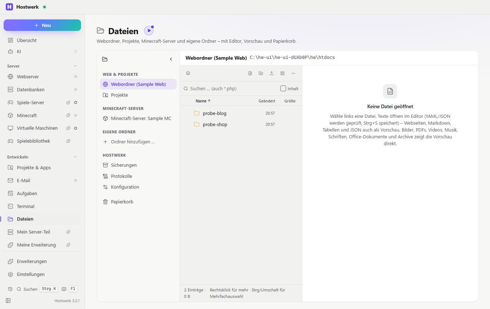

# Dateien

[← Zurück zur Übersicht](README.md)

Webordner, Projekte, Minecraft-Server und eigene Ordner – mit Editor, Vorschau und Papierkorb.

### Was du hier tun kannst

- Video
- Seitenleiste einklappen
- Webordner (Sample Web)
- Projekte
- Minecraft-Server: Sample MC
- Ordner hinzufügen …
- Sicherungen
- Protokolle
- Konfiguration
- Papierkorb
- Zurück
- Vor
- Nach oben
- Aktualisieren
- Wurzel des Bereichs
- Neu
- Hochladen
- Ausschneiden
- Kopieren
- Einfügen
- Umbenennen
- Verschieben nach …
- Löschen
- Name
- Kacheln
- Mehr
- Änderungsdatum
- Typ
- Größe

Erzeugt am 2026-11-20 · Hostwerk 3.3.0
