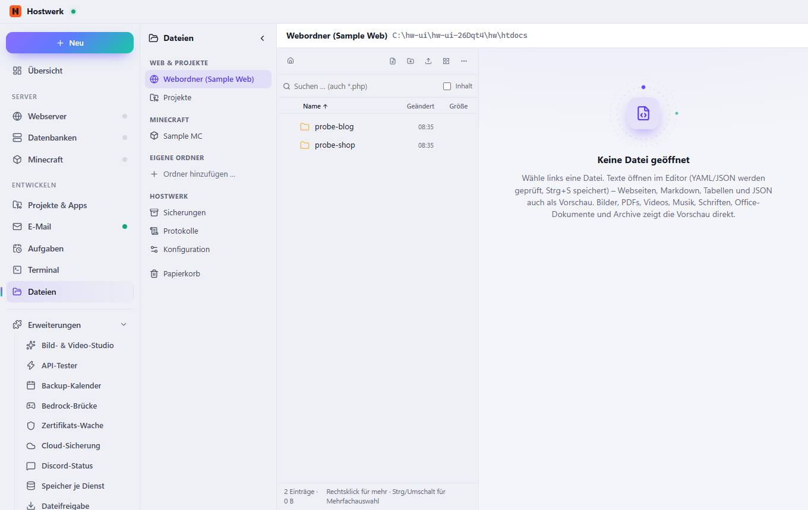

# Dateien

[← Zurück zur Übersicht](README.md)

### Was du hier tun kannst

- Seitenleiste einklappen
- Webordner (Sample Web)
- Projekte
- Sample MC
- Ordner hinzufügen …
- Sicherungen
- Protokolle
- Konfiguration
- Papierkorb
- Wurzel
- Neue Datei
- Neuer Ordner
- Kacheln
- Mehr
- Name
- Geändert
- Größe

Erzeugt am 2026-10-20 · Hostwerk 2.10.0
