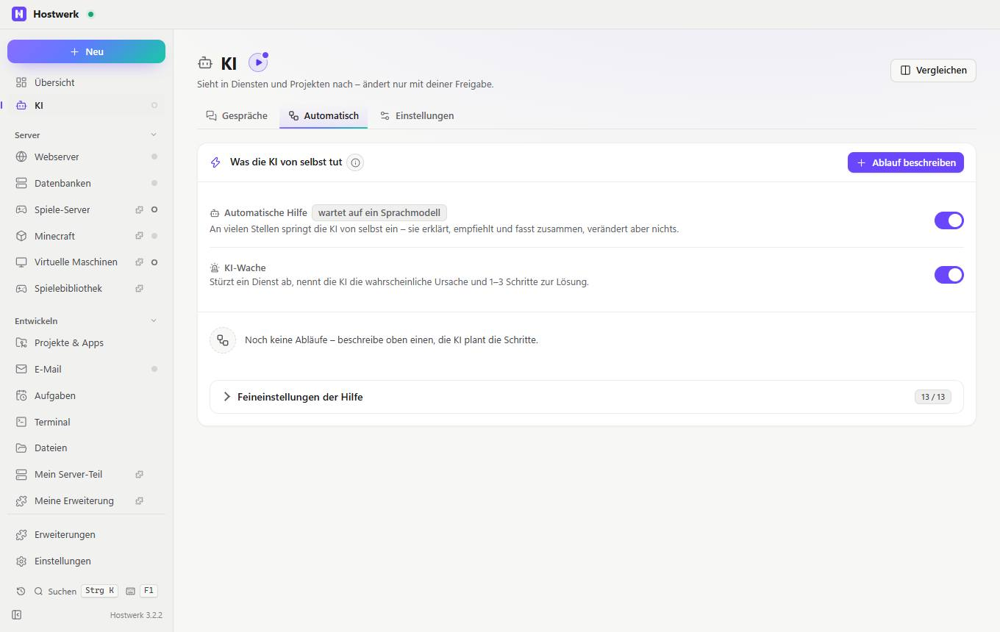
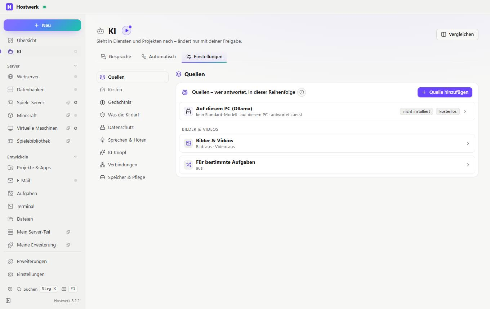

# KI

[← Zurück zur Übersicht](README.md)

Sieht in Diensten und Projekten nach – ändert nur mit deiner Freigabe.

### Was du hier tun kannst

- 2 Videos
- Vergleichen
- Schnellstart (ca. 4,3 GB)
- Anderes Modell wählen
- Einrichten (ca. 11,1 GB)
- Quelle wählen …
- Erneut suchen

## Reiter

### Automatisch

> Alles, was ohne Gespräch passiert: Hilfe an Ort und Stelle, die KI-Wache bei Abstürzen, deine Abläufe (von Hand, nach Zeitplan oder bei einem Ereignis) und Vorschläge aus deinem Verlauf.

**Bereiche auf dieser Seite:** Was die KI von selbst tut

**Was du hier tun kannst:** 2 Videos · Vergleichen · Ablauf beschreiben

### Einstellungen

> Die erste Quelle antwortet. Antwortet sie nicht, ist ihr Kontingent erschöpft oder ihre Monatsgrenze erreicht, übernimmt die nächste. Die Reihenfolge änderst du per Ziehen oder mit den Pfeilen. Bei Online-Quellen gehen Fragen und Daten an diesen Anbieter – was genau, stellst du unter Datenschutz ein.
> Hostwerk erkennt, was du fragst, und nimmt dafür den passenden Anbieter – z. B. kurze Fragen lokal, Code an ein starkes Modell. Antwortet er nicht, greift wie immer die Reihenfolge unter „Wer antwortet“.

**Bereiche auf dieser Seite:** Quellen · Quellen – wer antwortet, in dieser Reihenfolge

**Was du hier tun kannst:** 2 Videos · Vergleichen · Quelle hinzufügen · Auf diesem PC (Ollama) kein Standard-Modell · auf diesem PC · antwortet zuerst nicht installiert kostenlos · Bilder & Videos Bild: aus · Video: aus

Erzeugt am 2026-11-20 · Hostwerk 3.3.0
