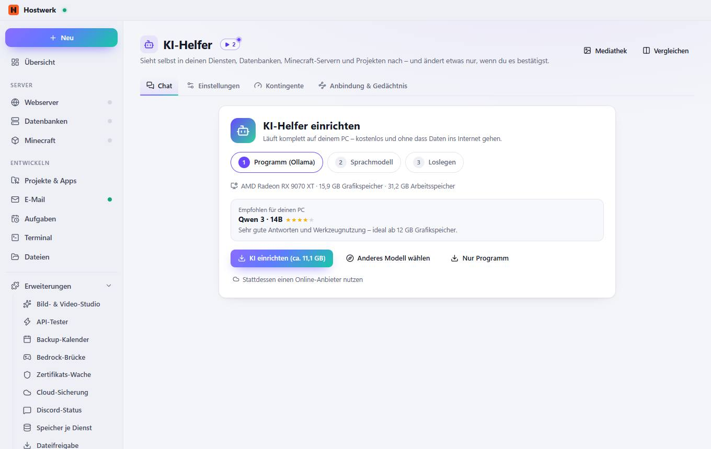
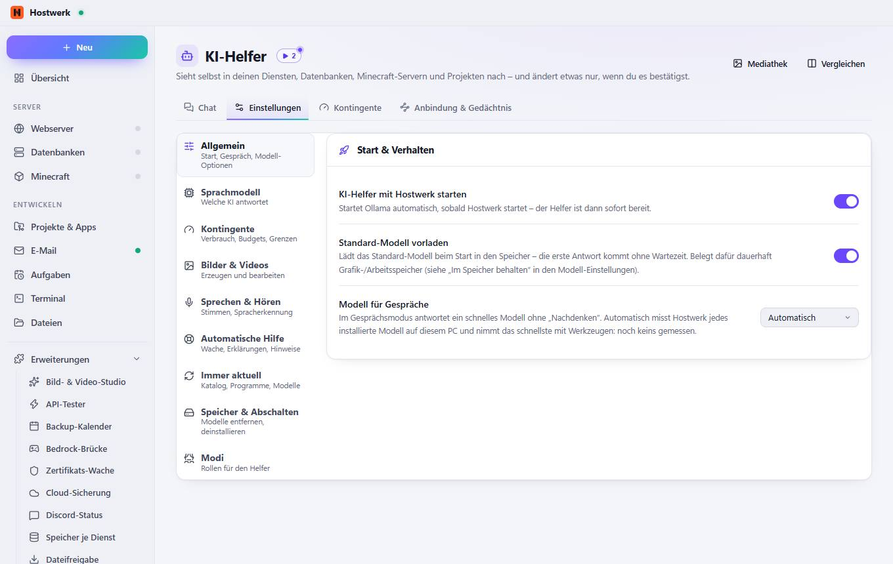
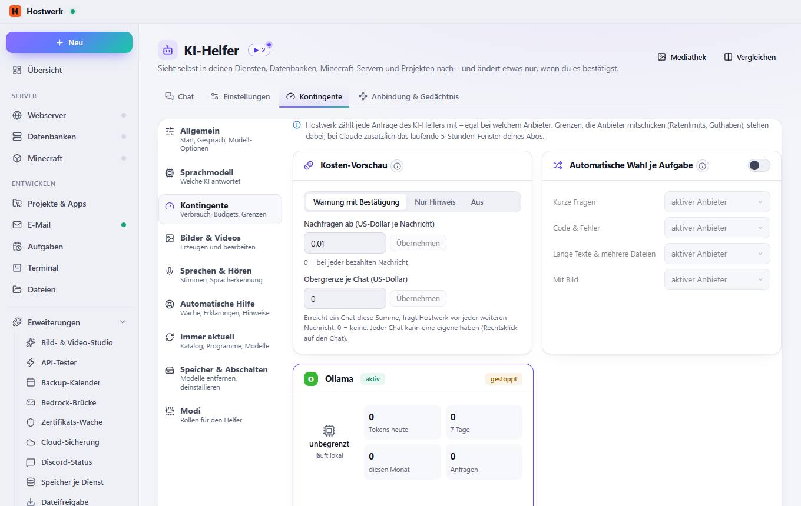
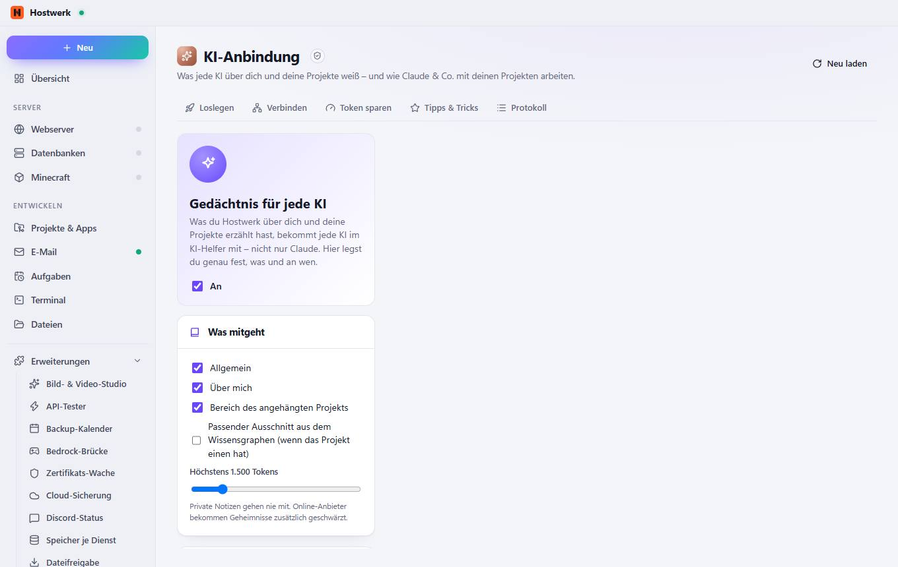

# KI-Helfer

[← Zurück zur Übersicht](README.md)

Sieht selbst in deinen Diensten, Datenbanken, Minecraft-Servern und Projekten nach – und ändert etwas nur, wenn du es bestätigst.

### Was du hier tun kannst

- Mediathek
- Vergleichen
- KI einrichten (ca. 11,1 GB)
- Anderes Modell wählen
- Nur Programm
- Stattdessen einen Online-Anbieter nutzen

## Reiter

### Einstellungen

**Bereiche auf dieser Seite:** Start & Verhalten

**Was du hier tun kannst:** Mediathek · Vergleichen · Allgemein Start, Gespräch, Modell-Optionen · Sprachmodell Welche KI antwortet · Kontingente Verbrauch, Budgets, Grenzen · Bilder & Videos Erzeugen und bearbeiten · Sprechen & Hören Stimmen, Spracherkennung · Automatische Hilfe Wache, Erklärungen, Hinweise · Immer aktuell Katalog, Programme, Modelle · Speicher & Abschalten Modelle entfernen, deinstallieren · Modi Rollen für den Helfer

### Kontingente

> Vor dem Senden an einen bezahlten Online-Anbieter schätzt Hostwerk Tokens und Kosten. Die Preise kommen täglich aus einer öffentlichen Modell-Liste – auch neue Modelle ohne Hostwerk-Update.
> Hostwerk erkennt, was du fragst, und nimmt dafür den passenden Anbieter – z. B. kurze Fragen lokal, Code an ein starkes Modell. Antwortet er nicht, greift wie immer die Ausweich-Kette.

**Bereiche auf dieser Seite:** Kosten-Vorschau · Automatische Wahl je Aufgabe · Ollama

**Was du hier tun kannst:** Mediathek · Vergleichen · Allgemein Start, Gespräch, Modell-Optionen · Sprachmodell Welche KI antwortet · Kontingente Verbrauch, Budgets, Grenzen · Bilder & Videos Erzeugen und bearbeiten · Sprechen & Hören Stimmen, Spracherkennung · Automatische Hilfe Wache, Erklärungen, Hinweise · Immer aktuell Katalog, Programme, Modelle · Speicher & Abschalten Modelle entfernen, deinstallieren · Modi Rollen für den Helfer · Übernehmen

### Anbindung & Gedächtnis

> Abgeschottete Erweiterung von Hostwerk · v1.2.0 · darf nach Rückfrage ändern Claude-Status, Projekte, Gedächtnis-Kontext, Spar-Werkzeuge und Verbrauch lesen Claude einrichten: Kontext in Projekt-Dateien, Spar-Werkzeuge (mit Rückfrage) Befehle ins Terminal tippen (du bestätigst) Wissensgraph lesen (Projekte, Graph, Bericht, Gedächtnis, Claude-Status) Claude einbinden und wieder vergessen (mit Rückfrage) Eigene Daten speichern (max. 256 KB)

**Was du hier tun kannst:** Neu laden

Erzeugt am 2026-10-20 · Hostwerk 2.10.0
