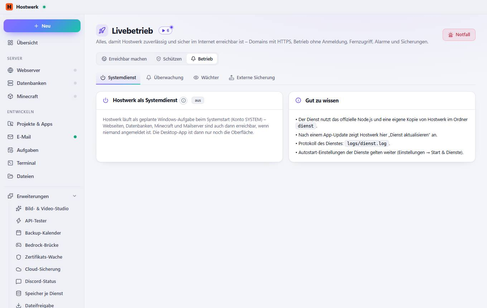

# Livebetrieb → Systemdienst

[← Zurück zur Übersicht](README.md)

Alles, damit Hostwerk zuverlässig und sicher im Internet erreichbar ist – Domains mit HTTPS, Betrieb ohne Anmeldung, Fernzugriff, Alarme und Sicherungen.

### Gut zu wissen

- Das Umschalten geht nur in der Desktop-App.

### Bereiche auf dieser Seite

- Hostwerk als Systemdienst
- Gut zu wissen

### Was du hier tun kannst

- Notfall

Erzeugt am 2026-10-20 · Hostwerk 2.10.0
