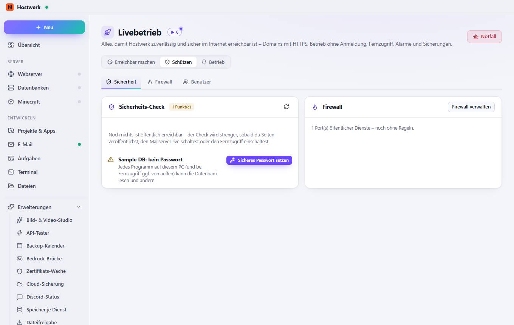
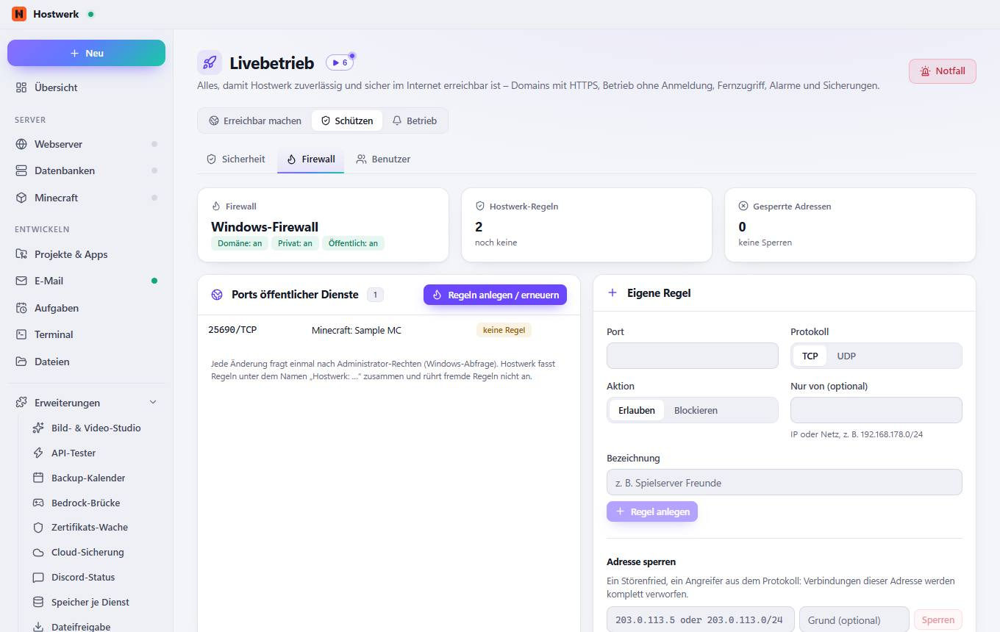
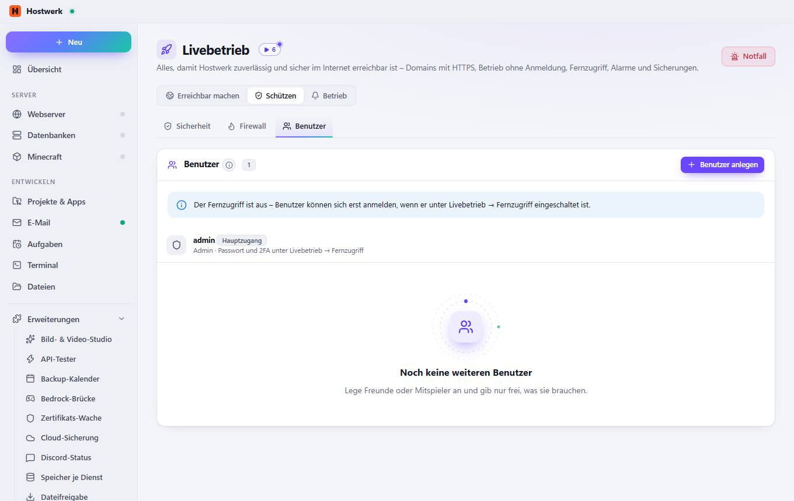

# Livebetrieb → Sicherheit

[← Zurück zur Übersicht](README.md)

Alles, damit Hostwerk zuverlässig und sicher im Internet erreichbar ist – Domains mit HTTPS, Betrieb ohne Anmeldung, Fernzugriff, Alarme und Sicherungen.

### Bereiche auf dieser Seite

- Sicherheits-Check
- Firewall

### Was du hier tun kannst

- Notfall
- Sicheres Passwort setzen
- Firewall verwalten

## Reiter

### Firewall

**Bereiche auf dieser Seite:** Ports öffentlicher Dienste · Eigene Regel · Regeln von Hostwerk

**Was du hier tun kannst:** Notfall · Regeln anlegen / erneuern · Regel anlegen · Sperren · Neu lesen · Regel entfernen

### Benutzer

> So funktionieren Rollen Jede Person meldet sich im Fernzugriff mit eigenem Namen und Passwort (oder Passkey) an. Mitglieder sehen und steuern nur die Dienste und Bereiche, die du freigibst – zum Beispiel „Survival-Server starten und Spieler verwalten“. Das Änderungs-Protokoll zeigt, wer was gemacht hat.

**Bereiche auf dieser Seite:** Benutzer

**Was du hier tun kannst:** Notfall · Benutzer anlegen

Erzeugt am 2026-10-20 · Hostwerk 2.10.0
