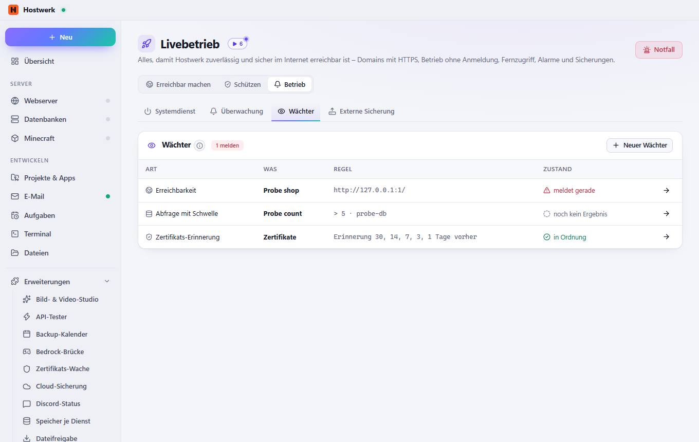
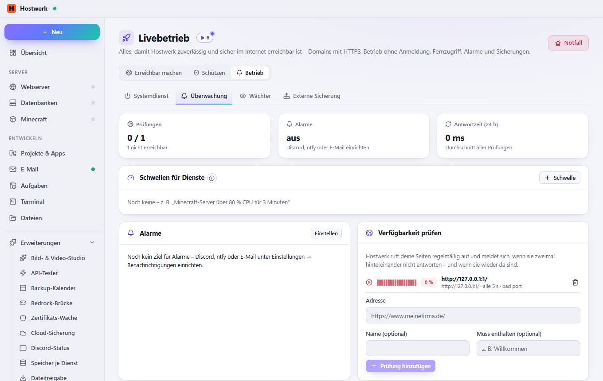
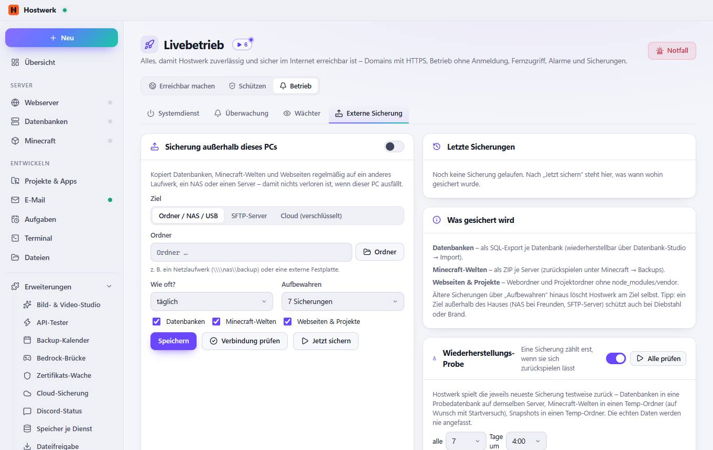

# Livebetrieb → Wächter

[← Zurück zur Übersicht](README.md)

Alles, damit Hostwerk zuverlässig und sicher im Internet erreichbar ist – Domains mit HTTPS, Betrieb ohne Anmeldung, Fernzugriff, Alarme und Sicherungen.

### Gut zu wissen

- Was sind Wächter? Alles, was Hostwerk von selbst beobachtet: Seiten, Dienste, Abfragen und Zertifikate. Wohin Meldungen gehen, stellst du unter Einstellungen → Benachrichtigungen ein.

### Bereiche auf dieser Seite

- Wächter

### Was du hier tun kannst

- Notfall
- Neuer Wächter
- Bearbeiten: Probe shop
- Bearbeiten: Probe count
- Bearbeiten: Zertifikate

## Reiter

### Überwachung

> Hostwerk prüft alle 30 Sekunden CPU, Arbeitsspeicher, Spieler, TPS oder Antwortzeit und meldet sich, wenn ein Wert die Schwelle eine Weile über- bzw. unterschreitet – und wenn er wieder passt.

**Bereiche auf dieser Seite:** Schwellen für Dienste · Alarme · Verfügbarkeit prüfen

**Was du hier tun kannst:** Notfall · Schwelle · Einstellen · Prüfung hinzufügen

### Externe Sicherung

**Bereiche auf dieser Seite:** Sicherung außerhalb dieses PCs · Letzte Sicherungen · Was gesichert wird · Wiederherstellungs-Probe

**Was du hier tun kannst:** Notfall · Ordner · Speichern · Verbindung prüfen · Jetzt sichern · Alle prüfen · Prüfen

Erzeugt am 2026-10-20 · Hostwerk 2.10.0
