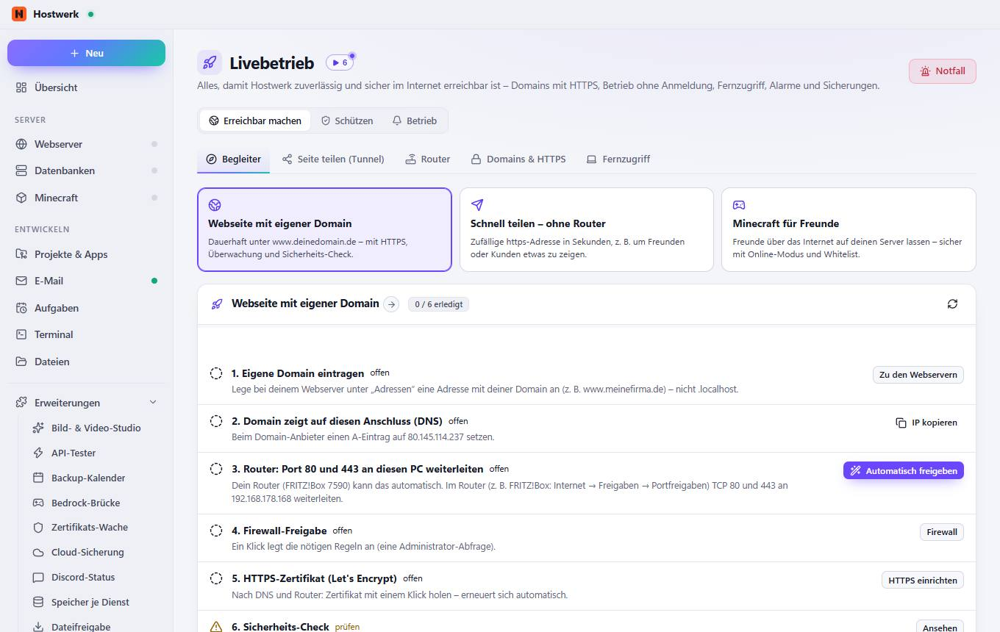
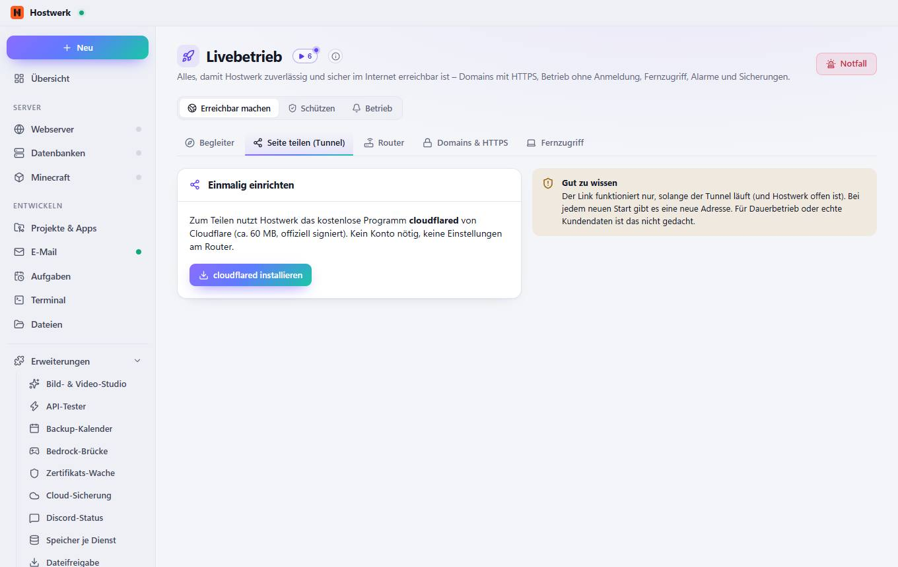
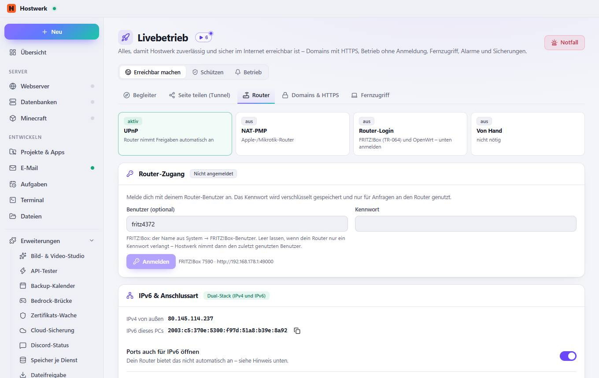
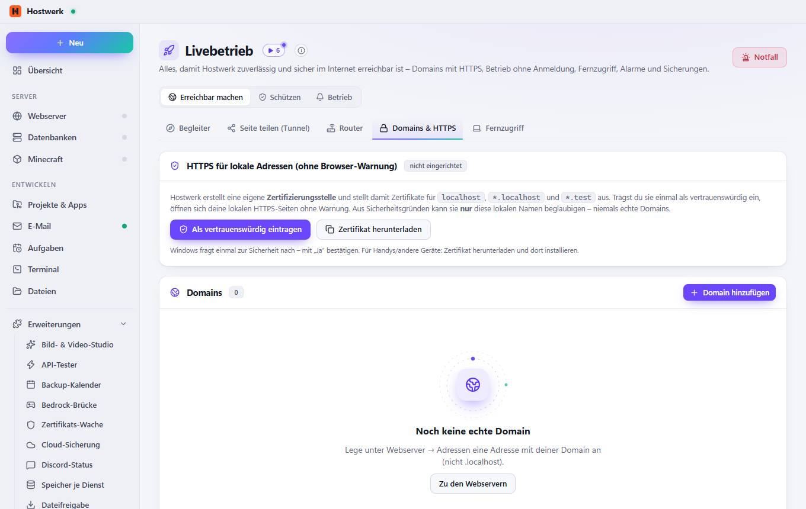
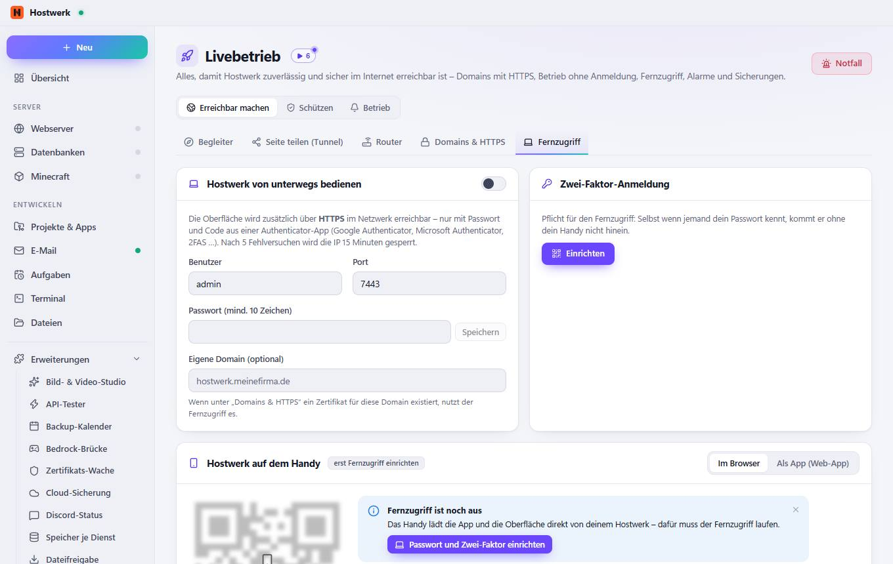

# Livebetrieb

[← Zurück zur Übersicht](README.md)

Alles, damit Hostwerk zuverlässig und sicher im Internet erreichbar ist – Domains mit HTTPS, Betrieb ohne Anmeldung, Fernzugriff, Alarme und Sicherungen.

### Gut zu wissen

- Als Nächstes: Eigene Domain eintragen Lege bei deinem Webserver unter „Adressen“ eine Adresse mit deiner Domain an (z. B. www.meinefirma.de) – nicht .localhost. Danach noch: Domain zeigt auf diesen Anschluss (DNS) · Router: Port 80 und 443 an diesen PC weiterleiten · Firewall-Freigabe · HTTPS-Zertifikat (Let's Encrypt) · Sicherheits-Check

### Bereiche auf dieser Seite

- Webseite mit eigener Domain

### Was du hier tun kannst

- Notfall
- Webseite mit eigener Domain Dauerhaft unter www.deinedomain.de – mit HTTPS, Überwachung und Sicherheits-Check.
- Schnell teilen – ohne Router Zufällige https-Adresse in Sekunden, z. B. um Freunden oder Kunden etwas zu zeigen.
- Minecraft für Freunde Freunde über das Internet auf deinen Server lassen – sicher mit Online-Modus und Whitelist.
- Neu prüfen
- Zu den Webservern
- IP kopieren
- Automatisch freigeben
- Firewall
- HTTPS einrichten
- Ansehen
- Überwachung
- Systemdienst

## Reiter

### Seite teilen (Tunnel)

> So funktioniert's Hostwerk baut eine verschlüsselte Verbindung zu Cloudflare auf. Dort bekommst du eine zufällige Adresse wie xyz.trycloudflare.com, die direkt auf deine lokale Seite zeigt – praktisch, um sie jemandem zu zeigen oder auf dem Handy zu testen.

**Bereiche auf dieser Seite:** Einmalig einrichten

**Was du hier tun kannst:** Notfall · cloudflared installieren

### Router

**Bereiche auf dieser Seite:** Router-Zugang · IPv6 & Anschlussart · FRITZ!Box 7590 · Automatisch freigeben · Ports von Hostwerk · Alle Freigaben im Router

**Was du hier tun kannst:** Notfall · Anmelden · Kopieren · Speichern · Neu suchen · Router-Oberfläche öffnen · Jetzt abgleichen · Eigene Freigabe · Router öffnen · Hinweis ausblenden · Freigeben

### Domains & HTTPS

> So machst du eine Seite öffentlich 1. Beim Domain-Anbieter einen A-Eintrag auf deine öffentliche IP setzen. 2. Im Router Port 80 und 443 an diesen PC weiterleiten. 3. Unter Webserver → Adressen die echte Domain als Adresse anlegen (z. B. www.meinefirma.de). 4. Hier auf „HTTPS einrichten“ klicken – Hostwerk holt ein kostenloses Zertifikat von Let's Encrypt und erneuert es automatisch.

**Bereiche auf dieser Seite:** HTTPS für lokale Adressen (ohne Browser-Warnung) · Domains

**Was du hier tun kannst:** Notfall · Als vertrauenswürdig eintragen · Zertifikat herunterladen · Domain hinzufügen · Zu den Webservern

### Fernzugriff

**Bereiche auf dieser Seite:** Hostwerk von unterwegs bedienen · Zwei-Faktor-Anmeldung · Hostwerk auf dem Handy · Anmelden mit Passkey

**Was du hier tun kannst:** Notfall · Speichern · Einrichten · Passwort und Zwei-Faktor einrichten · Hinweis ausblenden · Passkey hinzufügen

Erzeugt am 2026-10-20 · Hostwerk 2.10.0
