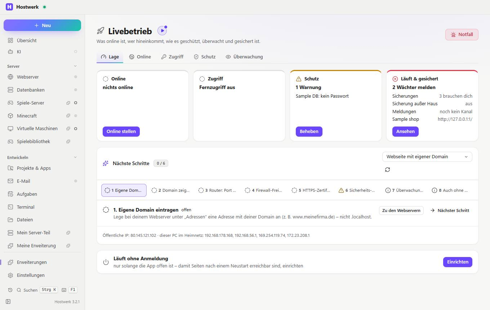
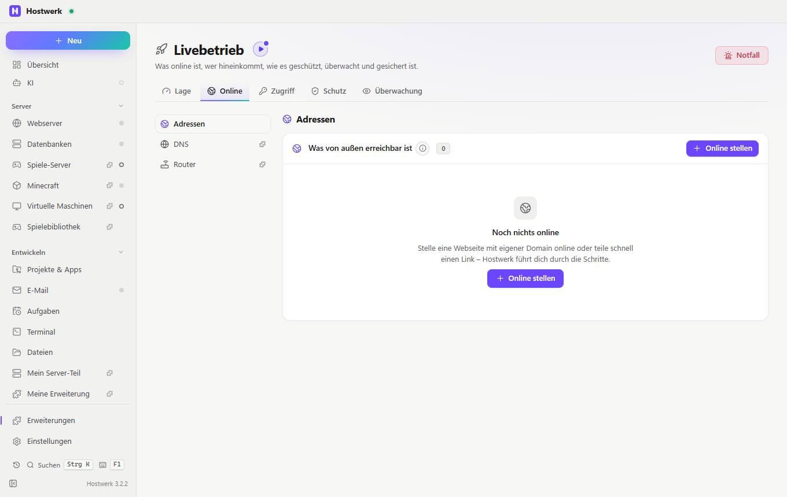
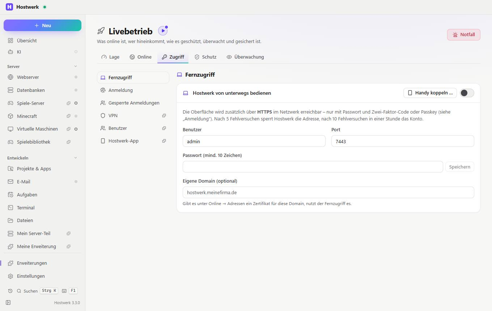
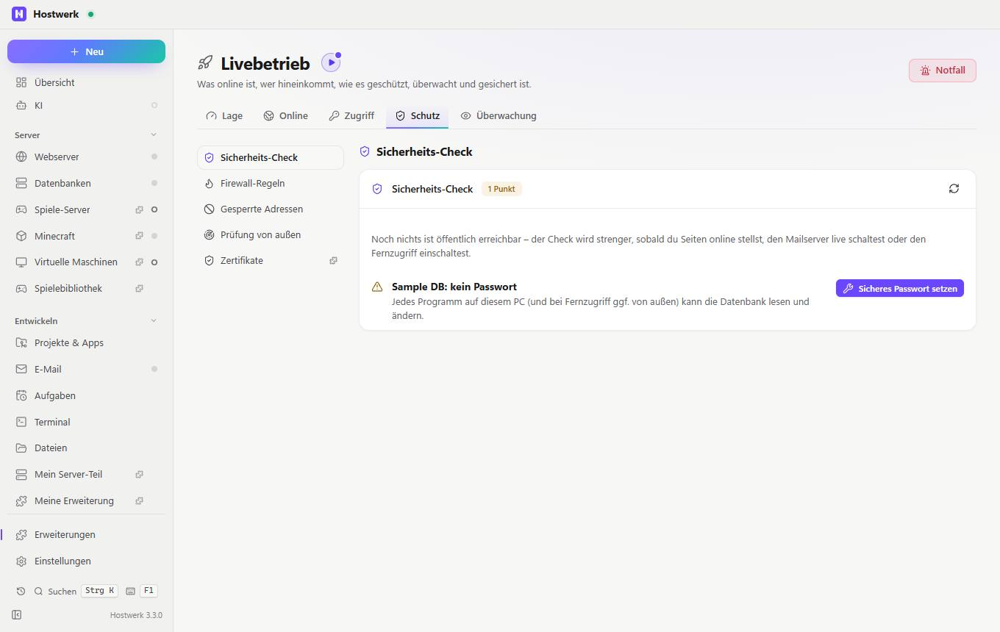
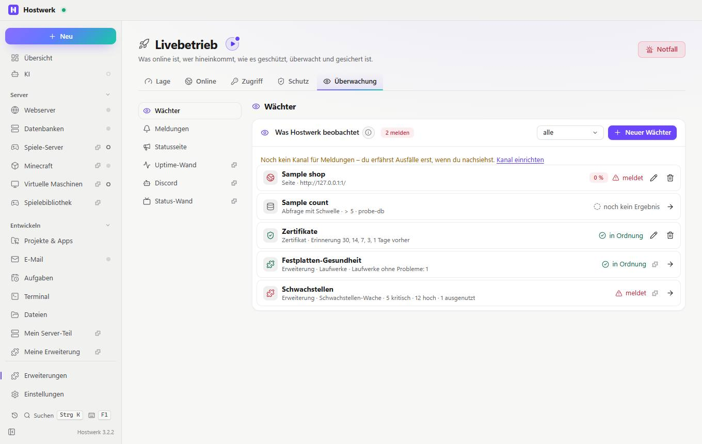

# Livebetrieb

[← Zurück zur Übersicht](README.md)

Was online ist, wer hineinkommt, wie es geschützt, überwacht und gesichert ist.

### Bereiche auf dieser Seite

- Nächste Schritte

### Was du hier tun kannst

- 6 Videos
- Notfall
- Online stellen
- Beheben
- Ansehen
- Neu prüfen
- 1 Eigene Domain eintragen
- 2 Domain zeigt auf diesen Anschluss (DNS)
- 3 Router: Port 80 und 443 an diesen PC weiterleiten
- 4 Firewall-Freigabe
- 5 HTTPS-Zertifikat (Let's Encrypt)
- 6 Sicherheits-Check
- 7 Überwachung und Alarm
- 8 Auch ohne Anmeldung laufen (Systemdienst)
- Zu den Webservern
- Nächster Schritt
- Einrichten

## Reiter

### Online

> Adressen Jede Adresse, unter der etwas aus dem Internet erreichbar ist – eine eigene Domain, ein Schnell-Link (läuft ab) oder der dauerhafte Tunnel über Cloudflare.

**Bereiche auf dieser Seite:** Adressen · Was von außen erreichbar ist

**Was du hier tun kannst:** 6 Videos · Notfall · Online stellen

### Zugriff

**Bereiche auf dieser Seite:** Fernzugriff · Hostwerk von unterwegs bedienen

**Was du hier tun kannst:** 6 Videos · Notfall · Handy koppeln … · Speichern

### Schutz

**Bereiche auf dieser Seite:** Sicherheits-Check

**Was du hier tun kannst:** 6 Videos · Notfall · Neu laden · Sicheres Passwort setzen

### Überwachung

> Wächter Alles, was Hostwerk von selbst beobachtet: Seiten, Ports, Dienste, Zertifikate, Abfragen und Protokolle. Meldet ein Wächter zweimal hintereinander ein Problem, geht eine Meldung an deine Kanäle – und wieder eine, wenn es vorbei ist.

**Bereiche auf dieser Seite:** Wächter · Was Hostwerk beobachtet

**Was du hier tun kannst:** 6 Videos · Notfall · Neuer Wächter · Bearbeiten: Sample shop · Entfernen: Sample shop · Bearbeiten: Sample count · Bearbeiten: Zertifikate · Entfernen: Zertifikate · Von der Erweiterung „disk-health“ – Infos · Bearbeiten: Festplatten-Gesundheit · Von der Erweiterung „vuln-watch“ – Infos · Bearbeiten: Schwachstellen

Erzeugt am 2026-11-18 · Hostwerk 3.2.1
