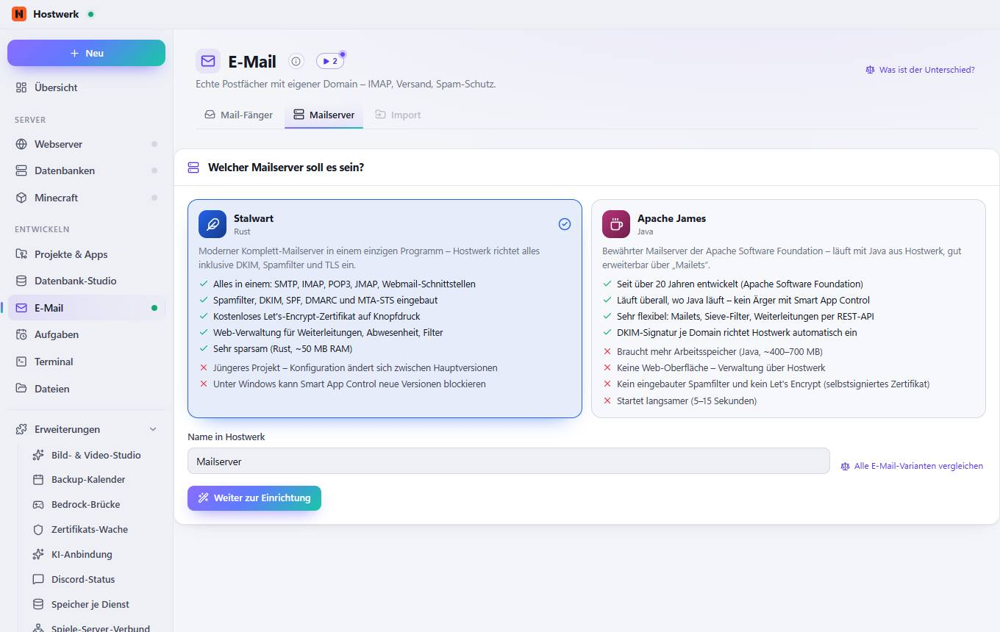
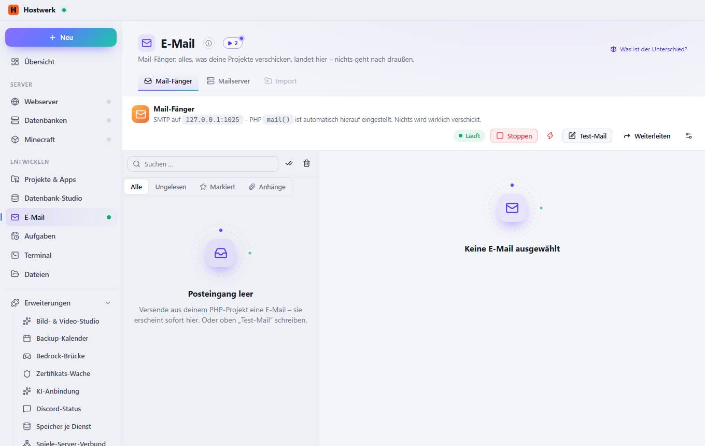

# E-Mail

[← Zurück zur Übersicht](README.md)

Mail-Fänger: alles, was deine Projekte verschicken, landet hier – nichts geht nach draußen.

### Gut zu wissen

- Mail-Fänger oder Mailserver? Der Mail-Fänger ist zum Entwickeln: Er fängt jede Mail ab, die ein Projekt verschickt (Registrierung, Bestellbestätigung …) – du liest sie hier, nichts verlässt den PC. Der Mailserver ist für echte Postfächer wie info@deine-domain.de mit IMAP und Versand ins Internet (Stalwart oder Apache James).

### Was du hier tun kannst

- Was ist der Unterschied?
- Stoppen
- Sofort beenden (erzwingen)
- Test-Mail
- Weiterleiten
- Einstellungen
- Alle als gelesen markieren
- Alle löschen

## Reiter

### Mailserver

> Mail-Fänger oder Mailserver? Der Mail-Fänger ist zum Entwickeln: Er fängt jede Mail ab, die ein Projekt verschickt (Registrierung, Bestellbestätigung …) – du liest sie hier, nichts verlässt den PC. Der Mailserver ist für echte Postfächer wie info@deine-domain.de mit IMAP und Versand ins Internet (Stalwart oder Apache James).

**Bereiche auf dieser Seite:** Welcher Mailserver soll es sein?

**Was du hier tun kannst:** Was ist der Unterschied? · Alle E-Mail-Varianten vergleichen · Weiter zur Einrichtung

### Import

> Mail-Fänger oder Mailserver? Der Mail-Fänger ist zum Entwickeln: Er fängt jede Mail ab, die ein Projekt verschickt (Registrierung, Bestellbestätigung …) – du liest sie hier, nichts verlässt den PC. Der Mailserver ist für echte Postfächer wie info@deine-domain.de mit IMAP und Versand ins Internet (Stalwart oder Apache James).

**Was du hier tun kannst:** Was ist der Unterschied? · Stoppen · Sofort beenden (erzwingen) · Test-Mail · Weiterleiten · Einstellungen · Alle als gelesen markieren · Alle löschen

Erzeugt am 2026-10-19 · Hostwerk 2.9.0
