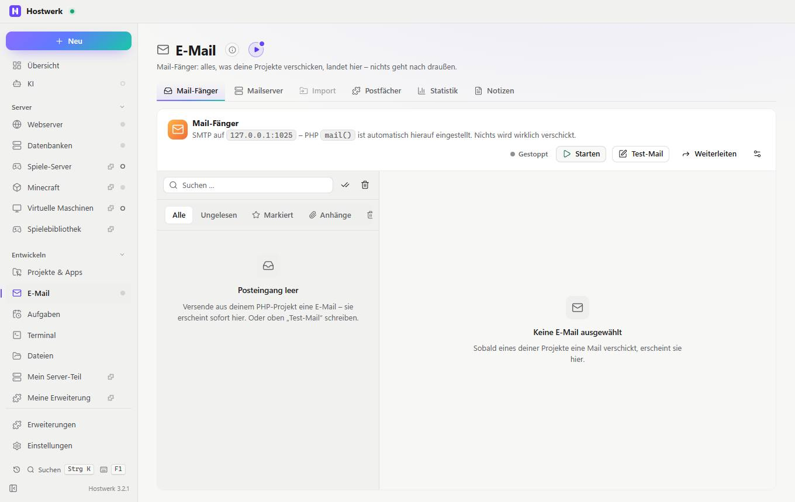
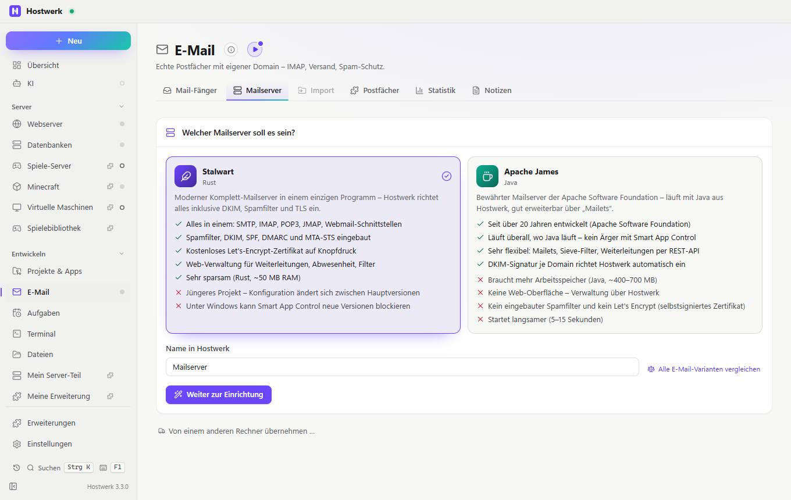
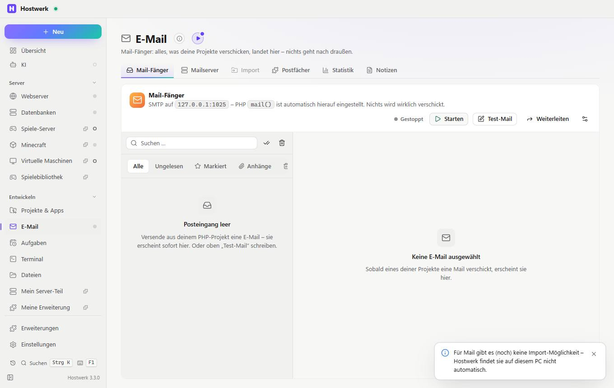
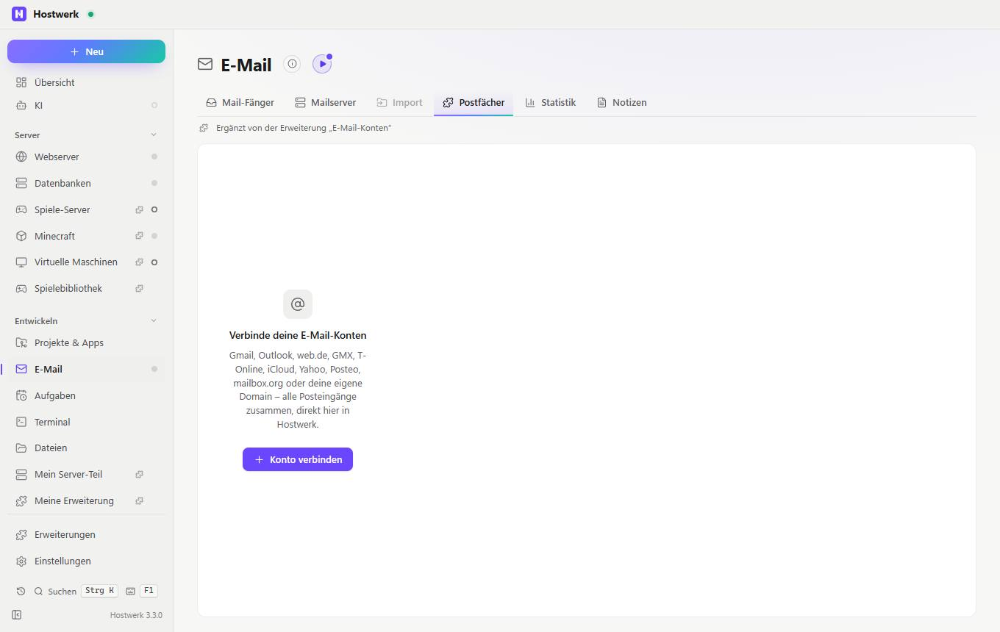
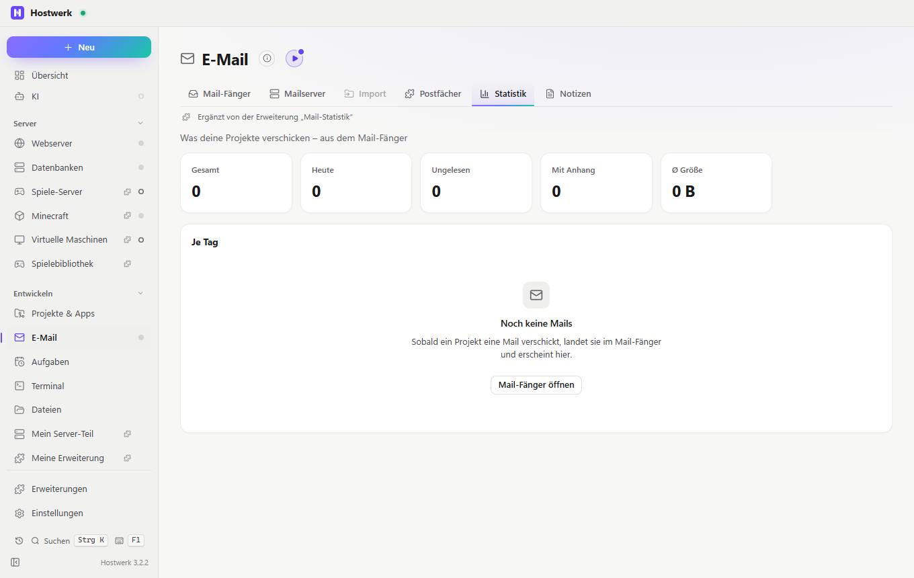
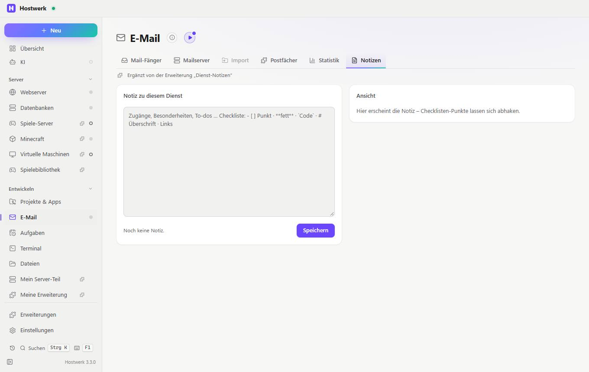

# E-Mail

[← Zurück zur Übersicht](README.md)

Mail-Fänger: alles, was deine Projekte verschicken, landet hier – nichts geht nach draußen.

### Gut zu wissen

- Mail-Fänger oder Mailserver? Der Mail-Fänger ist zum Entwickeln: Er fängt jede Mail ab, die ein Projekt verschickt (Registrierung, Bestellbestätigung …) – du liest sie hier, nichts verlässt den PC. Der Mailserver ist für echte Postfächer wie info@deine-domain.de mit IMAP und Versand ins Internet (Stalwart oder Apache James).

### Was du hier tun kannst

- 2 Videos
- Starten
- Test-Mail
- Weiterleiten
- Einstellungen
- Alle als gelesen markieren
- Alle löschen

## Reiter

### Mailserver

> Mail-Fänger oder Mailserver? Der Mail-Fänger ist zum Entwickeln: Er fängt jede Mail ab, die ein Projekt verschickt (Registrierung, Bestellbestätigung …) – du liest sie hier, nichts verlässt den PC. Der Mailserver ist für echte Postfächer wie info@deine-domain.de mit IMAP und Versand ins Internet (Stalwart oder Apache James).

**Bereiche auf dieser Seite:** Welcher Mailserver soll es sein?

**Was du hier tun kannst:** 2 Videos · Alle E-Mail-Varianten vergleichen · Weiter zur Einrichtung · Von einem anderen Rechner übernehmen …

### Import

> Mail-Fänger oder Mailserver? Der Mail-Fänger ist zum Entwickeln: Er fängt jede Mail ab, die ein Projekt verschickt (Registrierung, Bestellbestätigung …) – du liest sie hier, nichts verlässt den PC. Der Mailserver ist für echte Postfächer wie info@deine-domain.de mit IMAP und Versand ins Internet (Stalwart oder Apache James).

**Was du hier tun kannst:** 2 Videos · Starten · Test-Mail · Weiterleiten · Einstellungen · Alle als gelesen markieren · Alle löschen

### Postfächer

> Mail-Fänger oder Mailserver? Der Mail-Fänger ist zum Entwickeln: Er fängt jede Mail ab, die ein Projekt verschickt (Registrierung, Bestellbestätigung …) – du liest sie hier, nichts verlässt den PC. Der Mailserver ist für echte Postfächer wie info@deine-domain.de mit IMAP und Versand ins Internet (Stalwart oder Apache James).

**Was du hier tun kannst:** 2 Videos · Von der Erweiterung „E-Mail-Konten“ – Infos · Konto verbinden

### Statistik

> Mail-Fänger oder Mailserver? Der Mail-Fänger ist zum Entwickeln: Er fängt jede Mail ab, die ein Projekt verschickt (Registrierung, Bestellbestätigung …) – du liest sie hier, nichts verlässt den PC. Der Mailserver ist für echte Postfächer wie info@deine-domain.de mit IMAP und Versand ins Internet (Stalwart oder Apache James).

**Was du hier tun kannst:** 2 Videos · Von der Erweiterung „Mail-Statistik“ – Infos

### Notizen

> Mail-Fänger oder Mailserver? Der Mail-Fänger ist zum Entwickeln: Er fängt jede Mail ab, die ein Projekt verschickt (Registrierung, Bestellbestätigung …) – du liest sie hier, nichts verlässt den PC. Der Mailserver ist für echte Postfächer wie info@deine-domain.de mit IMAP und Versand ins Internet (Stalwart oder Apache James).

**Was du hier tun kannst:** 2 Videos · Von der Erweiterung „Dienst-Notizen“ – Infos

Erzeugt am 2026-11-18 · Hostwerk 3.2.1
