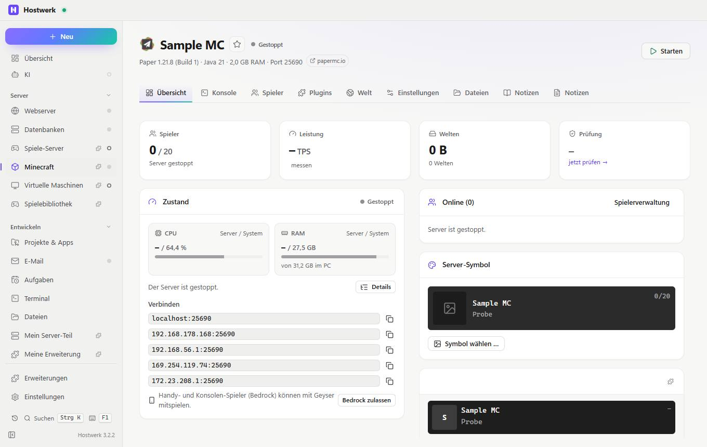
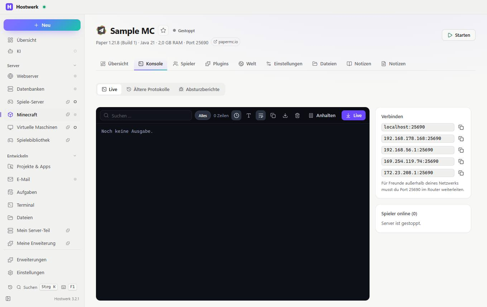
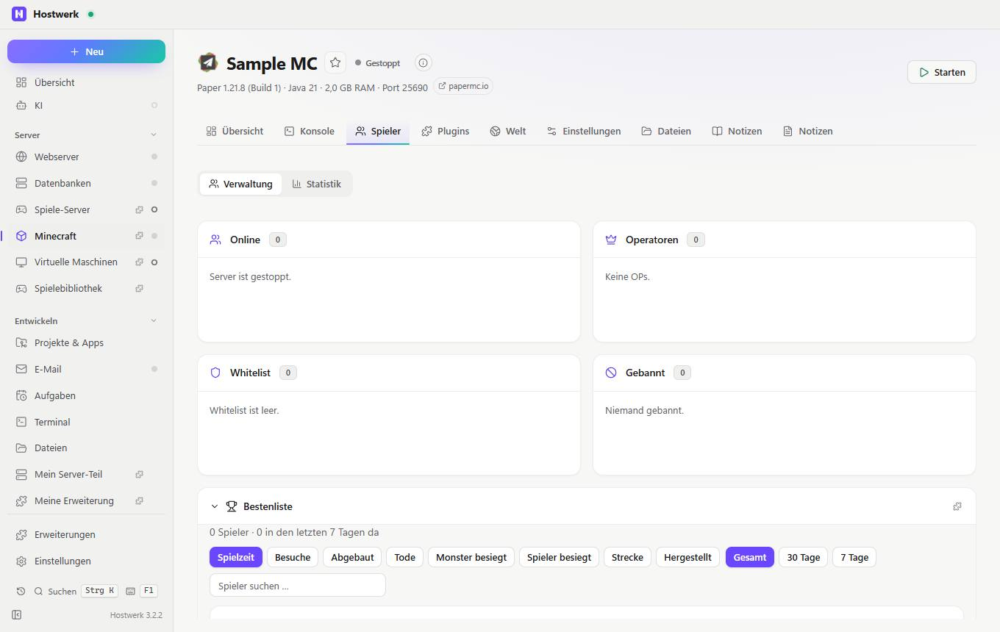
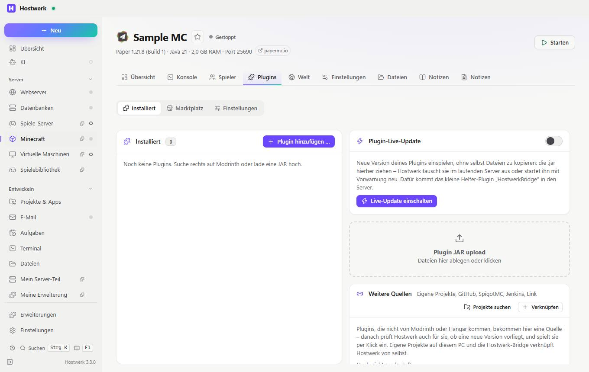
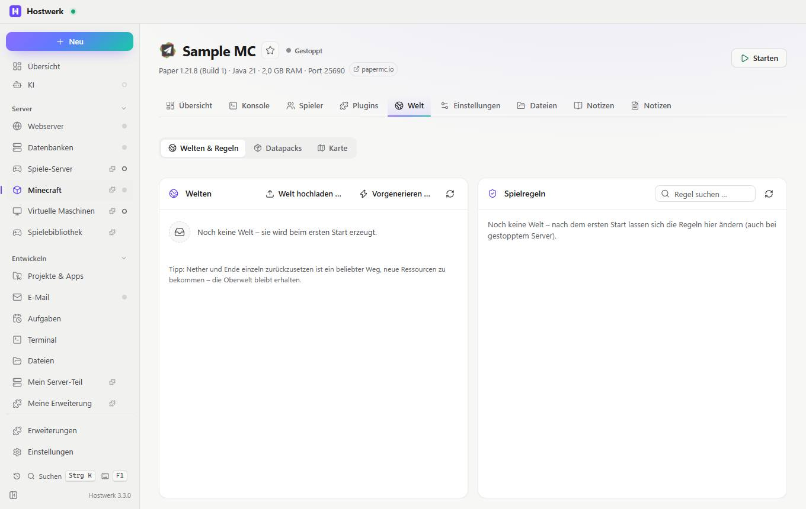
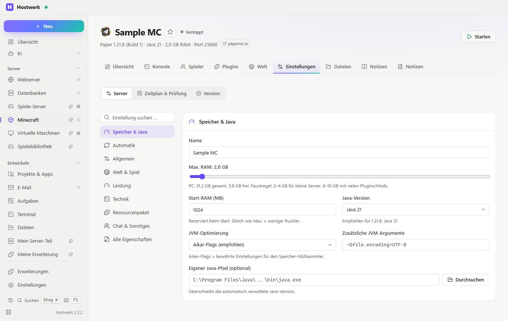
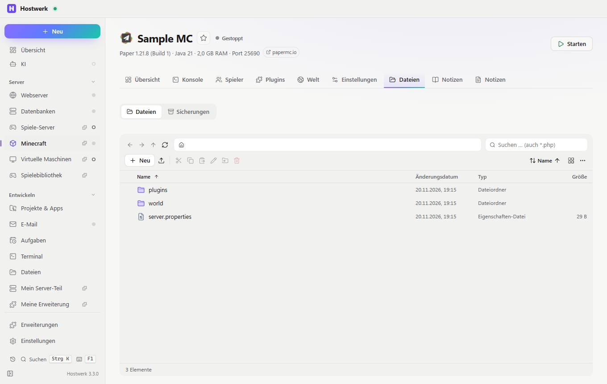
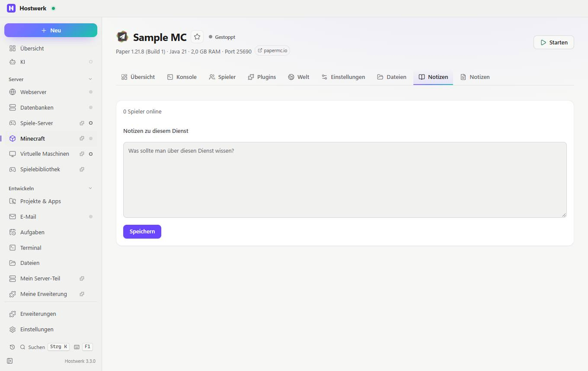

# Sample MC → Übersicht

[← Zurück zur Übersicht](README.md)

Paper 1.21.8 (Build 1) · Java 21 · 2,0 GB RAM · Port 25690 papermc.io

### Bereiche auf dieser Seite

- Zustand
- Online (0)
- Server-Symbol

### Was du hier tun kannst

- Bild ändern
- Als Favorit markieren (steht dann in Listen oben)
- papermc.io
- Starten
- messen
- Details
- Kopieren
- Bedrock zulassen
- Spielerverwaltung
- Symbol wählen …
- Von der Erweiterung „Minecraft-Server“ – Infos
- Von der Erweiterung „MOTD-Studio“ – Infos

## Reiter

### Konsole

**Was du hier tun kannst:** Bild ändern · Als Favorit markieren (steht dann in Listen oben) · papermc.io · Starten · Alles · Uhrzeit anzeigen · Größere Schrift · Lange Zeilen umbrechen · Kopieren · Als Textdatei speichern · Leeren · Anhalten · Live

### Spieler

> Spieler hinzufügen/entfernen geht über die Konsole und ist daher nur bei laufendem Server möglich.

**Bereiche auf dieser Seite:** Online · Operatoren · Whitelist · Gebannt · Bestenliste · Gerade online

**Was du hier tun kannst:** Bild ändern · Als Favorit markieren (steht dann in Listen oben) · papermc.io · Starten · Bestenliste · Von der Erweiterung „Spieler-Bestenliste“ – Infos · Gerade online · Von der Erweiterung „Spieler“ – Infos

### Plugins

**Bereiche auf dieser Seite:** Installiert · Plugin-Live-Update · Weitere Quellen

**Was du hier tun kannst:** Bild ändern · Als Favorit markieren (steht dann in Listen oben) · papermc.io · Starten · Plugin hinzufügen … · Live-Update einschalten · Projekte suchen · Verknüpfen

### Welt

**Bereiche auf dieser Seite:** Welten · Spielregeln

**Was du hier tun kannst:** Bild ändern · Als Favorit markieren (steht dann in Listen oben) · papermc.io · Starten · Welt hochladen … · Vorgenerieren … · Neu laden

### Einstellungen

**Bereiche auf dieser Seite:** Speicher & Java

**Was du hier tun kannst:** Bild ändern · Als Favorit markieren (steht dann in Listen oben) · papermc.io · Starten · Speicher & Java · Automatik · Allgemein · Welt & Spiel · Leistung · Technik · Ressourcenpaket · Chat & Sonstiges · Alle Eigenschaften · Durchsuchen

### Dateien

**Was du hier tun kannst:** Bild ändern · Als Favorit markieren (steht dann in Listen oben) · papermc.io · Starten · Wurzel · Neu … · Neuer Ordner · Kacheln · Mehr · Name · Geändert · Größe

### Notizen

**Was du hier tun kannst:** Bild ändern · Als Favorit markieren (steht dann in Listen oben) · papermc.io · Starten

Erzeugt am 2026-11-20 · Hostwerk 3.2.2
