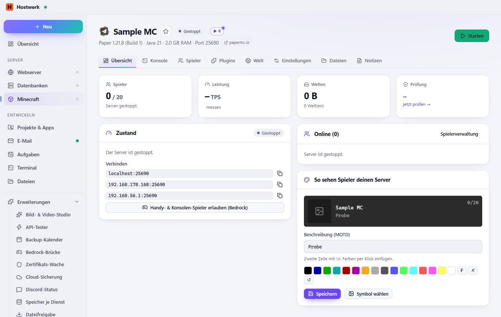
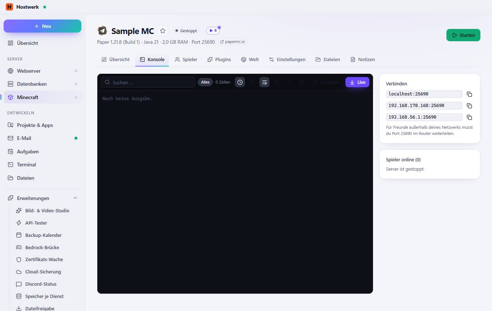
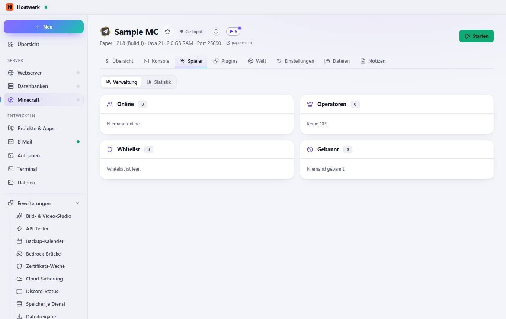
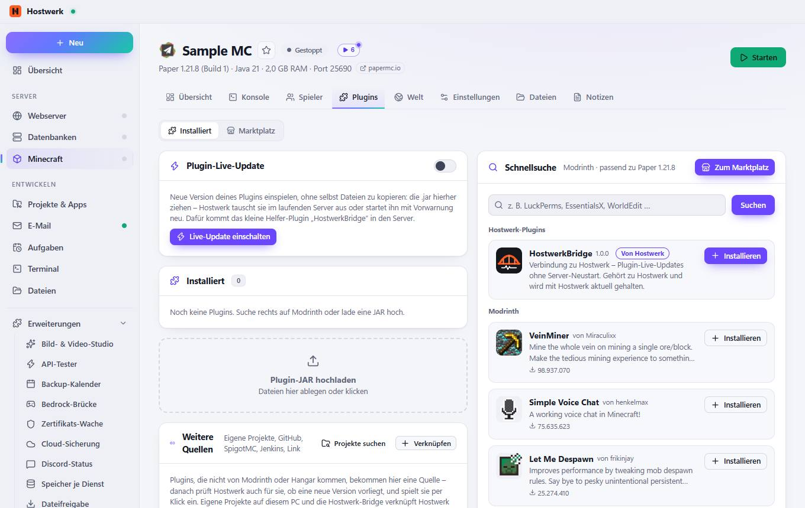
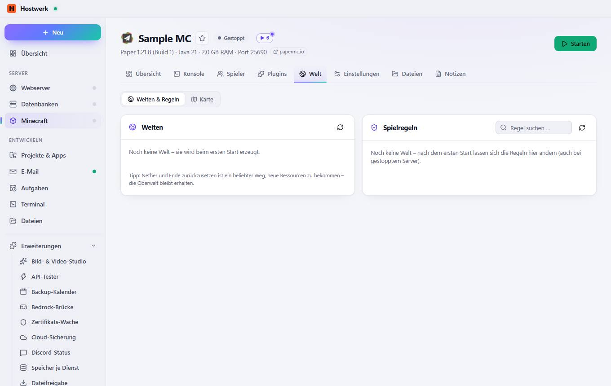
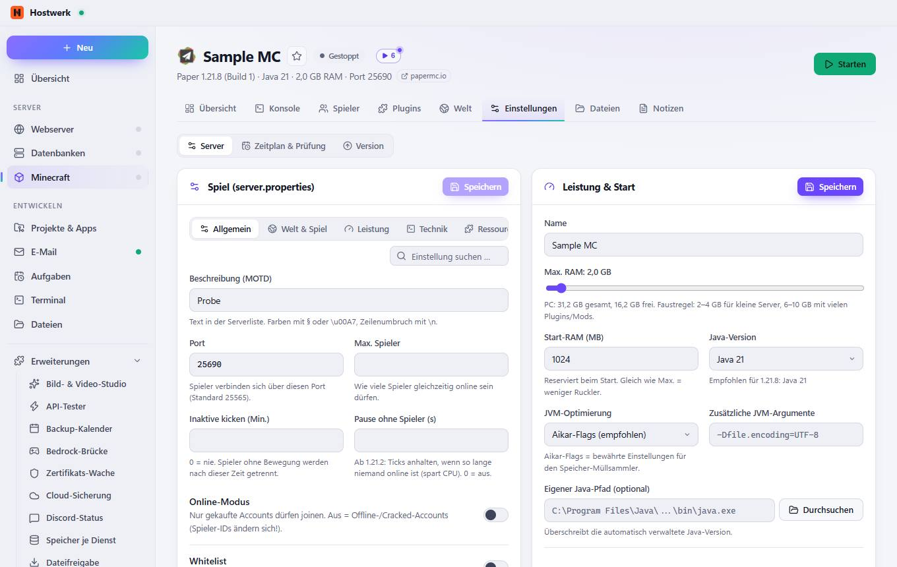
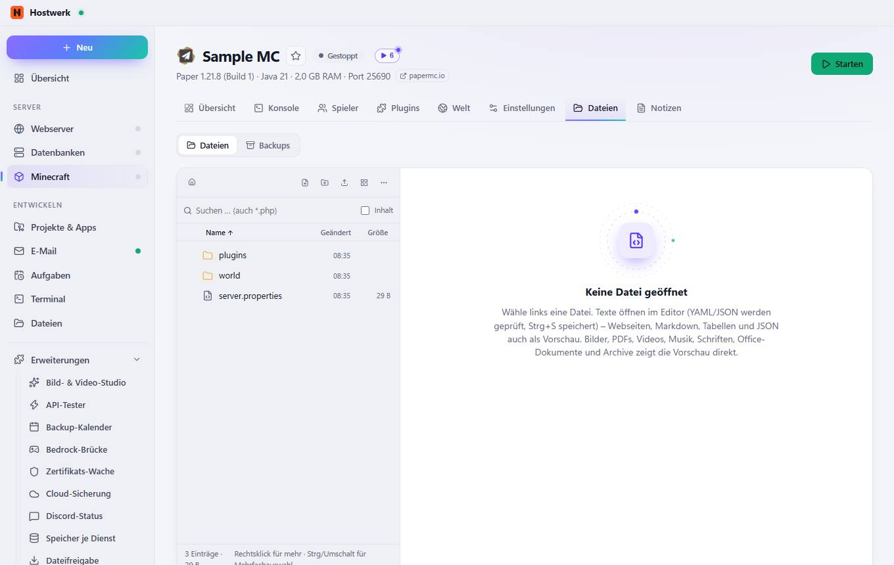
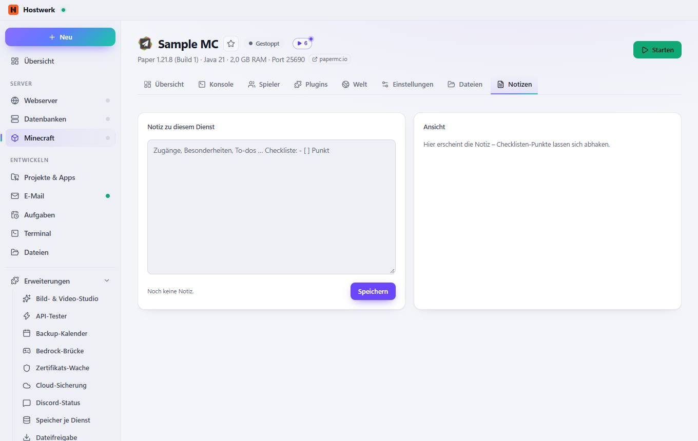

# Sample MC → Übersicht

[← Zurück zur Übersicht](README.md)

Paper 1.21.8 (Build 1) · Java 21 · 2,0 GB RAM · Port 25690 papermc.io

### Bereiche auf dieser Seite

- Zustand
- Online (0)
- So sehen Spieler deinen Server

### Was du hier tun kannst

- Bild ändern
- Als Favorit markieren (steht dann in Listen oben)
- papermc.io
- Starten
- messen
- Kopieren
- Handy- & Konsolen-Spieler erlauben (Bedrock)
- Spielerverwaltung
- §0
- §1
- §2
- §3
- §4
- §5
- §6
- §7
- §8
- §9
- §a
- §b
- §c
- §d
- §e
- §f
- Speichern
- Symbol wählen

### Eingaben

- Beschreibung (MOTD)

## Reiter

### Konsole

**Was du hier tun kannst:** Bild ändern · Als Favorit markieren (steht dann in Listen oben) · papermc.io · Starten · Alles · Uhrzeit anzeigen · Größere Schrift · Lange Zeilen umbrechen · Kopieren · Als Textdatei speichern · Leeren · Anhalten · Live

### Spieler

> Spieler hinzufügen/entfernen geht über die Konsole und ist daher nur bei laufendem Server möglich.

**Bereiche auf dieser Seite:** Online · Operatoren · Whitelist · Gebannt

**Was du hier tun kannst:** Bild ändern · Als Favorit markieren (steht dann in Listen oben) · papermc.io · Starten

### Plugins

**Bereiche auf dieser Seite:** Plugin-Live-Update · Installiert · Weitere Quellen · Schnellsuche

**Was du hier tun kannst:** Bild ändern · Als Favorit markieren (steht dann in Listen oben) · papermc.io · Starten · Live-Update einschalten · Projekte suchen · Verknüpfen · Zum Marktplatz · Suchen · Installieren

### Welt

**Bereiche auf dieser Seite:** Welten · Spielregeln

**Was du hier tun kannst:** Bild ändern · Als Favorit markieren (steht dann in Listen oben) · papermc.io · Starten · Neu laden

### Einstellungen

**Bereiche auf dieser Seite:** Spiel (server.properties) · Leistung & Start · Alle Eigenschaften

**Was du hier tun kannst:** Bild ändern · Als Favorit markieren (steht dann in Listen oben) · papermc.io · Starten · Speichern · Durchsuchen · server.properties im Editor

### Dateien

**Was du hier tun kannst:** Bild ändern · Als Favorit markieren (steht dann in Listen oben) · papermc.io · Starten · Wurzel · Neue Datei · Neuer Ordner · Kacheln · Mehr · Name · Geändert · Größe

### Notizen

**Was du hier tun kannst:** Bild ändern · Als Favorit markieren (steht dann in Listen oben) · papermc.io · Starten

Erzeugt am 2026-10-20 · Hostwerk 2.10.0
