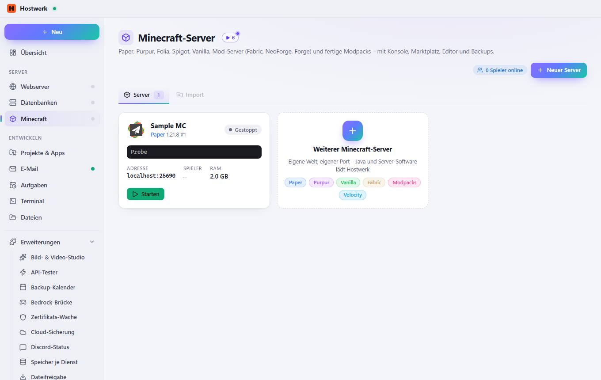

# Minecraft-Server

[← Zurück zur Übersicht](README.md)

Paper, Purpur, Folia, Spigot, Vanilla, Mod-Server (Fabric, NeoForge, Forge) und fertige Modpacks – mit Konsole, Marktplatz, Editor und Backups.

### Was du hier tun kannst

- Neuer Server
- Bild ändern
- Starten
- Weiterer Minecraft-Server Eigene Welt, eigener Port – Java und Server-Software lädt Hostwerk Paper Purpur Vanilla Fabric Modpacks Velocity

## Reiter

### Import

**Was du hier tun kannst:** Neuer Server · Bild ändern · Starten · Weiterer Minecraft-Server Eigene Welt, eigener Port – Java und Server-Software lädt Hostwerk Paper Purpur Vanilla Fabric Modpacks Velocity

Erzeugt am 2026-10-20 · Hostwerk 2.10.0
