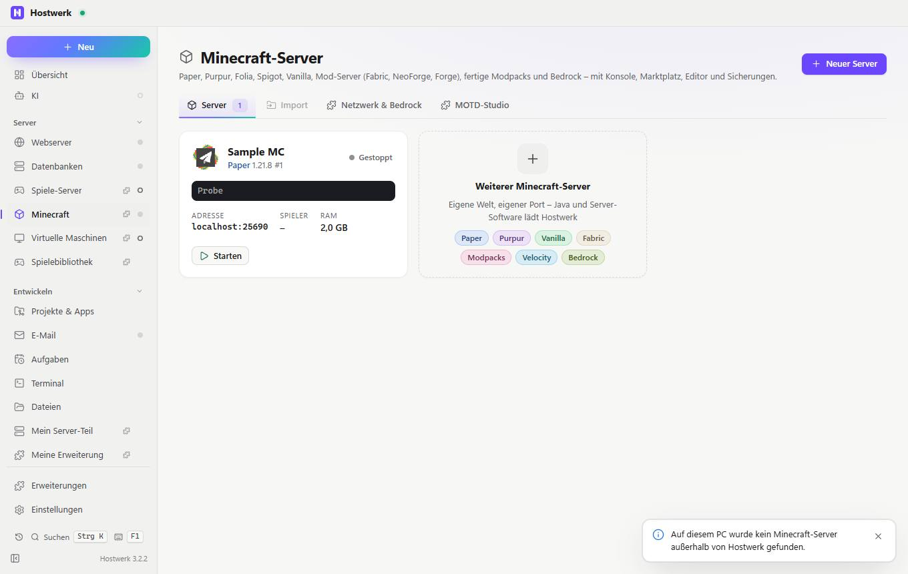
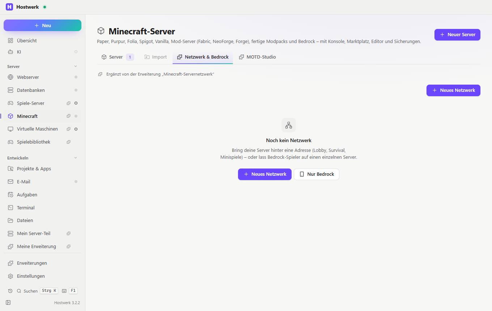
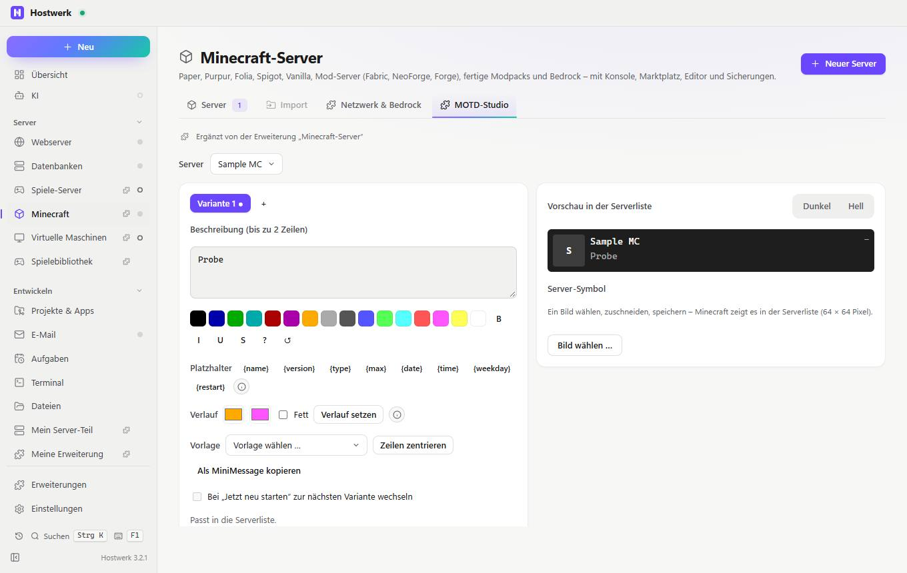

# Minecraft-Server

[← Zurück zur Übersicht](README.md)

Paper, Purpur, Folia, Spigot, Vanilla, Mod-Server (Fabric, NeoForge, Forge), fertige Modpacks und Bedrock – mit Konsole, Marktplatz, Editor und Sicherungen.

### Was du hier tun kannst

- Neuer Server
- Bild ändern
- Starten
- Weiterer Minecraft-Server Eigene Welt, eigener Port – Java und Server-Software lädt Hostwerk Paper Purpur Vanilla Fabric Modpacks Velocity Bedrock

## Reiter

### Import

**Was du hier tun kannst:** Neuer Server · Bild ändern · Starten · Weiterer Minecraft-Server Eigene Welt, eigener Port – Java und Server-Software lädt Hostwerk Paper Purpur Vanilla Fabric Modpacks Velocity Bedrock

### Netzwerk & Bedrock

> Wie alles zusammenhängt A proxy (Velocity) is the one address players connect to; it sends them to your servers and lets them switch with /server. Geyser on the proxy translates for Bedrock players (phone, console, Windows), Floodgate lets them in without a Java account. ViaVersion lets other Minecraft versions in. A Bedrock Dedicated Server is something else: Mojang’s own server with a separate Bedrock-only world.

**Was du hier tun kannst:** Neuer Server · Von der Erweiterung „Minecraft-Servernetzwerk“ – Infos · Neues Netzwerk · Nur Bedrock

### MOTD-Studio

**Was du hier tun kannst:** Neuer Server · Von der Erweiterung „Minecraft-Server“ – Infos

Erzeugt am 2026-11-20 · Hostwerk 3.2.2
