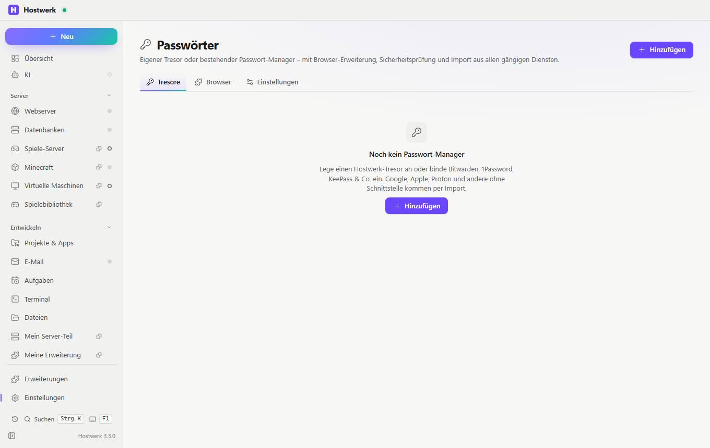
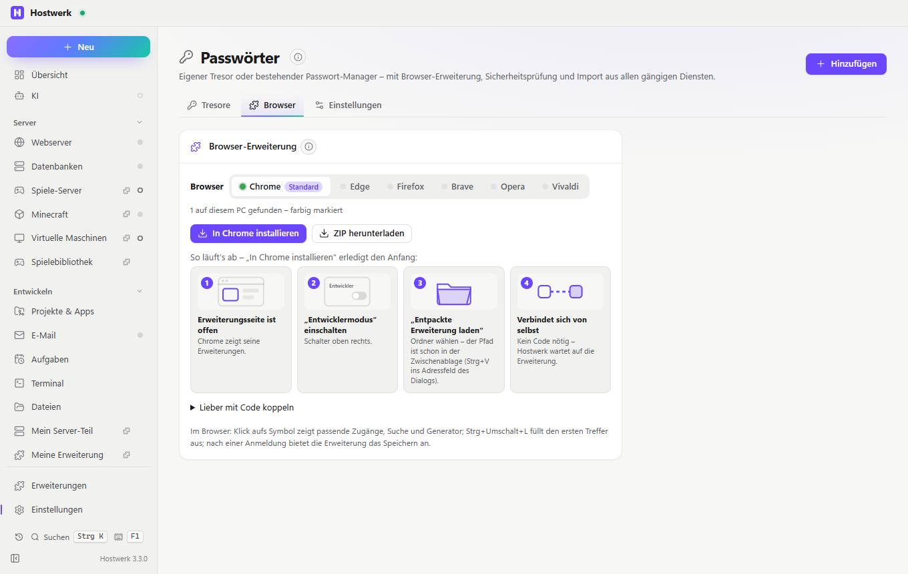
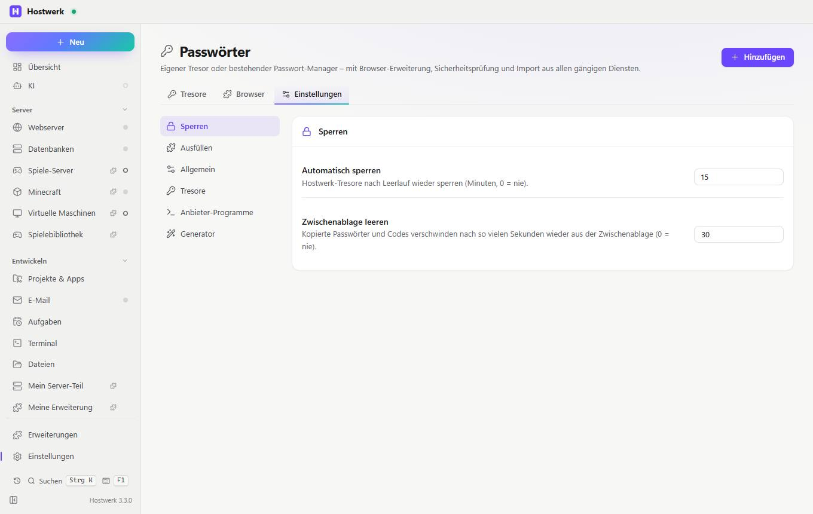

# Passwörter

[← Zurück zur Übersicht](README.md)

Eigener Tresor oder bestehender Passwort-Manager – mit Browser-Erweiterung, Sicherheitsprüfung und Import aus allen gängigen Diensten.

### Was du hier tun kannst

- Hinzufügen

## Reiter

### Browser

> Wie installiert Hostwerk? Gibt es die Erweiterung im Store des Browsers, meldet Hostwerk sie dem Browser auf dem offiziellen Weg und öffnet die Store-Seite – ein Klick „Hinzufügen“. Sonst lädt der Browser sie als „entpackte Erweiterung“ (Entwicklermodus). In beiden Fällen koppelt sie sich selbst, ohne Code.
> Die Erweiterung spricht nur mit deinem Hostwerk (127.0.0.1). Nach einem Neustart oder Port-Wechsel findet sie Hostwerk von selbst wieder und koppelt sich mit der Datei in ihrem Ordner neu – ohne Code.

**Bereiche auf dieser Seite:** Browser-Erweiterung

**Was du hier tun kannst:** Hinzufügen · In Chrome installieren · ZIP herunterladen

### Einstellungen

**Bereiche auf dieser Seite:** Sperren

**Was du hier tun kannst:** Hinzufügen · Sperren · Ausfüllen · Allgemein · Tresore · Anbieter-Programme · Generator

Erzeugt am 2026-11-20 · Hostwerk 3.3.0
