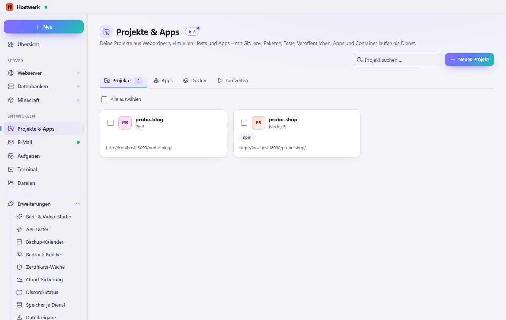
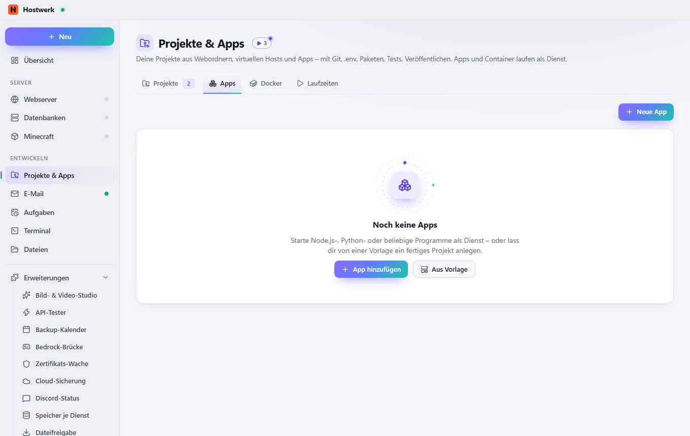
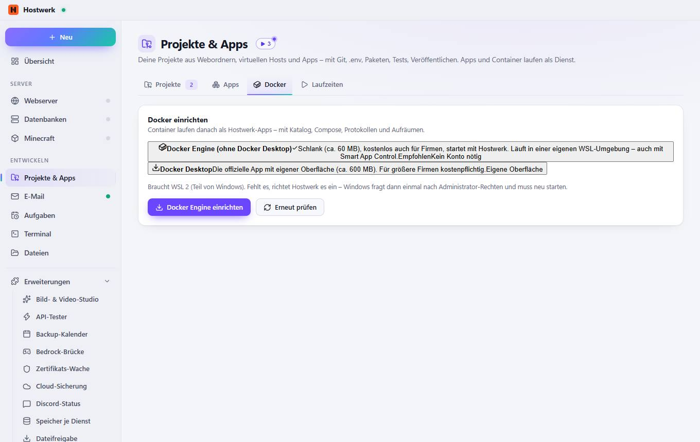
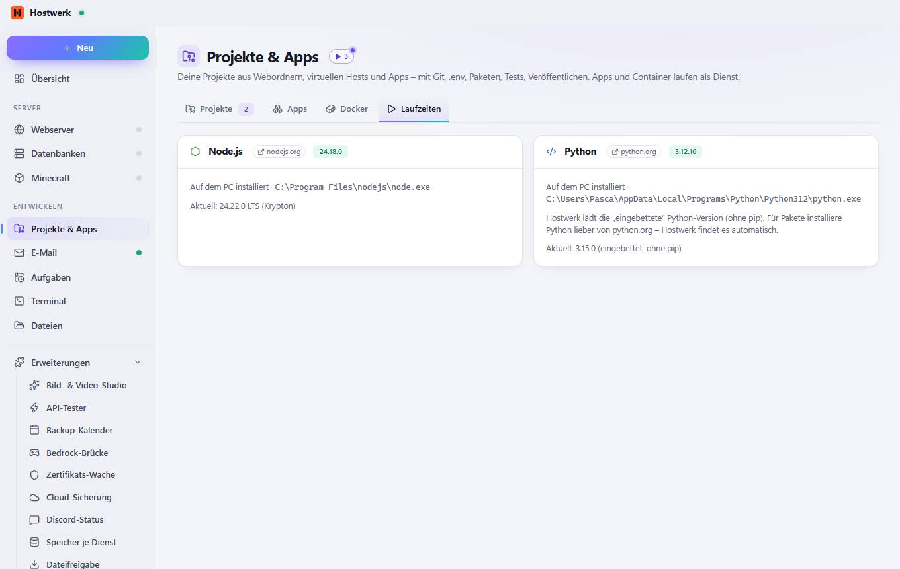

# Projekte & Apps

[← Zurück zur Übersicht](README.md)

Deine Projekte aus Webordnern, virtuellen Hosts und Apps – mit Git, .env, Paketen, Tests, Veröffentlichen. Apps und Container laufen als Dienst.

### Was du hier tun kannst

- Neues Projekt
- Bild ändern

## Reiter

### Apps

**Was du hier tun kannst:** Neue App · App hinzufügen · Aus Vorlage

### Docker

**Was du hier tun kannst:** Docker DesktopDie offizielle App mit eigener Oberfläche (ca. 600 MB). Für größere Firmen kostenpflichtig.Eigene Oberfläche · Docker Engine einrichten · Erneut prüfen

### Laufzeiten

**Bereiche auf dieser Seite:** Node.js · Python

**Was du hier tun kannst:** nodejs.org · python.org

Erzeugt am 2026-10-20 · Hostwerk 2.10.0
