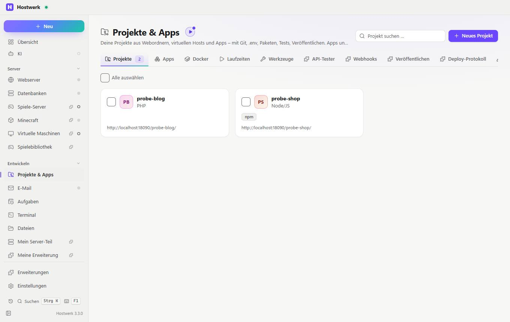
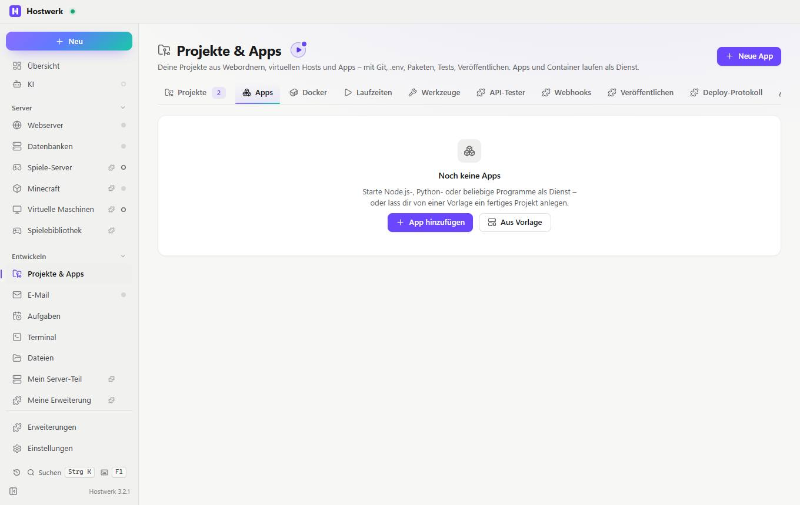
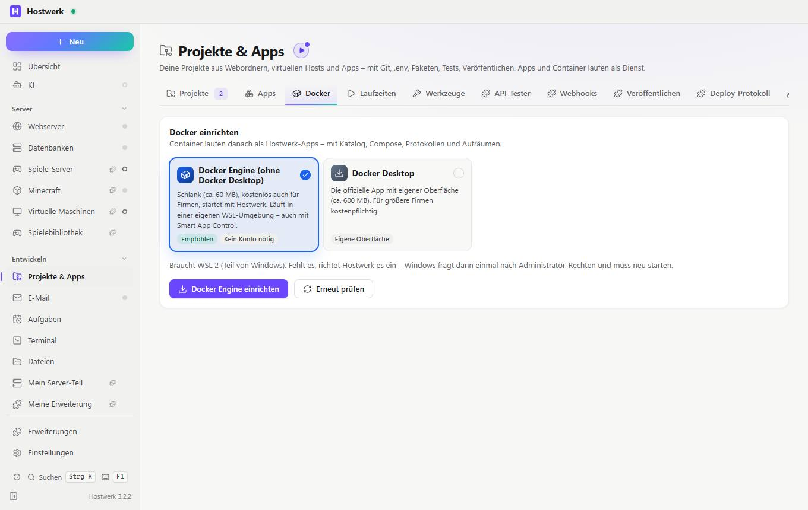
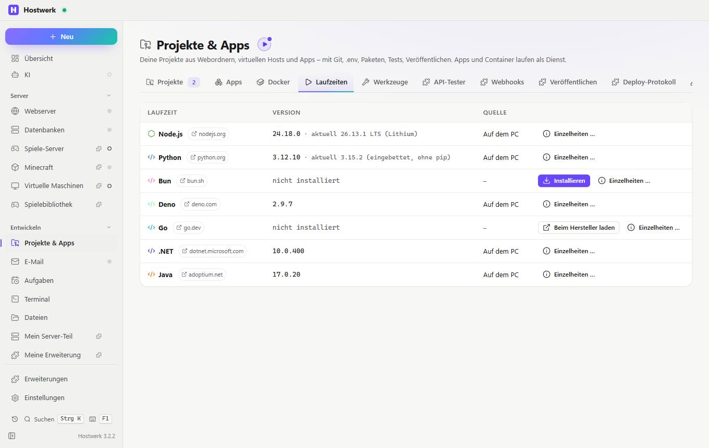
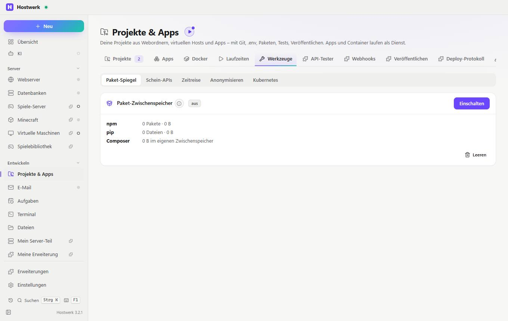
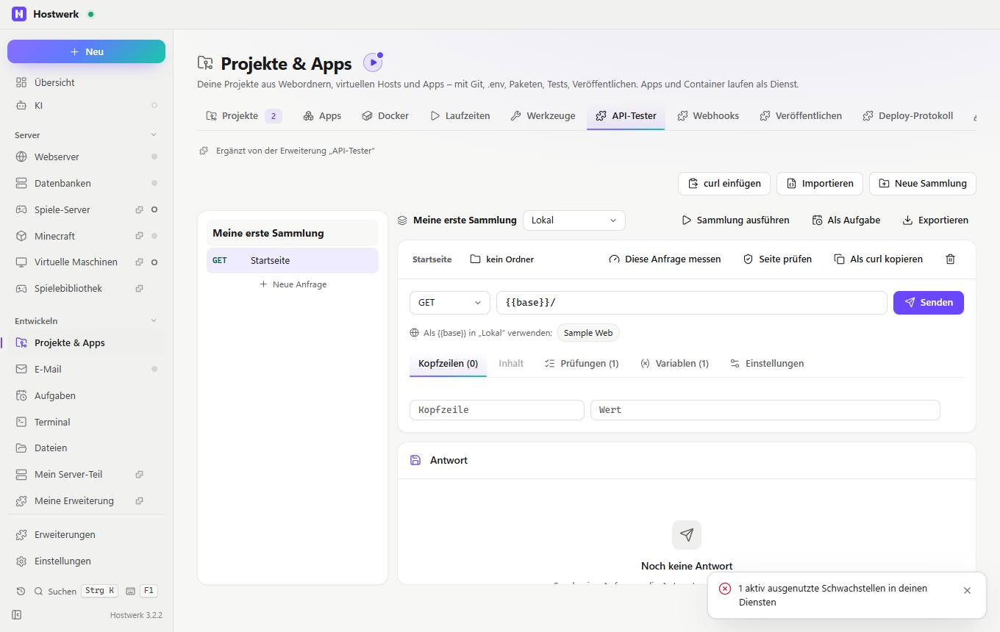
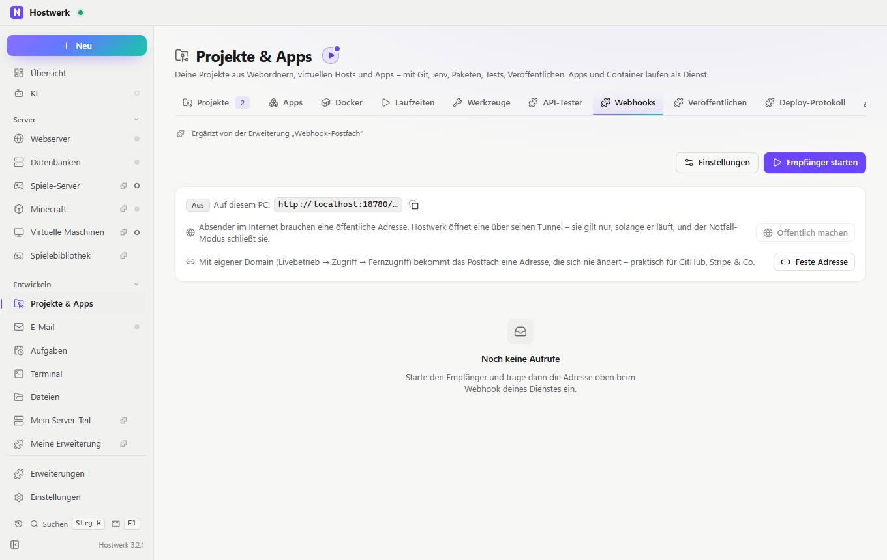
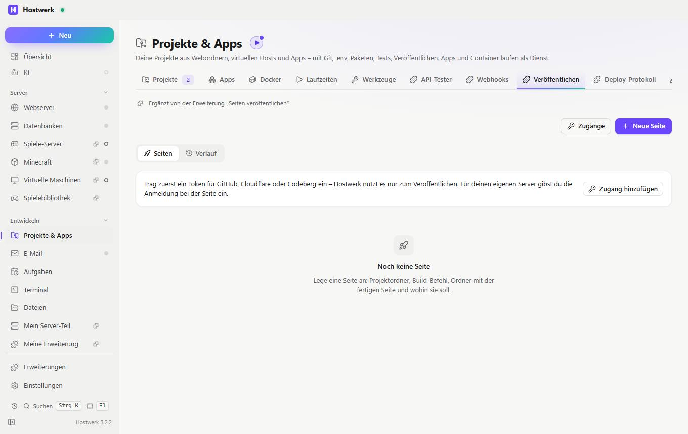
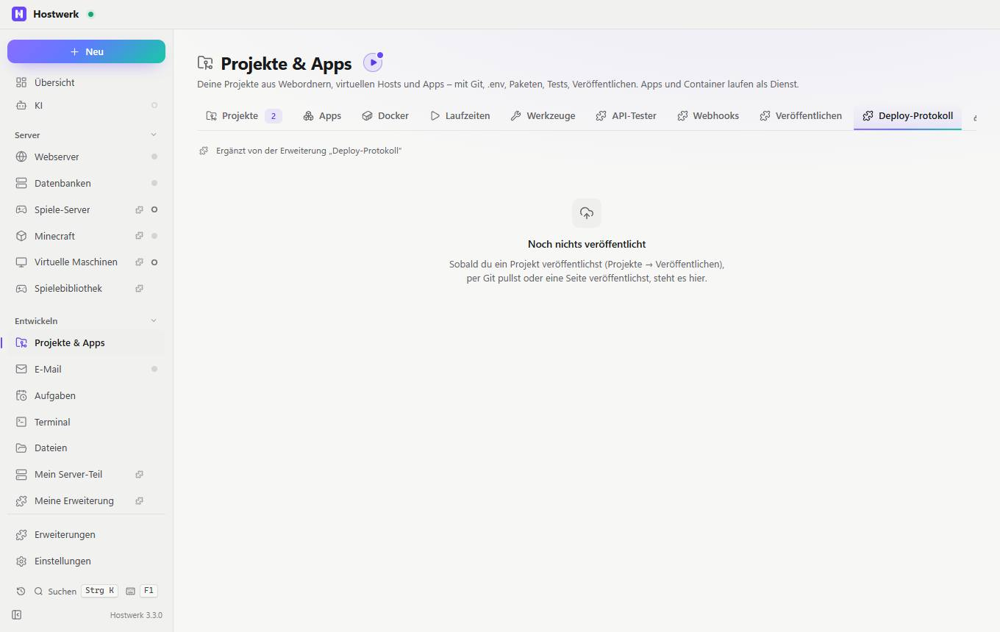
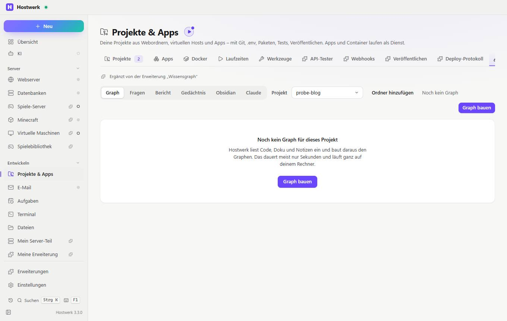

# Projekte & Apps

[← Zurück zur Übersicht](README.md)

Deine Projekte aus Webordnern, virtuellen Hosts und Apps – mit Git, .env, Paketen, Tests, Veröffentlichen. Apps und Container laufen als Dienst.

### Was du hier tun kannst

- 3 Videos
- Neues Projekt
- Bild ändern

## Reiter

### Apps

**Was du hier tun kannst:** 3 Videos · Neue App · App hinzufügen · Aus Vorlage

### Docker

**Was du hier tun kannst:** 3 Videos · Docker Desktop Die offizielle App mit eigener Oberfläche (ca. 600 MB). Für größere Firmen kostenpflichtig. Eigene Oberfläche · Docker Engine einrichten · Erneut prüfen

### Laufzeiten

**Was du hier tun kannst:** 3 Videos · nodejs.org · Einzelheiten … · python.org · bun.sh · Installieren · deno.com · go.dev · Beim Hersteller laden · dotnet.microsoft.com · adoptium.net

### Werkzeuge

> Paket-Zwischenspeicher Ein lokaler Spiegel für npm, yarn, pnpm, pip und Composer: jedes Paket kommt einmal aus dem Netz und liegt danach auf diesem PC. Installationen in allen Projekten werden schneller, und offline geht alles, was schon einmal geladen war. Composer spricht dafür https mit einem Zertifikat der lokalen Zertifizierungsstelle – andere Quellen prüft Composer weiter ganz normal. Ausschalten stellt die vorherigen Einstellungen wieder her.

**Bereiche auf dieser Seite:** Paket-Zwischenspeicher

**Was du hier tun kannst:** 3 Videos · Einschalten · Leeren

### API-Tester

> Umgebungen Switch between local, staging and live in one go: the values of the chosen environment replace the variables of the collection – {{base}} points to the right server.

**Bereiche auf dieser Seite:** Antwort

**Was du hier tun kannst:** 3 Videos · Von der Erweiterung „API-Tester“ – Infos · curl einfügen · Importieren · Neue Sammlung · Meine erste Sammlung · GET Startseite · Neue Anfrage · Sammlung ausführen · Als Aufgabe · Exportieren · Startseite · kein Ordner · Diese Anfrage messen · Seite prüfen · Als curl kopieren · Anfrage entfernen · Senden · Sample Web

### Webhooks

**Was du hier tun kannst:** 3 Videos · Von der Erweiterung „Webhook-Postfach“ – Infos · Einstellungen · Empfänger starten · Kopieren · Öffentlich machen · Feste Adresse

### Veröffentlichen

**Was du hier tun kannst:** 3 Videos · Von der Erweiterung „Seiten veröffentlichen“ – Infos · Zugänge · Neue Seite · Zugang hinzufügen

### Deploy-Protokoll

**Was du hier tun kannst:** 3 Videos · Von der Erweiterung „Deploy-Protokoll“ – Infos

### Wissensgraph

**Was du hier tun kannst:** 3 Videos · Von der Erweiterung „Wissensgraph“ – Infos

Erzeugt am 2026-11-20 · Hostwerk 3.2.2
