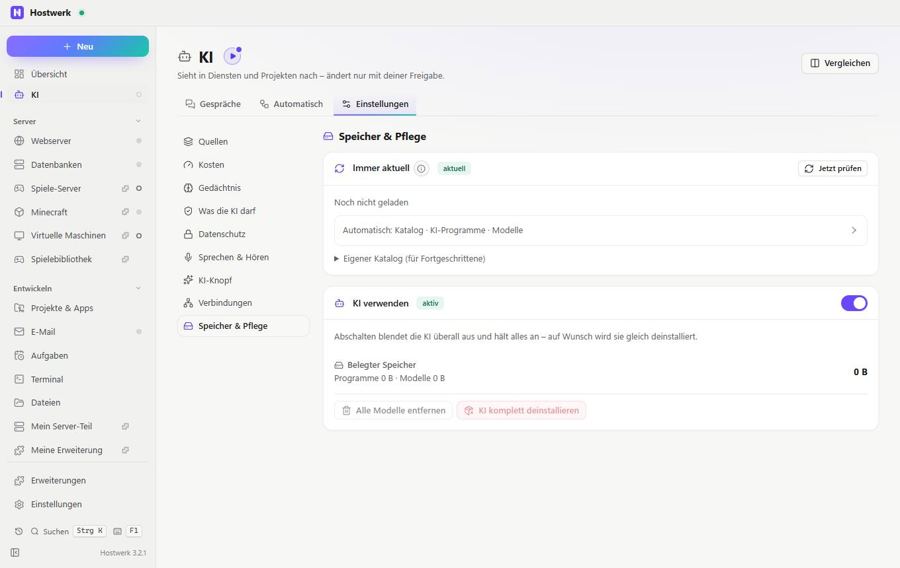
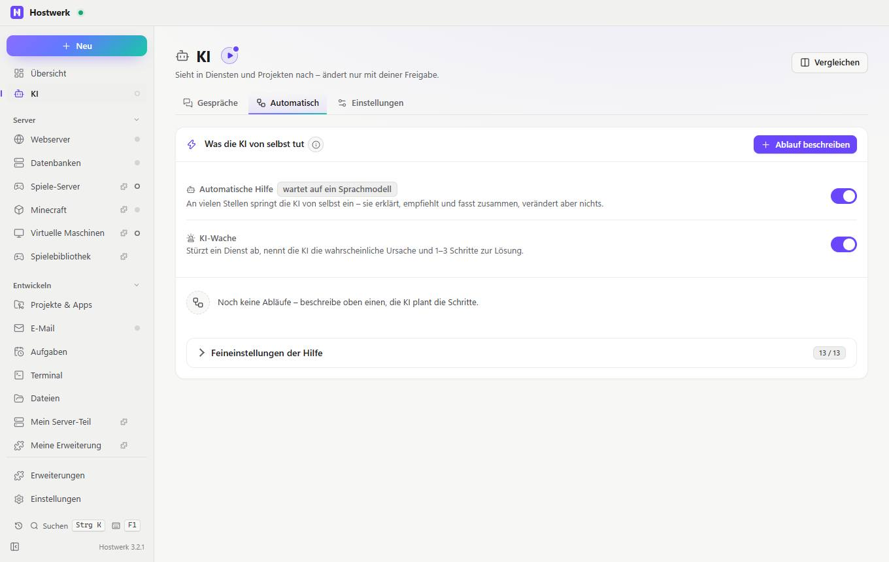

# KI → Einstellungen

[← Zurück zur Übersicht](README.md)

Sieht in Diensten und Projekten nach – ändert nur mit deiner Freigabe.

### Gut zu wissen

- Hostwerk lädt einmal täglich den Modell-Katalog (neue Modelle von ollama.com und neue lokale Bild-/Video-Modelle) und hält die KI-Programme und Modelle aktuell – ohne dass du Hostwerk selbst aktualisieren musst.

### Bereiche auf dieser Seite

- Speicher & Pflege
- Immer aktuell
- KI verwenden

### Was du hier tun kannst

- 2 Videos
- Vergleichen
- Jetzt prüfen
- Alle Modelle entfernen
- KI komplett deinstallieren

### Eingaben

- Belegter Speicher

## Reiter

### Automatisch

> Alles, was ohne Gespräch passiert: Hilfe an Ort und Stelle, die KI-Wache bei Abstürzen, deine Abläufe (von Hand, nach Zeitplan oder bei einem Ereignis) und Vorschläge aus deinem Verlauf.

**Bereiche auf dieser Seite:** Was die KI von selbst tut

**Was du hier tun kannst:** 2 Videos · Vergleichen · Ablauf beschreiben

Erzeugt am 2026-11-18 · Hostwerk 3.2.1
