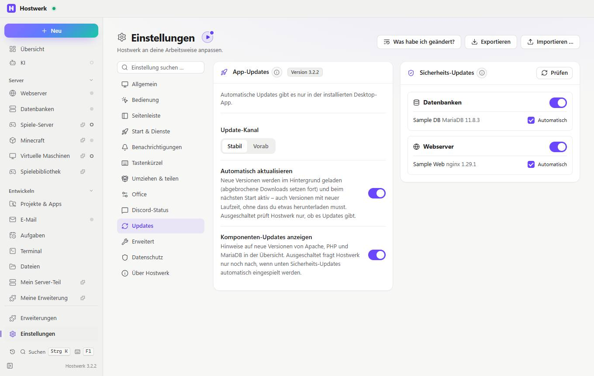
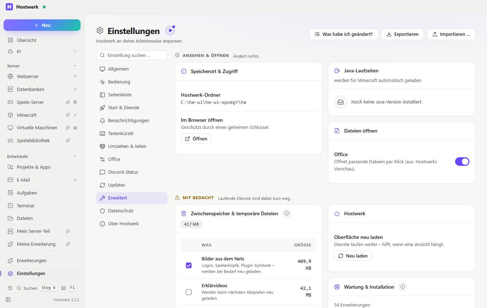

# Einstellungen → Updates

[← Zurück zur Übersicht](README.md)

Hostwerk an deine Arbeitsweise anpassen.

### Gut zu wissen

- „Stabil“ bekommt nur fertige Versionen, und neue Versionen kommen schrittweise an – erst bei wenigen, dann bei allen. „Vorab“ bekommt auch Testversionen sofort, sobald sie erscheinen. Zurück zu „Stabil“ geht jederzeit; eine schon installierte Testversion bleibt, bis eine neuere stabile kommt.
- Kleine Updates innerhalb derselben Version (z. B. PHP 8.4.11 → 8.4.12). Hostwerk lädt die neue Version neben die alte, schaltet um und prüft kurz, ob alles läuft. Klappt das nicht, bleibt die alte Version aktiv. Große Versionssprünge macht Hostwerk nie von selbst.

### Bereiche auf dieser Seite

- App-Updates
- Sicherheits-Updates

### Was du hier tun kannst

- 3 Videos
- Was habe ich geändert?
- Exportieren
- Importieren …
- Allgemein
- Bedienung
- Seitenleiste
- Start & Dienste
- Benachrichtigungen
- Tastenkürzel
- Umziehen & teilen
- Office
- Discord-Status
- Updates
- Erweitert
- Datenschutz
- Über Hostwerk
- Prüfen

### Eingaben

- Update-Kanal
- Automatisch aktualisieren
- Komponenten-Updates anzeigen

## Reiter

### Erweitert

> Zwischenspeicher Alles hier lädt Hostwerk bei Bedarf neu. Projekte, Datenbanken, Sicherungen und Einstellungen bleiben unberührt.
> Wartung Die Wartung läuft als eigenes Fenster und lädt keine Erweiterung – so kann keine sie stören. Dort schaltest du Erweiterungen aus, setzt sie zurück oder entfernst sie, aktualisierst, reparierst oder entfernst Hostwerk. Startet Hostwerk nicht mehr: Startmenü → „Hostwerk – Wartung“ oder beim Start F8 drücken.

**Bereiche auf dieser Seite:** Speicherort & Zugriff · Java-Laufzeiten · Dateien öffnen · Zwischenspeicher & temporäre Dateien · Hostwerk · Wartung & Installation

**Was du hier tun kannst:** 3 Videos · Was habe ich geändert? · Exportieren · Importieren … · Allgemein · Bedienung · Seitenleiste · Start & Dienste · Benachrichtigungen · Tastenkürzel · Umziehen & teilen · Office · Discord-Status · Updates · Erweitert · Datenschutz · Über Hostwerk · Öffnen · 587,3 KB löschen · Neu messen · Jetzt aufräumen · Neu laden · Wartung öffnen · Nächster Start ohne Erweiterungen

Erzeugt am 2026-11-20 · Hostwerk 3.2.2
