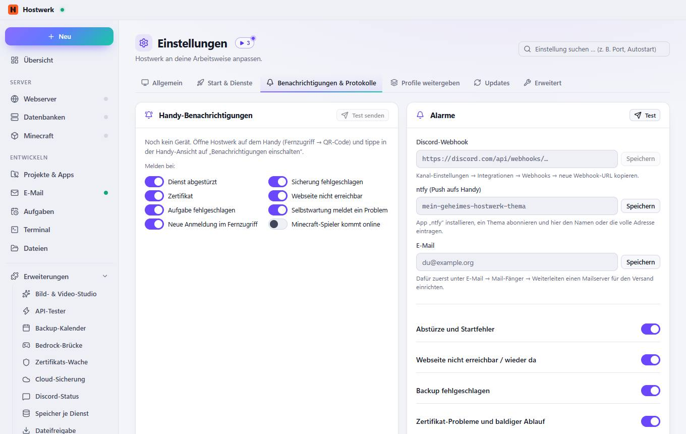
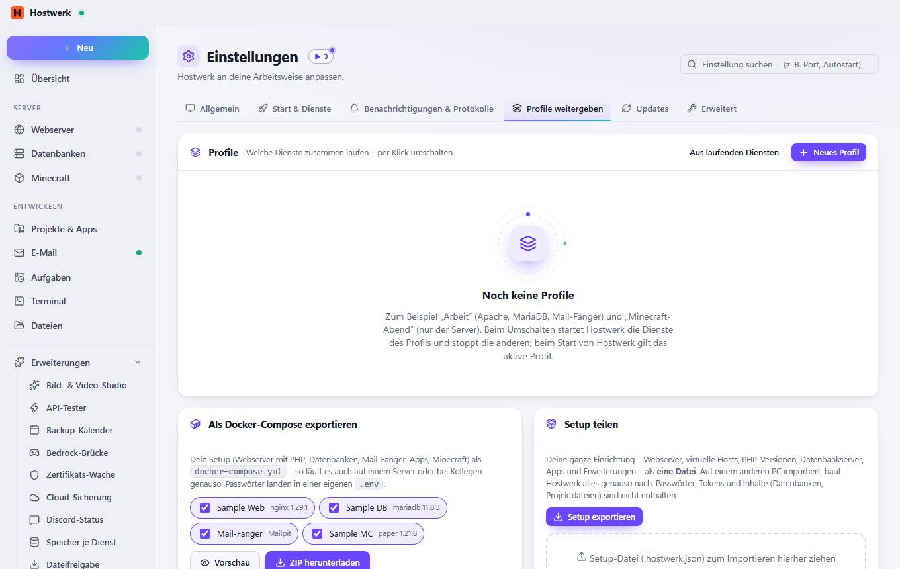

# Einstellungen

[← Zurück zur Übersicht](README.md)

Hostwerk an deine Arbeitsweise anpassen.

### Bereiche auf dieser Seite

- Wofür nutzt du Hostwerk?
- Darstellung
- Bereiche in der Seitenleiste

### Was du hier tun kannst

- Webseiten & Apps
- Spiele-Server
- KI
- Online stellen & Team
- Neu suchen (z. B. nach einer Installation)
- Eigenes Programm als Editor hinzufügen
- Hostwerk-Lila
- Blau
- Himmelblau
- Türkis
- Grün
- Bernstein
- Orange
- Rot
- Pink
- Wieder anzeigen

### Eingaben

- Sprache · Language
- Code-Editor
- Akzentfarbe
- Erscheinungsbild
- Startseite
- Kompakte Ansicht
- Animationen reduzieren
- Ausgeblendete Hinweise
- Vor dem Stoppen nachfragen
- Download-Geschwindigkeit anzeigen
- Projekte
- Apps
- E-Mail
- Aufgaben
- Dateien
- Minecraft
- KI
- Claude Gedankennetz
- Livebetrieb
- Sicherungen

## Reiter

### Start & Dienste

**Bereiche auf dieser Seite:** Beim Start von Hostwerk · Welche Dienste starten automatisch?

**Was du hier tun kannst:** Alle · Keine

### Benachrichtigungen & Protokolle

**Bereiche auf dieser Seite:** Handy-Benachrichtigungen · Alarme · Windows-Benachrichtigungen · Protokolle

**Was du hier tun kannst:** Test senden · Test · Speichern · Jetzt prüfen

### Profile weitergeben

**Bereiche auf dieser Seite:** Profile · Als Docker-Compose exportieren · Setup teilen

**Was du hier tun kannst:** Aus laufenden Diensten · Neues Profil · Vorschau · ZIP herunterladen · Setup exportieren

### Updates

> Automatische Updates gibt es nur in der installierten Desktop-App.

**Bereiche auf dieser Seite:** App-Updates · Sicherheits-Updates

**Was du hier tun kannst:** Prüfen

### Erweitert

> Lädt nur die Oberfläche neu – Dienste laufen ungestört weiter. Hilft, wenn eine Ansicht hängt oder nach einem Update nicht aktuell aussieht.
> Alles hier lädt Hostwerk bei Bedarf neu. Projekte, Datenbanken, Backups und Einstellungen bleiben unberührt.
> Alle 6 Stunden, kurz nach dem Start und nach dem Löschen, Anlegen oder Aktualisieren von Diensten: lange unbenutzte Bilder, alte Video-Fassungen, alte Downloads und Reste werden entfernt – nichts, was gerade gebraucht wird.

**Bereiche auf dieser Seite:** Hostwerk · Java-Laufzeiten · Zwischenspeicher & temporäre Dateien · Hostwerk entfernen · Speicherort & Zugriff

**Was du hier tun kannst:** Neu laden · 921,1 KB löschen · Neu messen · Jetzt aufräumen · Hostwerk entfernen … · Im Standardbrowser öffnen

Erzeugt am 2026-10-20 · Hostwerk 2.10.0
