# Einstellungen

[← Zurück zur Übersicht](README.md)

Hostwerk an deine Arbeitsweise anpassen.

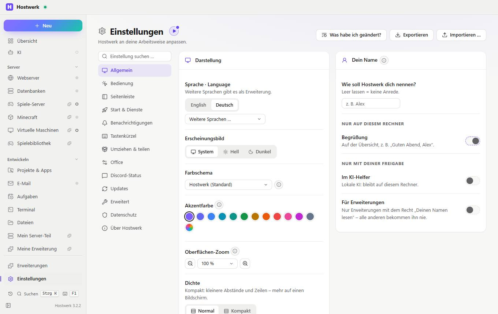

### Gut zu wissen

- Farbschemata aus Erweiterungen Ein Farbschema ändert Farben, Schrift, Rundung und Abstände – nur über geprüfte Werte. Hostwerk wendet es nur an, wenn Texte und Bedienelemente gut lesbar bleiben (WCAG 2.2 AA). Wird die Erweiterung entfernt, gilt wieder Hostwerks eigenes Aussehen.
- Akzentfarbe Farbe für Knöpfe, Markierungen und Hervorhebungen – du siehst sie sofort überall. Erweiterungen übernehmen sie. Bei eigenen Farben passt Hostwerk Knopf und Text an, damit alles gut lesbar bleibt.
- Oberflächen-Zoom Macht Schrift und Bedienelemente überall größer oder kleiner – bis 200 %, ohne dass etwas abgeschnitten wird. Gilt überall, wo du Hostwerk öffnest – auch im Browser und auf dem Handy.
- Dein Name Bleibt in den Einstellungen auf diesem Rechner – nicht in Setup-Dateien, Exporten oder Protokollen; Fehlerberichte ersetzen ihn durch „<name>“. Verwendet wird er nur, wo du es unten einschaltest.

### Bereiche auf dieser Seite

- Darstellung
- Dein Name

### Was du hier tun kannst

- 3 Videos
- Was habe ich geändert?
- Exportieren
- Importieren …
- Allgemein
- Bedienung
- Seitenleiste
- Start & Dienste
- Benachrichtigungen
- Tastenkürzel
- Umziehen & teilen
- Updates
- Erweitert
- Datenschutz
- Über Hostwerk
- Hostwerk-Lila
- Indigo
- Blau
- Cyan
- Türkis
- Grün
- Bernstein
- Orange
- Rot
- Pink
- Fuchsia
- Schiefergrau
- Kleiner
- Größer

### Eingaben

- Sprache · Language
- Erscheinungsbild
- Farbschema
- Akzentfarbe
- Oberflächen-Zoom
- Dichte
- Animationen reduzieren
- Wie soll Hostwerk dich nennen?
- Begrüßung
- Im KI-Helfer
- Für Erweiterungen

## Reiter

### Bedienung

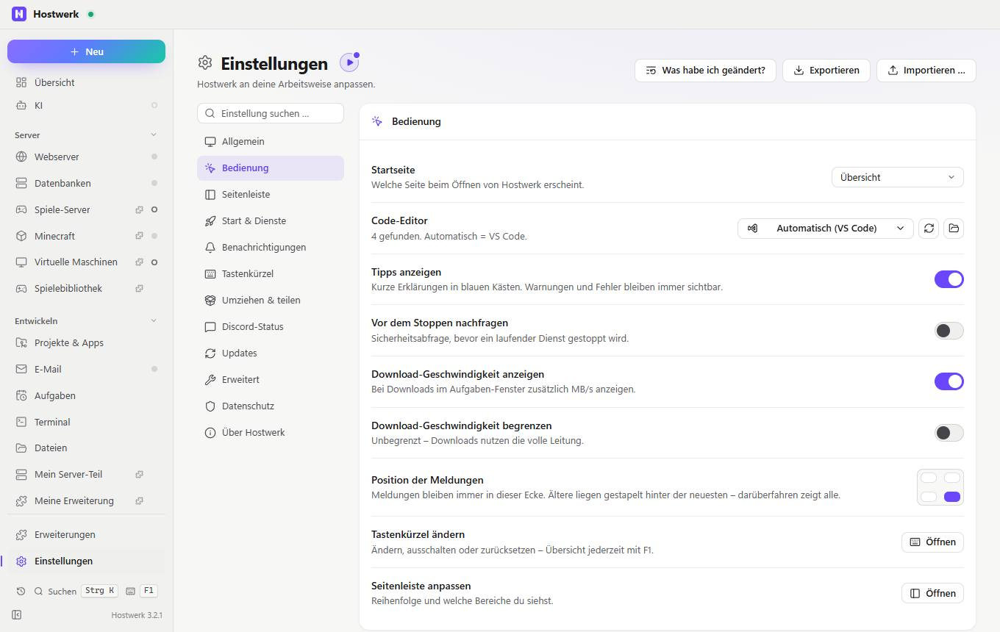

**Bereiche auf dieser Seite:** Bedienung

**Was du hier tun kannst:** 3 Videos · Was habe ich geändert? · Exportieren · Importieren … · Allgemein · Bedienung · Seitenleiste · Start & Dienste · Benachrichtigungen · Tastenkürzel · Umziehen & teilen · Discord-Status · Updates · Erweitert · Datenschutz · Über Hostwerk · Automatisch (VS Code) · Neu suchen (z. B. nach einer Installation) · Eigenes Programm als Editor hinzufügen · Oben links · Oben rechts · Unten links · Unten rechts · Öffnen

### Seitenleiste

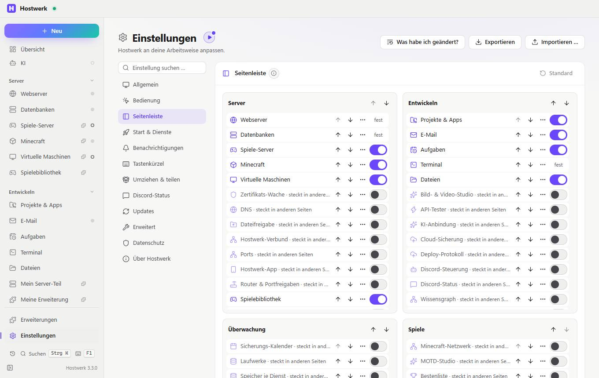

> Seitenleiste Reihenfolge und Sichtbarkeit aller Einträge. Ausgeblendetes wird nicht gelöscht – Schalter wieder an, und es ist zurück. Einträge lassen sich auch direkt in der Seitenleiste ziehen; Erweiterungen können eigene Bereiche mitbringen.
> Ohne eigenen Eintrag Diese Bereiche stecken in anderen Seiten (z. B. Apps unter „Projekte & Apps“). Ausgeblendet verschwinden sie auch aus der Übersicht, dem Neu-Menü und der Einrichtung.

**Bereiche auf dieser Seite:** Seitenleiste

**Was du hier tun kannst:** 3 Videos · Was habe ich geändert? · Exportieren · Importieren … · Allgemein · Bedienung · Seitenleiste · Start & Dienste · Benachrichtigungen · Tastenkürzel · Umziehen & teilen · Discord-Status · Updates · Erweitert · Datenschutz · Über Hostwerk · Standard · Bereich „Server“ nach oben · Bereich „Server“ nach unten · „Webserver“ nach oben · „Webserver“ nach unten · Mehr zu „Webserver“ · „Datenbanken“ nach oben · „Datenbanken“ nach unten · Mehr zu „Datenbanken“ · „Spiele-Server“ nach oben · „Spiele-Server“ nach unten · Mehr zu „Spiele-Server“ · „Minecraft“ nach oben · „Minecraft“ nach unten · Mehr zu „Minecraft“ · „Virtuelle Maschinen“ nach oben · „Virtuelle Maschinen“ nach unten · Mehr zu „Virtuelle Maschinen“ · „Zertifikats-Wache“ nach oben · „Zertifikats-Wache“ nach unten · Mehr zu „Zertifikats-Wache“ · „DNS“ nach oben · „DNS“ nach unten · Mehr zu „DNS“

### Start & Dienste

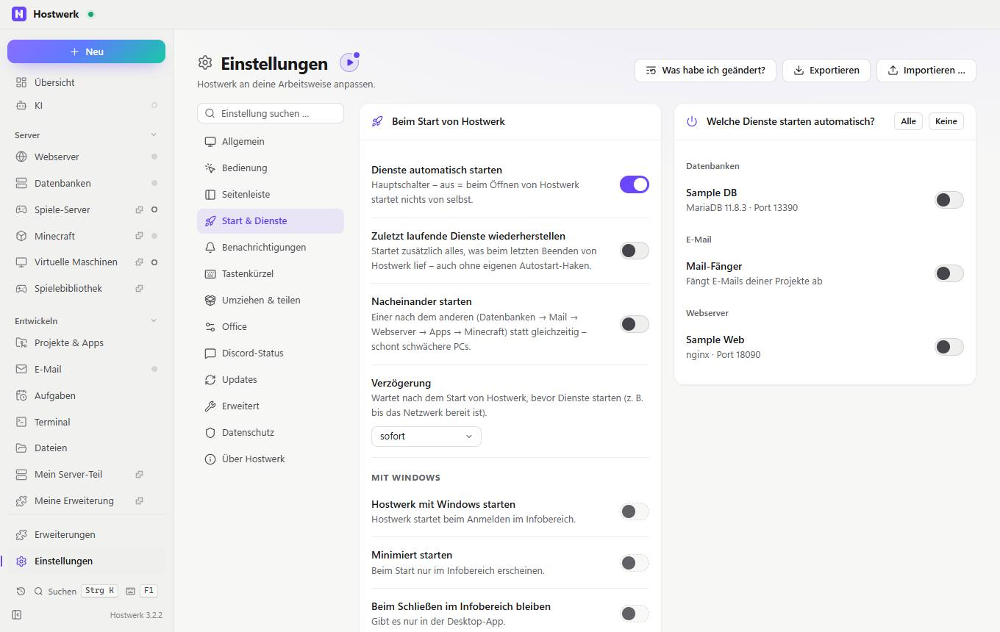

**Bereiche auf dieser Seite:** Beim Start von Hostwerk · Welche Dienste starten automatisch?

**Was du hier tun kannst:** 3 Videos · Was habe ich geändert? · Exportieren · Importieren … · Allgemein · Bedienung · Seitenleiste · Start & Dienste · Benachrichtigungen · Tastenkürzel · Umziehen & teilen · Discord-Status · Updates · Erweitert · Datenschutz · Über Hostwerk · Alle · Keine

### Benachrichtigungen

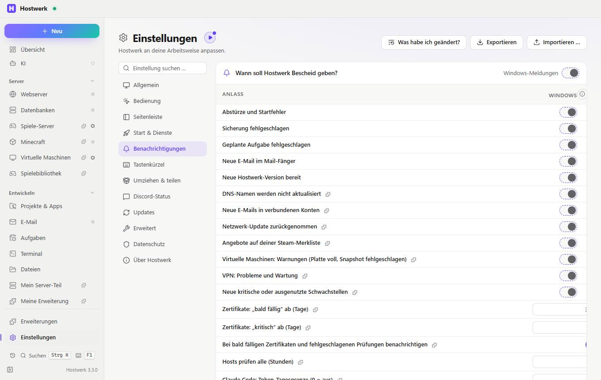

> Windows Gibt es nur in der Desktop-App.

**Bereiche auf dieser Seite:** Wann soll Hostwerk Bescheid geben? · Meldungen aufs Handy, per E-Mail oder Chat

**Was du hier tun kannst:** 3 Videos · Was habe ich geändert? · Exportieren · Importieren … · Allgemein · Bedienung · Seitenleiste · Start & Dienste · Benachrichtigungen · Tastenkürzel · Umziehen & teilen · Discord-Status · Updates · Erweitert · Datenschutz · Über Hostwerk · Von der Erweiterung „DNS-Verwaltung“ – Infos · Von der Erweiterung „E-Mail-Konten“ – Infos · Von der Erweiterung „Minecraft-Servernetzwerk“ – Infos · Von der Erweiterung „Spielebibliothek“ – Infos · Von der Erweiterung „Virtuelle Maschinen“ – Infos · Von der Erweiterung „VPN-Zugang“ – Infos · Von der Erweiterung „Schwachstellen-Wache“ – Infos · Von der Erweiterung „Zertifikats-Wache“ – Infos · Von der Erweiterung „KI-Anbindung“ – Infos · Von der Erweiterung „Laufwerke“ – Infos · Meldungen einstellen → Livebetrieb

### Tastenkürzel

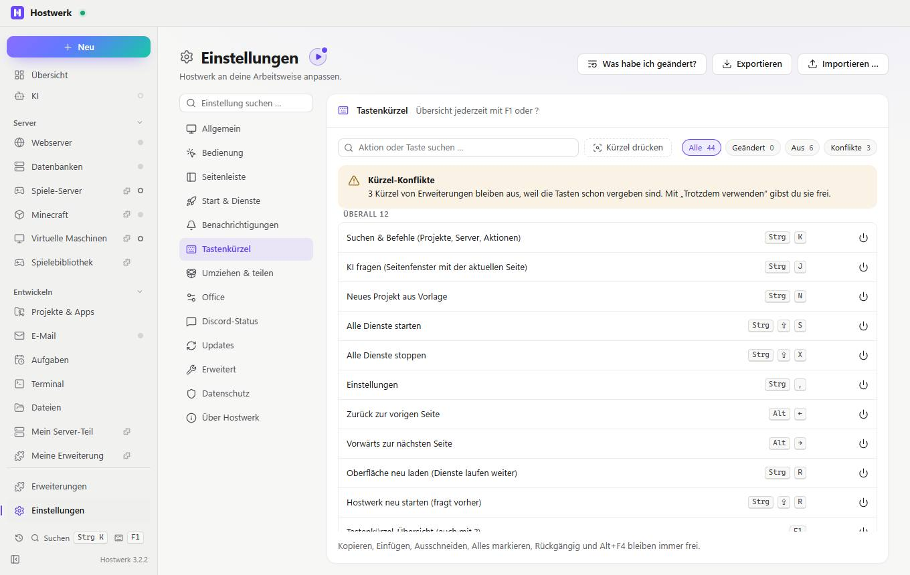

**Bereiche auf dieser Seite:** Tastenkürzel

**Was du hier tun kannst:** 3 Videos · Was habe ich geändert? · Exportieren · Importieren … · Allgemein · Bedienung · Seitenleiste · Start & Dienste · Benachrichtigungen · Tastenkürzel · Umziehen & teilen · Discord-Status · Updates · Erweitert · Datenschutz · Über Hostwerk · Kürzel drücken · Alle 39 · Geändert 0 · Aus 2 · Konflikte 3 · Strg K · Kürzel für „Suchen & Befehle (Projekte, Server, Aktionen)“ ausschalten · Strg J · Kürzel für „KI fragen (Seitenfenster mit der aktuellen Seite)“ ausschalten · Strg N · Kürzel für „Neues Projekt aus Vorlage“ ausschalten · Strg ⇧ S · Kürzel für „Alle Dienste starten“ ausschalten · Strg ⇧ X · Kürzel für „Alle Dienste stoppen“ ausschalten · Strg , · Kürzel für „Einstellungen“ ausschalten · Alt ← · Kürzel für „Zurück zur vorigen Seite“ ausschalten · Alt → · Kürzel für „Vorwärts zur nächsten Seite“ ausschalten · Strg R · Kürzel für „Oberfläche neu laden (Dienste laufen weiter)“ ausschalten · Strg ⇧ R

### Umziehen & teilen

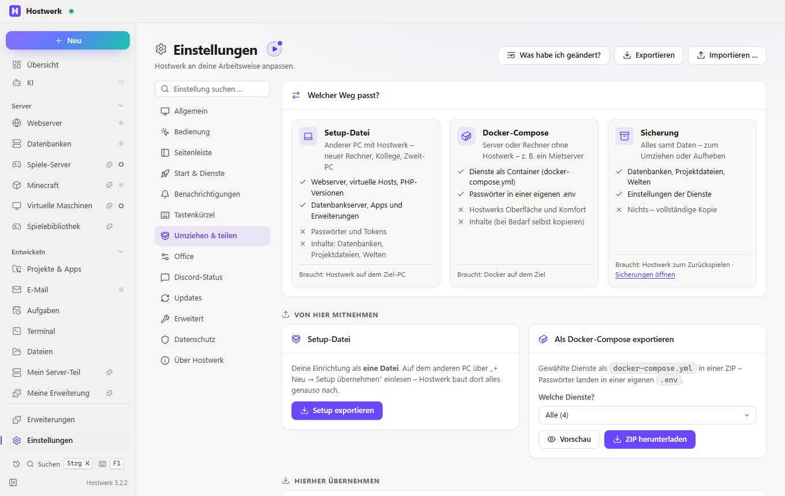

**Bereiche auf dieser Seite:** Welcher Weg passt? · VON HIER MITNEHMEN · Setup-Datei · Als Docker-Compose exportieren · HIERHER ÜBERNEHMEN

**Was du hier tun kannst:** 3 Videos · Was habe ich geändert? · Exportieren · Importieren … · Allgemein · Bedienung · Seitenleiste · Start & Dienste · Benachrichtigungen · Tastenkürzel · Umziehen & teilen · Discord-Status · Updates · Erweitert · Datenschutz · Über Hostwerk · Setup exportieren · Alle (4) · Vorschau · ZIP herunterladen · Setup-Datei einlesen …

### Discord-Status

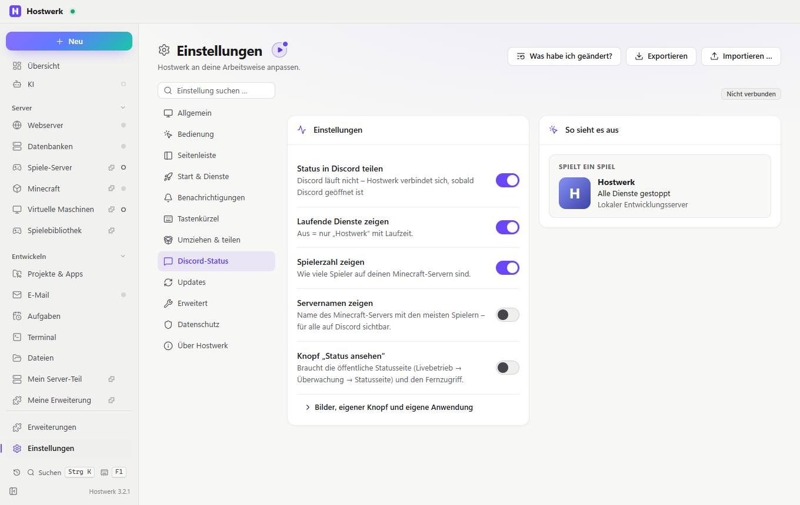

> Was wird geteilt? Nur Dienstarten (z. B. Webserver · Datenbank) und wie viele laufen. Nie Projekt- oder Ordnernamen – einen Servernamen nur, wenn du ihn einschaltest.

**Bereiche auf dieser Seite:** Einstellungen · So sieht es aus

**Was du hier tun kannst:** 3 Videos · Was habe ich geändert? · Exportieren · Importieren … · Allgemein · Bedienung · Seitenleiste · Start & Dienste · Benachrichtigungen · Tastenkürzel · Umziehen & teilen · Discord-Status · Updates · Erweitert · Datenschutz · Über Hostwerk · Bilder, eigener Knopf und eigene Anwendung

### Erweitert

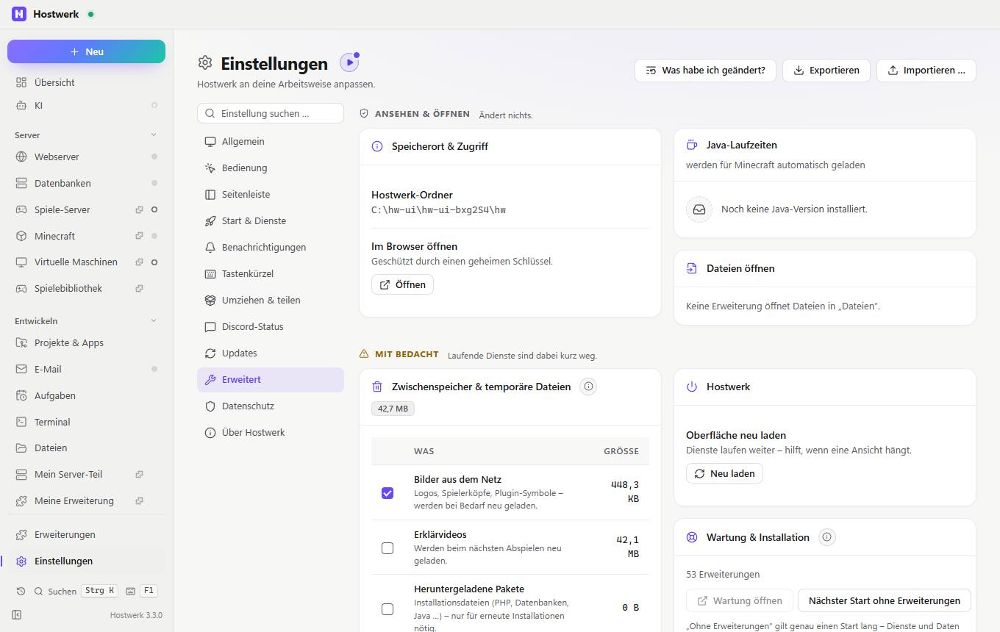

> Zwischenspeicher Alles hier lädt Hostwerk bei Bedarf neu. Projekte, Datenbanken, Sicherungen und Einstellungen bleiben unberührt.
> Wartung Die Wartung läuft als eigenes Fenster und lädt keine Erweiterung – so kann keine sie stören. Dort schaltest du Erweiterungen aus, setzt sie zurück oder entfernst sie, aktualisierst, reparierst oder entfernst Hostwerk. Startet Hostwerk nicht mehr: Startmenü → „Hostwerk – Wartung“ oder beim Start F8 drücken.

**Bereiche auf dieser Seite:** Speicherort & Zugriff · Java-Laufzeiten · Zwischenspeicher & temporäre Dateien · Hostwerk · Wartung & Installation

**Was du hier tun kannst:** 3 Videos · Was habe ich geändert? · Exportieren · Importieren … · Allgemein · Bedienung · Seitenleiste · Start & Dienste · Benachrichtigungen · Tastenkürzel · Umziehen & teilen · Discord-Status · Updates · Erweitert · Datenschutz · Über Hostwerk · Öffnen · 586,9 KB löschen · Neu messen · Jetzt aufräumen · Neu laden · Wartung öffnen · Nächster Start ohne Erweiterungen

### Datenschutz

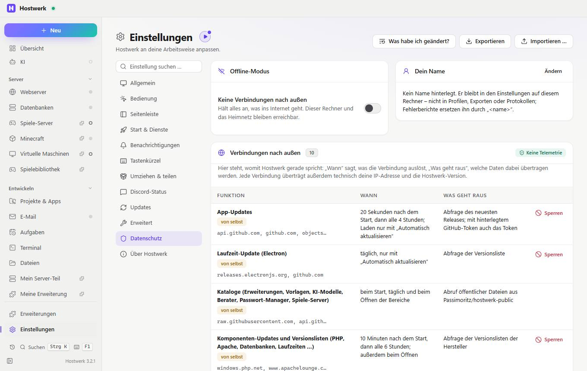

**Bereiche auf dieser Seite:** Offline-Modus · Dein Name · Verbindungen nach außen

**Was du hier tun kannst:** 3 Videos · Was habe ich geändert? · Exportieren · Importieren … · Allgemein · Bedienung · Seitenleiste · Start & Dienste · Benachrichtigungen · Tastenkürzel · Umziehen & teilen · Discord-Status · Updates · Erweitert · Datenschutz · Über Hostwerk · Ändern · Sperren

### Über Hostwerk

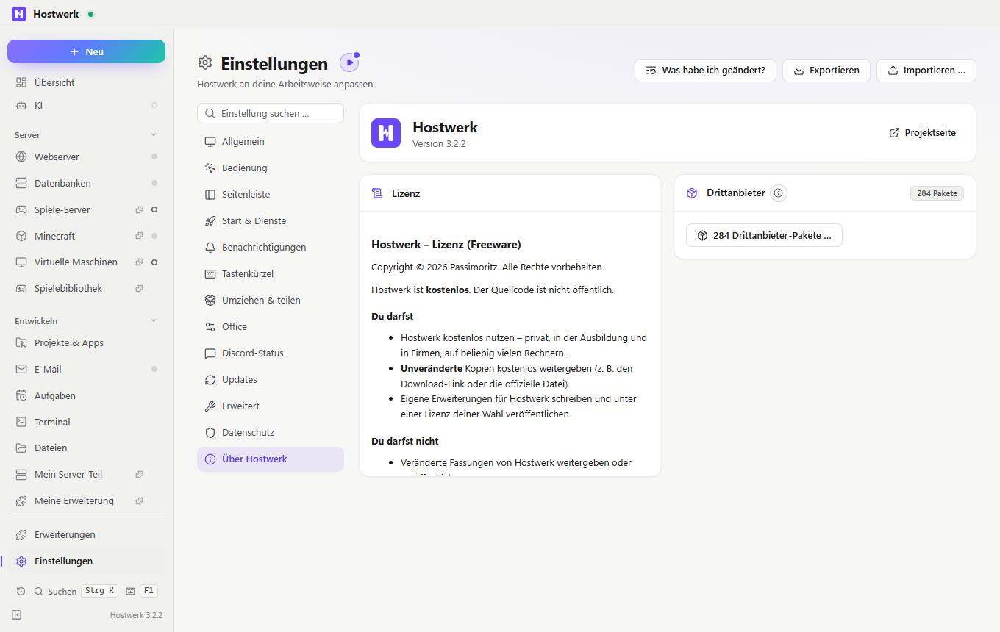

> Bibliotheken anderer Projekte, die in Hostwerk stecken – jede unter ihrer eigenen Lizenz. Die Liste entsteht automatisch beim Bauen.

**Bereiche auf dieser Seite:** Lizenz · Drittanbieter

**Was du hier tun kannst:** 3 Videos · Was habe ich geändert? · Exportieren · Importieren … · Allgemein · Bedienung · Seitenleiste · Start & Dienste · Benachrichtigungen · Tastenkürzel · Umziehen & teilen · Discord-Status · Updates · Erweitert · Datenschutz · Über Hostwerk · Projektseite · 284 Drittanbieter-Pakete …

Erzeugt am 2026-11-18 · Hostwerk 3.2.1
