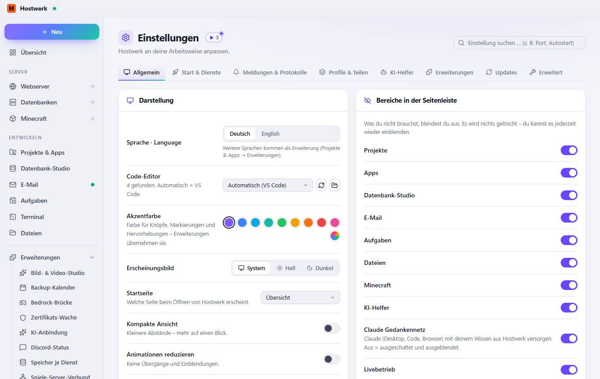
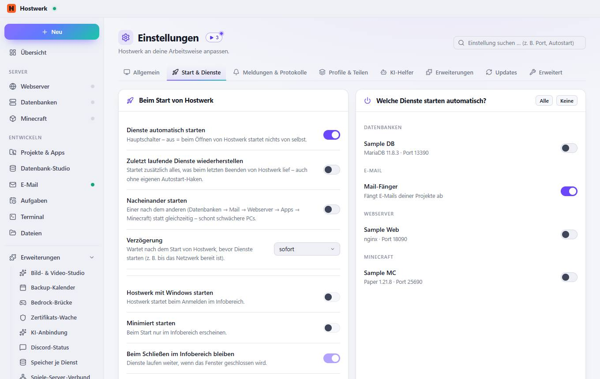
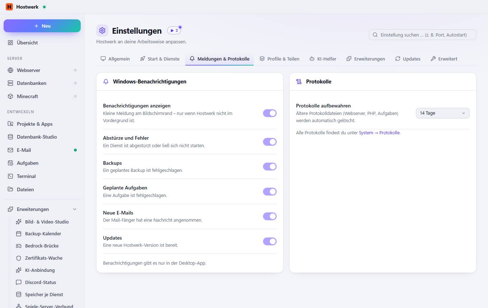
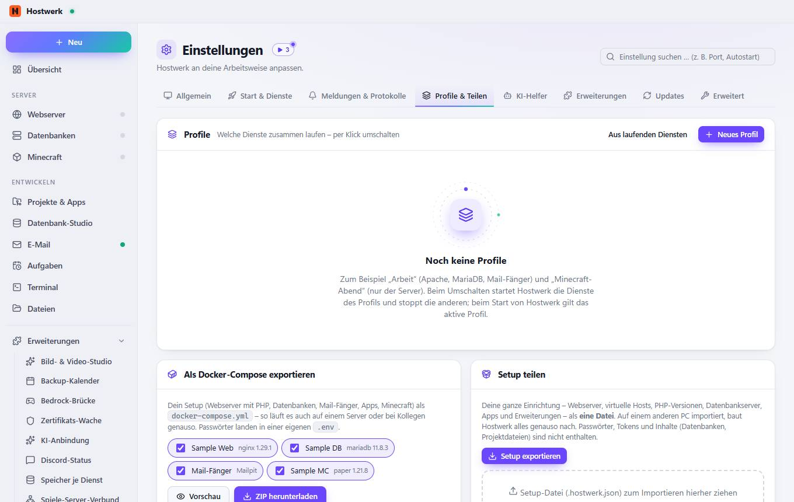
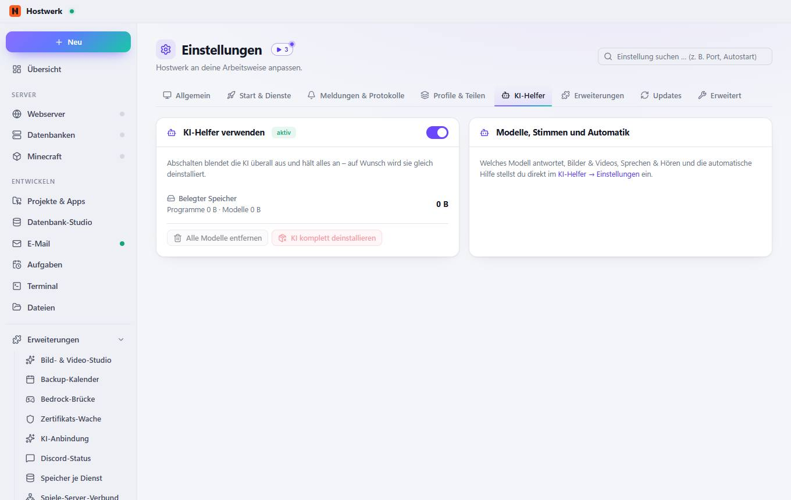
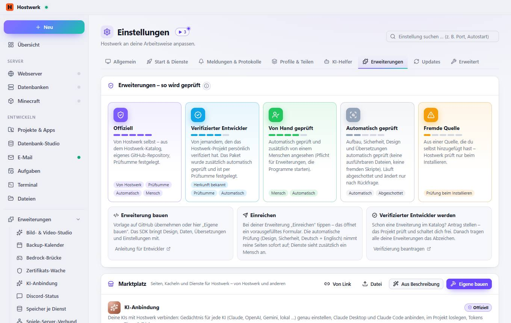
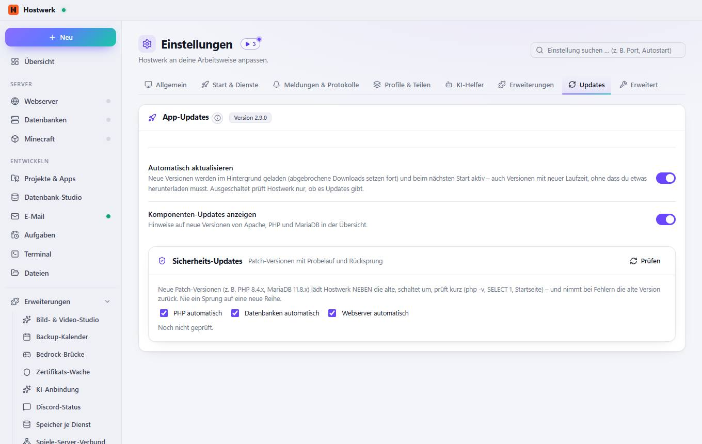
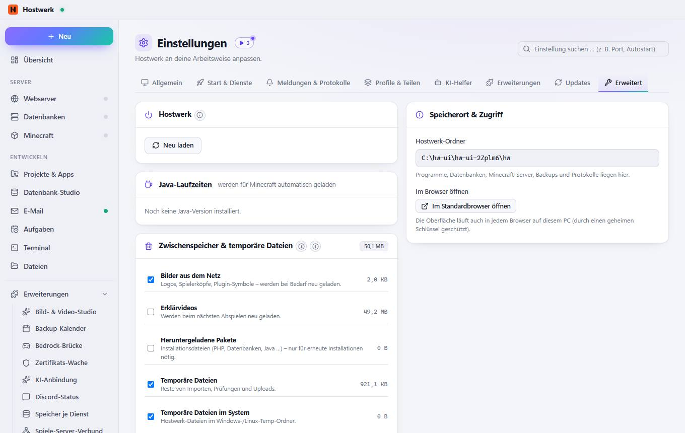

# Einstellungen

[← Zurück zur Übersicht](README.md)

Hostwerk an deine Arbeitsweise anpassen.

### Bereiche auf dieser Seite

- Darstellung
- Bereiche in der Seitenleiste

### Was du hier tun kannst

- Neu suchen (z. B. nach einer Installation)
- Eigenes Programm als Editor hinzufügen
- Hostwerk-Lila
- Blau
- Himmelblau
- Türkis
- Grün
- Bernstein
- Orange
- Rot
- Pink
- Wieder anzeigen

### Eingaben

- Sprache · Language
- Code-Editor
- Akzentfarbe
- Erscheinungsbild
- Startseite
- Kompakte Ansicht
- Animationen reduzieren
- Ausgeblendete Hinweise
- Vor dem Stoppen nachfragen
- Download-Geschwindigkeit anzeigen
- Projekte
- Apps
- Datenbank-Studio
- E-Mail
- Aufgaben
- Dateien
- Minecraft
- KI-Helfer
- Claude Gedankennetz
- Livebetrieb

## Reiter

### Start & Dienste

**Bereiche auf dieser Seite:** Beim Start von Hostwerk · Welche Dienste starten automatisch?

**Was du hier tun kannst:** Alle · Keine

### Meldungen & Protokolle

**Bereiche auf dieser Seite:** Windows-Benachrichtigungen · Protokolle

### Profile & Teilen

**Bereiche auf dieser Seite:** Profile · Als Docker-Compose exportieren · Setup teilen

**Was du hier tun kannst:** Aus laufenden Diensten · Neues Profil · Vorschau · ZIP herunterladen · Setup exportieren

### KI-Helfer

**Bereiche auf dieser Seite:** KI-Helfer verwenden · Modelle, Stimmen und Automatik

**Was du hier tun kannst:** Alle Modelle entfernen · KI komplett deinstallieren

### Erweiterungen

> Was ist eine Erweiterung? Eine Erweiterung bringt eine eigene Seite, eine Kachel für die Übersicht und/oder einen eigenen Dienst in Hostwerk. Seiten laufen abgeschottet (eigener Ursprung, kein Zugriff auf deine Anmeldung), sehen nur, was ihre Rechte erlauben, und ändern nur, wenn du jedes Mal bestätigst. Farben und Schrift kommen von Hostwerk – so passt jede Erweiterung ins Design.

**Bereiche auf dieser Seite:** Erweiterungen – so wird geprüft · Marktplatz · Installierte Pakete · Für Entwickler

**Was du hier tun kannst:** Anleitung für Entwickler · Verifizierung beantragen · Von Link · Aus Beschreibung · Eigene bauen · Bewerten · Quellcode · Weitere Kataloge (Quellen) hinzufügen · Öffnen · Prüfen (Design, Sicherheit, Übersetzungen) · Zugriffe – was die Erweiterung gelesen oder geändert hat · Weiterbauen lassen – die KI ändert die Erweiterung nach deinem Wunsch · Exportieren (ZIP) · Teilen (Link) · Im öffentlichen Katalog einreichen · Entfernen · Einstellungen · Anleitung Schritt für Schritt: Paket, SDK, Design, Rechte, Übersetzungen, Prüfung, Verifizierung. · Vorlage auf GitHub „Use this template“ – mit Prüf-Action und automatischem Release. · Hier anlegen Ordner mit Beispielseite, Texten (de/en) und Symbol – sofort sichtbar.

### Updates

> Automatische Updates gibt es nur in der installierten Desktop-App.

**Bereiche auf dieser Seite:** App-Updates · Sicherheits-Updates

**Was du hier tun kannst:** Prüfen

### Erweitert

> Lädt nur die Oberfläche neu – Dienste laufen ungestört weiter. Hilft, wenn eine Ansicht hängt oder nach einem Update nicht aktuell aussieht.
> Alles hier lädt Hostwerk bei Bedarf neu. Projekte, Datenbanken, Backups und Einstellungen bleiben unberührt.
> Alle 6 Stunden, kurz nach dem Start und nach dem Löschen, Anlegen oder Aktualisieren von Diensten: lange unbenutzte Bilder, alte Video-Fassungen, alte Downloads und Reste werden entfernt – nichts, was gerade gebraucht wird.

**Bereiche auf dieser Seite:** Hostwerk · Java-Laufzeiten · Zwischenspeicher & temporäre Dateien · Hostwerk entfernen · Speicherort & Zugriff

**Was du hier tun kannst:** Neu laden · 923,1 KB löschen · Neu messen · Jetzt aufräumen · Hostwerk entfernen … · Im Standardbrowser öffnen

Erzeugt am 2026-10-19 · Hostwerk 2.9.0
